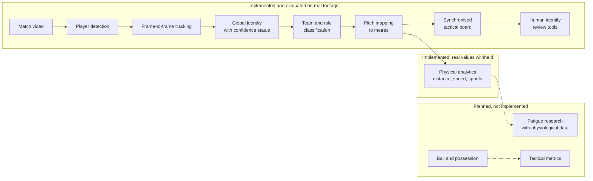

# Football Fatigue & Performance Prediction: Task 2 progress report

**Task:** Software Architecture & Tactical Board Streaming

**Date:** 28 October 2026

**Prepared for:** graduation project advisor (Biomedical Engineering)

**Evidence basis:**
- Every number below comes from an evaluation report in the repository. Sources are listed in the Appendix.
- Each result is labelled by kind:
  - **development**: data we also used to tune the system;
  - **independent validation**: data never used for tuning;
  - **synthetic**: simulated data with a known truth;
  - **diagnostic**: plausibility or consistency checks without ground truth.

---

## 1. Project overview

The graduation project studies football player **performance and workload**, with the long-term aim of supporting **fatigue-related research** using suitable, validated data. The full vision is a modular platform with four parts:
1. measuring how players move during matches;
2. presenting this to coaches and analysts;
3. at a later stage, combining these movement descriptors with physiological or wearable measurements to study fatigue;
4. possibly, injury risk.

This report covers **Task 2: Software Architecture & Tactical Board Streaming**, which is my responsibility. Task 2 provides the *measurement and visualisation foundation*: turning match data and match video into player positions, identities, a synchronised tactical board, and movement statistics.

**Important scope statement:**
- Task 2 does **not** measure fatigue.
- Distance, speed, acceleration and sprint counts describe the **external load** a player performs. They are not physiological fatigue.
- No physiological, wearable, fatigue-prediction or injury-risk component has been implemented yet. These belong to later or separate modules.

## 2. Objectives of Task 2

Task 2 has two connected parts.

**A. Tracking-data platform.** It reads professional tracking and event data (FIFA World Cup 2022, 64 matches), validates it, synchronises events with tracking frames, and replays matches on an interactive 2D tactical board with movement and spatial summaries. This part works on data that already contains player positions.

**B. Video analysis pipeline.** This is the main focus of recent work. It produces the same kind of information *directly from match video*:

| step | question it answers |
|---|---|
| detection | where are the people in each frame? |
| tracking | which box in this frame is the same person as in the previous frame? |
| global identity | which track segments belong to the same player across the whole clip? |
| team and role | which team is each player on? Is the person a goalkeeper or an official? |
| pitch mapping | where on the pitch, in metres, is each player standing? |
| tactical board | a top-down view, synchronised with the video |
| analytics | team shape and zones, and (when the measurements are reliable enough) per-player distance, speed and sprints, using coach-defined thresholds |

**Why this matters for later fatigue research.** Any study relating workload to fatigue first needs workload measurements that are *accurate and correctly attributed to the right player*. A speed value that belongs to the wrong player, or is inflated by measurement noise, would corrupt any later fatigue model. Much of our work has therefore gone into **measuring and controlling error** rather than only producing numbers.

## 3. Dataset and methodology

### 3.1 Video dataset: SoccerTrack v2

- **Source:** the public research dataset SoccerTrack v2 (gated download; CC BY 4.0 per the dataset page).
- **Footage:** one fixed **panoramic camera** covering the whole pitch, 4096 × 1080 pixels, 25 frames per second.
- **Clip length:** each clip is about **4 minutes** (about 6,000 frames), not a full match. For example, match 117093 has 5,976 frames, which is 3 min 59 s.
- **Annotations:** a bounding box and a consistent identity for each of the **22 players** in every frame.
  - Referees, staff and the ball are **not** annotated.
  - We use these annotations **only to evaluate** the system, never as input to it.
- **Pitch calibration:** information (camera model and 65 pitch keypoints) exists for **one match (117093)** only. All pitch-metre results are therefore from that match.
- **Detector:** a publicly available football player detector (YOLO family, Apache-2.0). **We did not train or fine-tune any model on our data.**

### 3.2 Why this dataset

- It is one of very few public football datasets that provides **video together with frame-by-frame player identity annotations**. This is what objective evaluation of tracking and identity requires.
- Its fixed wide camera is similar to the low-cost single-camera set-ups a club could use.

### 3.3 Development and evaluation split

To avoid over-optimistic results, matches were assigned roles in advance:

| role | matches | use |
|---|---|---|
| development | 117092, 117093, 118575, 118576 | design, tuning, diagnosis |
| independent validation (used once) | 118577 | one pre-registered test of an earlier identity system in M6.2 (milestone groups are described in section 5); must not be reused for tuning |
| reserved validation | 118578, 128058 | never opened |
| final test | 3 further matches | not downloaded; for the very end |

Within development, we also use **leave-one-match-out** evaluation: a setting is chosen on three matches and scored on the fourth.

### 3.4 Data limitations
- The clips are short (about 4 minutes), so whole-match statistics are impossible with this data.
- Far-side players are only **30–50 pixels tall**, which limits what any detector or appearance model can see.
- Only one match has pitch calibration.
- There are no ball annotations, no jersey numbers and no physiological data.
- The tracking-data part (FIFA World Cup 2022) has **no video**, so it cannot be used to validate the video pipeline.

## 4. System architecture

**Tracking-data platform (part A)**, implemented separately: data inventory → validated ingestion → event/tracking synchronisation → unified match interface → 2D tactical board with movement and spatial summaries.

**Design principles:**
- **Uncertainty is visible, not hidden.** Every player identity carries a status: *confirmed*, *provisional*, *ambiguous* or *unknown*. Positions carry a validity flag and an uncertainty in metres.
- **Measured vs estimated are kept apart.** Positions filled in for display smoothness are drawn as dashed markers and are **never** used in any measurement.
- **Safety gates.** Physical values are shown only if a declared plausibility test passes. Otherwise they are withheld, and the reason is shown.
- **Reproducibility.** Detections are stored once and replayed, so all later steps run on an ordinary CPU and give identical results. Every experiment writes versioned outputs and never overwrites earlier ones.

## 5. Development progress

The work was carried out in short, documented milestones. Each one ended with a written evaluation and a go/no-go decision.

1. **Data foundation (tracking data).**
   - A dataset inventory and a schema audit of the FIFA World Cup 2022 data.
   - Validated loaders, event-to-tracking synchronisation, a unified match interface, and a tactical playback board with movement and spatial summaries.
   - Status: implemented, pending independent code review.
2. **First video pipeline.**
   - Detection, tracking, team colour and video export on match 117093.
   - We found that boxes appeared "ahead" of players because of a video time offset, not a tracking error, and corrected it.
3. **Objective evaluation (M2–M3).**
   - We adopted the standard multi-object-tracking metrics (HOTA, IDF1; via the TrackEval library) and stored detections for exact replay.
   - We made tracking robust against role-label changes and the ball.
4. **Detection improvements (M4–M5).**
   - The panorama is processed in overlapping tiles.
   - We diagnosed and fixed a tile-boundary defect that cut players in half.
   - Small-player detection improved on held-out sections of the development footage and was confirmed on a second development match.
5. **Global identity (M6–M6.3).**
   - We built a layer that joins track fragments into whole-clip player identities and attaches a calibrated confidence.
   - We tested it once on an independent match (118577), where it **failed** our pre-declared reliability target.
   - We then tried several improvements: contact-aware splitting, a pretrained re-identification network, link-reliability calibration and swap detection. **Most were rejected** on evidence.
   - The adopted design accepts lower coverage for higher accuracy.
6. **Demonstrator and coach dashboard (M7–M7.2).**
   - A synchronised video + tactical board dashboard, verified pixel by pixel.
   - Pitch calibration accurate to about half a metre (median).
   - Team assignment corrected.
   - Coach-configurable physical analytics with eligibility levels and a human identity review workflow.
7. **Motion measurement and identity continuity (M7.3, just completed).**
   - We found why real speeds looked implausible and built much better motion filtering.
   - We tested automatic re-linking of short track gaps; it was rejected and converted into review suggestions (see section 7).

## 6. Current working prototype

The prototype runs locally (one command) in a web browser, on match 117093.

| feature | what it shows | evidence status |
|---|---|---|
| synchronised video + overlay | detection boxes drawn exactly on the playing video at 0.5×, 1× and 2× speed and while paused | **verified on real footage**: 75 of 75 test frames pixel-exact |
| tactical board | top-down pitch view of all detected people, linked to the video clock | **real footage**; positions approximate (calibration about 0.45 m median error) |
| identity display | tracker number or global identity, with the status shown on every player; identity timeline per player | **real footage**; identities are model hypotheses, and statuses show the uncertainty |
| team and role filters | Blue / White / Unknown; goalkeeper and official candidates | **real footage**; team error 0.3–3.3 % on development matches (visual reference labels) |
| player selection | highlight, follow, trail and segment information for one player | **real footage** |
| team analytics | zone occupancy, team centroid, length, width and compactness over time | **real footage, approximate** (visible players only) |
| coach physical settings | sprint and high-speed thresholds, minimum durations, acceleration thresholds, smoothing method; 3 presets; save and load | **implemented**; computations verified on **synthetic** data only |
| physical results on the real match | distance, speed, sprints and similar | **withheld**: the plausibility check fails (section 9). The dashboard explains why |
| identity review tools | confirm, reject, split, merge or undo identities; accept, reject or mark unsure the suggested hand-overs; append-only log | **implemented and browser-tested**; no real reviewer data yet |
| exports | summary JSON, segment and sprint CSV, presets, data-quality report | **implemented**, with units, coverage and eligibility in each file |

**What cannot be demonstrated:**
- whole-match or whole-player totals;
- validated real speeds;
- ball or possession;
- jersey numbers;
- fatigue estimates.

## 7. Quantitative results

### 7.1 Detection (development footage, match 117092, two held-out 25-second sections)

| system | precision | recall | recall, small players (< 35 px) |
|---|---|---|---|
| earlier tiling | 0.965 / 0.912 | 0.671 / 0.709 | 0.378 / 0.317 |
| **current (edge-aware tiling)** | 0.934 / 0.919 | 0.751 / 0.736 | 0.546 / 0.392 |

The gain comes mostly from small, distant players. A slightly lower precision in one section comes from extra small boxes, some of which are real but unannotated people. *(Development data.)*

### 7.2 Tracking (standard HOTA / IDF1 metrics; higher is better, maximum 1.0)

| evaluation | HOTA | IDF1 | type |
|---|---|---|---|
| 25-second sections, match 117092 (current detector) | 0.52 – 0.57 | 0.69 – 0.71 | development (held-out sections) |
| full 4-minute clips, mean of 4 development matches: earlier identity layer | 0.381 | 0.384 | development, leave-one-match-out |
| full 4-minute clips, mean of 4 development matches: **current identity layer** | **0.398** | **0.411** | development, leave-one-match-out |
| full 4-minute clip, match 118577 (earlier identity system) | 0.329 | 0.328 | **independent validation** |

Scores are much lower on full clips than on short sections. Over 4 minutes, identity errors (players swapping or splitting into several identities) accumulate. **Long-horizon identity is the main weakness.**

### 7.3 Global identity accuracy and coverage

The system marks an identity as *confirmed* only when it is confident.

| evaluation | accuracy of confirmed identities | share of player boxes confirmed (coverage) |
|---|---|---|
| current system, 4 development matches | 0.995 – 0.9998 | 0.13 – 0.20 |
| earlier system, independent match 118577 | 0.961 | 0.249 |
| best earlier candidate, independent match 118577 | 0.971 | 0.355 |

The pre-declared target was ≥ 0.98 accuracy at ≥ 0.40 coverage; it was **not met** on the independent match. The current, more conservative system is highly accurate when it says "confirmed", but it confirms only **about one box in six**, and it has not yet been independently validated.

### 7.4 Team assignment (development matches; reference labels are visual, not independent)

| | 117092 | 117093 | 118575 | 118576 |
|---|---|---|---|---|
| wrong team, before | 4.1 % | 9.6 % | 17.7 % | 12.4 % |
| **wrong team, current** | **0.3 %** | **3.0 %** | **3.3 %** | **2.9 %** |

- Frames that showed more than 11 players in one team fell from 58.7 % to 15.5 % (117093).
- Cost: about 20 % of outfield players are now labelled Unknown rather than guessed.

### 7.5 Synchronisation of video and board
- A 24-frame offset (about 1 s) was found and fixed.
- Verification on decoded video pixels: **75 of 75** frames exact (1 of 73 before the fix), plus 36 of 36 board/overlay consistency checks.

### 7.6 Pitch calibration (match 117093; error on keypoints held out from fitting)

| method | median error | 90th-percentile error |
|---|---|---|
| single perspective transform | 6.3 m | — |
| **current: lens model + spline correction** | **0.45 m** | **1.07 m** |
| (interior of the pitch only, 11 points) | 0.52 m | 1.75 m |

Separately, uncertainty from detector "foot point" noise is about **0.8 m on the far side**, 0.5 m in the middle and 0.2 m on the near side. This comes on top of the calibration error.

### 7.7 Motion stabilisation (M7.3)

**(a) Synthetic test.** Simulated player runs with known true speed, corrupted by **real measured detector noise** from a match not used for tuning.

| | previous method | **new method** (continuous mapping + Kalman smoother) |
|---|---|---|
| speed error (RMS) | 8.0 km/h | **2.8 km/h** |
| peak-speed overestimate (median) | +13.9 km/h | **+3.6 km/h** |
| distance error | +2.3 % | +1.5 % |
| true sprints detected | 3 % | **75 %** |
| false sprints per 10 min | 0.3 | 0.6 |
| time lag | 0 | 0 |

**(b) Real match 117093.** No true speed exists here, so these are **plausibility checks only**.

| check | previous | new |
|---|---|---|
| segments with an implausible peak above 36 km/h | 20.5 % | 3.0 % |
| standing players shown moving faster than 7.2 km/h | 7.4 % of samples | 1.1 % |
| agreement with the annotated-box trajectory (90th-percentile distance ratio; 1.0 is perfect) | 1.53 | 1.11 |
| raw-to-smoothed distance ratio (must be ≤ 1.15) | 1.49 | 1.74, **fails** |

The synthetic results show the method is sound. The real-match checks show clear improvement but **do not prove real speed accuracy**.

### 7.8 Identity continuity experiment (M7.3)

We tested automatically joining short gaps (under 1 s) between track fragments, scored on matches not used for tuning:

| measure | result |
|---|---|
| change in HOTA | +0.0001 to +0.0004 |
| change in IDF1 | flat |
| precision of joins on unseen matches | 0.905, below our required 0.97 |
| harm | 3 wrong joins on one match moved about 1,000 boxes to the wrong player |

**Rejected** as an automatic method. It now only generates **suggestions for a human reviewer**. In the top tier, 89 % of suggestions are correct (25 of 28 scored).

### 7.9 Software quality
- **617 automated tests pass** (6 skipped).
- Browser tests: 6/6 for the new features and 34/34 regression checks on the previous dashboard.

## 8. Current technical challenges

- **Identity switches.** When two players cross or collide, the tracker may continue following the wrong person. At 30–50 pixels height, team-mates in identical kits look almost the same. Such swaps are invisible to colour cues and are the main source of confident errors.
- **Track fragmentation.** A player's track often breaks into several pieces: about half of a player's boxes end up outside their main identity. In our diagnosis, 76 % of the lost boxes follow gaps shorter than 1 s, but most happen inside contacts, where a simple "join the pieces" rule cannot help.
- **Occlusion and crowding.** Players hidden behind others are missed, especially in crowded situations and on the far side.
- **Player similarity.** Pretrained re-identification networks did not separate team-mates reliably at this resolution (we tested one; it failed 4 of 5 criteria).
- **Referees and staff.** They are detected as people but are not in the annotations, and the detector's "referee" label also fires on staff. They can contaminate team counts if not filtered.
- **Foot-point jitter.** A player's ground position is taken from the bottom of the detection box, which moves by a pixel or two between frames. On the far side, one pixel is about 0.5 m on the pitch. At 25 frames per second this creates large false speeds, so speed needs filtering.
- **Projection uncertainty.** The calibration is good near pitch landmarks (about 0.5 m) but worse in the interior (90th percentile 1.75 m).
- **Unrealistic speed spikes.** The previous method cut each track at every noisy step, leaving pieces too short to smooth. This was the main cause of the spikes and is now fixed.
- **Limited observation coverage.** Only safe, continuously observed segments can be measured: 166 of about 4,000 segments, 28 % of observed player time.
- **Short footage.** About 4 minutes per clip, so no full-match load profile is possible with this dataset.

**Why this matters for physical analytics:**
- Speed is the change in position divided by time. Small position errors become large speed errors at 25 frames per second.
- Identity errors attach one player's movement to another player.
- Either error would make workload values, and any later fatigue analysis built on them, misleading.

## 9. Current status of physical analytics

| level | status |
|---|---|
| algorithms (distance, speed zones, acceleration and deceleration, high-speed running, sprints, repeated sprints, recovery) | **implemented** |
| coach-configurable definitions and presets | **implemented** |
| synthetic tests with known truth | **completed** (motion fidelity in section 7.7a; plus unit tests) |
| real-match plausibility tests | **completed**; large improvement; one criterion still fails |
| eligible real-match measurements | **none yet**; all physical values on the real match are withheld |
| multi-segment, player or match totals | **blocked**: need human-reviewed or independently validated identity |

**Why real values are still blocked.**
- Our plausibility test has two criteria. The first, implausible peaks, now **passes**: 3 % against a 5 % limit.
- The second compares the raw path length with the smoothed one; it detects excessive noise in the *input* positions. It **fails**: 1.74 against 1.15.
- Better filtering cannot pass this criterion. Stronger smoothing actually increases the ratio, so only a less noisy foot position can fix it.
- We deliberately **did not relax the threshold**. A threshold change would not make the measurements any more accurate.

**Coach thresholds are not accuracy.** A coach may define a sprint as above 25.2 km/h for 1 s, for example. This decides *what counts as a sprint*, but does not make the underlying speed measurement more accurate. Accuracy must be demonstrated separately.

**Fatigue.** No fatigue estimate is produced or claimed. Fatigue requires physiological or validated reference data that this project does not yet have.

**Requirements for safe activation:**
1. Show that foot-position noise is low enough, or replace the noise criterion with a pre-declared, evidence-based test (distance bias, false movement of standing players, agreement with the reference). Then check it on footage not used so far.
2. For player totals, add human review of identities or independent identity validation.
3. Extend calibration beyond one match.

## 10. Next steps and research plan

### Short term (weeks)
1. **Reliable local motion measurement.**
   - Measure foot-position noise directly on standing and slow players across the pitch.
   - Pre-declare the revised plausibility test and evaluate the current motion method on unused footage.
2. **Identity continuity.**
   - Collect a first set of human identity reviews using the new suggestion tool, so that a few players reach the "reviewed" level.
   - Investigate higher-resolution or targeted evidence for player crossings.
3. **Pitch coordinates.** Add interior landmarks to reduce the interior calibration error, and calibrate a second match.

### Medium term
4. **Defensible real-match physical analytics.** Unlock observed-segment distance and speed once the revised test passes, and then sprints.
5. **Coach-oriented tactical analysis.** Ball detection and possession, which are needed for meaningful tactical metrics.

### Longer term (research)
6. **Integration with fatigue research.** Combine validated movement descriptors with physiological or wearable data in the project's later modules, under separate validation.
7. **Generalisation.** Evaluate the frozen system on the reserved validation and final-test matches, which remain untouched.

## 11. Conclusion

**What has been built:**
- A complete, modular, tested software foundation: a validated tracking-data platform with a tactical board, and a video pipeline from raw panoramic footage to a synchronised tactical board.
- Identity confidence, team assignment, pitch mapping, coach analytics and human review tools.

**What has been demonstrated experimentally:**
- Objective, standard-metric evaluation on real annotated footage.
- Clear gains in small-player detection, team assignment, synchronisation (pixel-exact) and pitch calibration (6.3 m → 0.45 m median).
- With M7.3, a sound method for measuring player motion: speed error 8.0 → 2.8 km/h on realistic simulated data, and far fewer implausible values on the real match.

**What remains scientifically unresolved:**
- Long-term player identity in crowded situations.
- Input position noise, which still blocks real speed and sprint values.
- Calibration beyond one match.
- Generalisation to unseen matches, where the one independent test did not reach the targets.

**Why the project is on track:** each limitation is measured, explained and has a concrete next experiment. The system withholds numbers it cannot yet support, rather than displaying attractive but unreliable values. This is the foundation that later performance and fatigue research will need.

---

## Appendix: sources (local repository; `data/` is not under version control)

| result | report |
|---|---|
| dataset facts | `docs/vision_module.md`; annotation row counts checked 2026-10-28; `data/processed/vision_eval/m62-plan-v1/README.md` |
| detection (7.1) | `data/processed/vision_eval/m4c-heldout-v1/README.md` |
| tracking, short sections (7.2) | `m4c-heldout-v1/README.md` (also `m5-crossmatch-v1/README.md`) |
| tracking and identity, full clips (7.2, 7.3) | `m63a-deferred-association-v1/tables.md`; `m73-core-engine-v1/M7.3_TECHNICAL_REPORT.md` section B2 |
| independent validation 118577 (7.2, 7.3) | `m62-validation-118577-v1/report_118577.md` |
| team assignment (7.4) | `m72-sprint-v1/M7.2_EXECUTIVE_SUMMARY.md` |
| synchronisation (7.5) | `m7demo-sync-v1/README.md`; `m73-core-engine-v1/results/sync_m73_*.json` |
| calibration (7.6) | `m7-sprint-v1/README.md`; `m73-core-engine-v1/results/c2_coordinate_validity_h1.json`, `d1_sidecar.json` |
| motion (7.7) | `m73-core-engine-v1/results/a3_motion_fidelity_v2.json`, `d2_real_motion_v2.json` |
| hand-over experiment (7.8) | `m73-core-engine-v1/results/b2_handover_eval.json`, `b5_suggestions_eval.json` |
| tests (7.9) | `m73-core-engine-v1/tests_result.txt`; re-run 2026-10-28: 617 passed, 6 skipped |
| full technical context | `docs/PROJECT_MASTER_CONTEXT.md` |
