# Project master context

**Last updated:** 2026-10-28, after M7.3.

**Audience:** future engineers and AI coding agents (Claude Code, Codex).

**Authority:**
- [PROJECT_RULES.md](../PROJECT_RULES.md) overrides this file.
- This file summarises evidence; it does not replace the source reports listed in section 22.
- Every number below is copied from a named report. Where reports disagree, section 16.9 explains why.

> **Path note.** `data/` is git-ignored. Links into `data/processed/...` resolve only on the machine that holds the local data, currently `F:\Football-Fatigue-Project`.

---

## 1. Project title, vision and objectives

**Football Fatigue & Performance Prediction.** This is a Biomedical Engineering graduation project.

**Vision:** a modular football analytics platform that studies player movement, workload, fatigue-related indicators and, possibly, injury risk, using multiple *validated* data sources ([README.md](../README.md)).

**Long-term objectives (whole project):**
1. Reliable player-level movement and workload descriptors from match data.
2. A tactical and performance visualisation platform.
3. Later: fatigue-related modelling, using physiological or wearable signals and validated labels.
4. Possibly injury-risk research.

Objectives 3 and 4 are **not implemented** and are outside Task 2.

## 2. Overall project vs Task 2 scope

| scope | content | status |
|---|---|---|
| **Overall graduation project** | movement, workload, fatigue, injury-risk research | fatigue, physiology, wearables and injury risk: **not started**; no data, no models |
| **Task 2 (this repository's owner): Software Architecture & Tactical Board Streaming** | data foundation and tactical board for tracking data (FIFA WC 2022); the video pipeline (detection → tracking → global identity → team/role → pitch mapping → board → coach analytics) | implemented as described in section 20; validation is partial |
| **Separate / future modules** | physiological signals, wearable sensors, fatigue modelling, injury-risk prediction, genetics | **planned only**; each needs its own validated ingestion, time mapping and authorisation (PROJECT_RULES, "Later research") |

**Hard rule:** tracking-derived movement metrics (distance, speed, acceleration, HSR, sprints) are **external-load descriptors**, not fatigue measurements. Never label a player "fatigued" from them.

### Two parallel tracks inside Task 2

| track | data | milestone names | entry point |
|---|---|---|---|
| **A. Tracking-data platform** | FIFA World Cup 2022 (PFF) tracking, events, rosters and metadata; 64 matches; **no video** | Milestone 0, 1A, 1B, 2A, 2B, 2C, roadmap stages 7–9 | `python -m football_fatigue.playback` (port 5780) |
| **B. Computer-vision (video) pipeline** | SoccerTrack v2 panoramic video and MOT annotations | pre-M2 CV work, then **M2 … M7.3** | `python -m football_fatigue.demo` (port 5790) |

**Naming collision:** "Milestone 2A/2B/2C" (track A) and "M2" (track B, TrackEval evaluation) are unrelated. In this file, track-B milestones are always written **M2–M7.3**.

---

## 3. Repository architecture and folder structure

| path | purpose |
|---|---|
| `src/football_fatigue/inventory.py` | M1A metadata-only dataset inventory (track A) |
| `src/football_fatigue/ingestion/` | M2A typed loaders, models, validation and quality reports (track A) |
| `src/football_fatigue/synchronization.py` | M2B event-to-tracking temporal alignment (track A) |
| `src/football_fatigue/match_data.py` | M2C unified match data interface (track A) |
| `src/football_fatigue/playback/`, `board/index.html`, `board/home.html` | tactical board for FIFA tracking data (track A); `board/cv.html` is the older `/cv` page for video runs |
| `src/football_fatigue/analytics/movement.py`, `spatial.py` | movement and spatial analytics for tracking data (track A) |
| `src/football_fatigue/analytics/cv.py` | `analytics.json` for CV runs: readiness, movement only with calibrated positions |
| `src/football_fatigue/analytics/observed.py` | M7 observed-segment physical metrics engine |
| `src/football_fatigue/analytics/coach.py` | M7.2 coach-configurable definitions, presets and metric computation |
| `src/football_fatigue/analytics/motion.py` | **M7.3** motion stabilisers (Savitzky–Golay, Hampel+SG, robust polynomial, Kalman-RTS) and the run rules |
| `src/football_fatigue/vision/` | CV pipeline. Main files: `detector.py` (YOLO + tiling + merge policies), `detection_cache.py` (save/replay), `tracker.py` (ByteTrack / IoU, class-safe), `pipeline.py`, `__main__.py` (CLI), `mot_eval.py` (TrackEval adapter), `tracking_eval.py` (older approximate evaluator), `identity.py` (global identity layer M6/M6.1/M6.2), `association.py` (M6.3-A deferred association), `team_appearance.py`, `team_classifier.py`, `identity_eval.py`, `identity_export.py` (M7-0), `pitch_mapping.py` (M7 hybrid calibration), `calibration.py` (homography), `handover.py` (**M7.3**), `postprocess.py`, `export_video.py` |
| `src/football_fatigue/demo/` | **coach dashboard** (M7-DEMO → M7.3): `server.py`, `demo.html` (current page), `demo_m7.html` (old layout at `/m7`), `overlay.py`, `continuity.py` (M7.1 display continuity), `teams.py` (M7.2 team v5), `physical.py` (M7.2 eligibility + M7.3 position sources), `review.py` (identity review log) |
| `tests/` | 37 test files; synthetic fixtures; real-data evaluation lives under `data/processed/vision_eval/` |
| `scripts/audit/` | read-only M1B audit scripts |
| `docs/` | documentation (section 22) |
| `data/raw/` | **immutable** source data: FIFA WC 2022, plus `soccertrack_v2/mot/117092.{mp4,txt}` and `soccertrack_v2/bas/117092` |
| `data/external/soccertrack-v2/` | SoccerTrack MOT annotations (117093, 118575, 118576, 118577, 118578, 128058), `mot/clips/` videos, and `raw/117093/` calibration assets |
| `data/processed/` | derived outputs (git-ignored): `vision/` runs, `vision_eval/<milestone>/` evaluation reports, `demo/117093/` overlays, sidecars, screenshots and reviews |
| `models/vision/player_detector.pt` | detector weights (git-ignored) |

---

## 4. Datasets

### 4.1 FIFA World Cup 2022, PFF (track A)
- **Location:** `data/raw/` (immutable).
- **Inventory:** 64 matches with tracking, events, metadata and rosters; tracking at 29.97 fps.
- **Event versions:** 3 (root, `March 14, 2025`, `May 1, 2025`). Which one is authoritative is **not decided**.
- **Unverified:** licensing and checksums.
- **No match video.**
- **Sources:** [README.md](../README.md), [dataset_schema_audit.md](dataset_schema_audit.md), [event_version_comparison.md](event_version_comparison.md).

### 4.2 SoccerTrack v2 (track B)
- **Source:** gated Hugging Face dataset `atomscott/soccertrack-v2`, CC BY 4.0 per the dataset page. Access and redistribution terms must be rechecked before sharing outputs ([vision_module.md](vision_module.md)).
- **Video:** one fixed panoramic camera, 4096 × 1080 px, 25 fps.
- **Clips:** each MOT clip is about **4 minutes** (≈6,000 frames), **not a full match half**. Verified by counting annotation rows (2026-10-28):

  | match | annotation rows | last frame index (0-based) | distinct ids |
  |---|---|---|---|
  | 117092 | 132,000 | 5,999 | 22 |
  | 117093 | 131,472 | 5,975 | 22 |
  | 118575 | 132,000 | 5,999 | 22 |
  | 118576 | 131,450 | 5,974 | 22 |

- **MOT annotations:** 22 players per frame, no referees, staff or ball. Frames are 0-indexed, and conf/class/visibility are −1. This differs from the published docs (M6.2 plan).
- **Calibration assets:** only for 117093 (`raw/117093/`): intrinsics, homography, 65 keypoints, remap arrays.
- **Ball action spotting (BAS) events:** only for 117092. They are not used yet.
- **Detector:** `models/vision/player_detector.pt` from `mobadam/football-player-detection` (Apache-2.0), SHA-256 `05ee5d6c…`. The model card says it was trained on broadcast footage, not SoccerTrack; this is not verified independently (M6.2 plan). **No model was trained or fine-tuned on project data.**

---

## 5. Data boundaries (track B)

| role | matches | rule |
|---|---|---|
| **Development** (tuning allowed) | 117092, 117093, 118575, 118576 | 118575 and 118576 were first used as M6.2 Gate A/B validation for frozen M6.1. Since M6.2 recovery they are development data and are no longer independent. 117093 has been tuned on since M5. |
| **Spent independent validation** | 118577 | Run once under a pre-registered protocol (M6.2, 2026-10-27). Its reports may be read; **never rerun or tune on it**. |
| **Reserved internal validation** | 118578, 128058 | **Never accessed.** Use only with explicit user authorisation and a pre-registered protocol. |
| **Tier 2: pre-test and final test** | 132877 (pre-test); 128057, 132831 (final test) | Not downloaded; download only after a freeze (M6.2 plan). |

**Reference ids and boxes are evaluation-only.** They are never an inference feature.

---

## 6. Processing pipeline (video → board)

```mermaid
flowchart LR
  V[Panoramic video<br/>4096x1080, 25 fps] --> D[Detection<br/>YOLO, 1280 px tiles,<br/>edge-aware merge]
  D --> C[(Detection cache<br/>replay without GPU)]
  C --> T[Local tracking<br/>ByteTrack, class-safe]
  T --> G[Global identity<br/>tracklets, swap-aware splits,<br/>deferred association, status cap]
  G --> R[Team / role<br/>colour votes v5, touchline rule,<br/>role evidence]
  R --> P[Pitch mapping<br/>fisheye + TPS hybrid,<br/>validity mask, sigma]
  P --> O[(Overlay v5 JSON<br/>+ motion sidecar)]
  O --> B[Coach dashboard<br/>video-clock synced board]
  O --> A[Analytics<br/>team shape, zones;<br/>physical: gated]
  B --> H[Identity review log<br/>human, append-only]
  H -.->|L2 eligibility| A
```



- **Steps that run offline once (GPU or long CPU):** detection with cache. Everything after the cache runs on CPU from saved files.
- **The dashboard never runs a model.** It replays `data/processed/demo/117093/overlay_v5.json`. The server default is v5 (M7.2).

---

## 7. Detection

**Detector:** YOLO weights `player_detector.pt`, classes {ball, player, referee, goalkeeper}.

**Frozen configuration "D1-EA fixed"** (M5; used for all frozen identity work):
- confidence 0.4 to the tracker, cache floor 0.1;
- `imgsz` 1920; tiles 1280 × 1280; `tile_batch` 2;
- `--tile-merge edge_aware`, detection-only, `--save-detections`.

On 1080-px-high video the tile height is clamped, so D1-EA equals the B2 strip grid with the edge-aware merge.

**Edge-aware merge** (M4-B): a box truncated at an interior tile edge is resolved *before* same-role NMS. This fixed a confirmed defect where truncated boxes beat complete ones ([vision_module.md](vision_module.md) "Detector tiling options").

**Results:**

| evidence | numbers | source |
|---|---|---|
| Pre-M2 detection grid, 117093, 1,000 dev frames | COCO-style YOLO variants and tile geometries all give F1 0.79–0.82 | [cv_detection_tracking_report.md](cv_detection_tracking_report.md) |
| M4-C held-out windows of 117092 (A 3000–3624, B 5375–5999), conf > 0.4, IoU ≥ 0.5 | D1-EA precision .934/.919, recall .751/.736. Small (< 35 px) recall .546/.392, against B2 .378/.317. Large-player recall .980/.970 (B2 .989/.991) | `data/processed/vision_eval/m4c-heldout-v1/README.md` |
| M5, 117093 windows A/B/C | D1-EA vs B2: HOTA +.001/+.010/+.010, no window regresses | `m5-crossmatch-v1/README.md` |
| Known misses | small far-side players (30–50 px tall, inherent to the panorama), yellow goalkeepers, crowded clusters. Referees and staff are detected but unlabelled in the reference | M4-C, M6.3-A video audit |

---

## 8. Tracking and identity architecture

**Identity layers** (always kept distinct; M7.3 B4):

| layer | meaning | field |
|---|---|---|
| local tracker id | ByteTrack id | `local` / `local_track_id` |
| global identity hypothesis | solver chain over tracklets | `gid`, `identity_status` |
| human-verified identity | review log (L2) | `reviews/identity_reviews_v1.jsonl`; never written into predictions |
| display continuity | M7.1 visual smoothing | `continuity` |

**Local tracking:**
- ByteTrack via `supervision` 0.30.9; ByteTrack is deprecated there and removed in 0.31, so the pin is `<0.31`.
- Tuned settings: activation 0.5, buffer 75 frames, matching 0.95 (pre-M2).
- **Class-safe** (M3): the ball is never tracked, and association ignores the person role.

**Global identity** (`vision/identity.py`, M6 → M6.2):
- Tracklets are split only on two independent cues: a team-vote change point **and** a contact, gap or jump.
- Constant-velocity motion gates; team, role and size gates.
- Abstention when a competitor is nearly as cheap.
- Statuses: `confirmed` / `provisional` / `ambiguous` / `unknown`, with calibrated confidence.

**Deferred association** (`vision/association.py`, M6.3-A):
- Leave-one-match-out (LOMO) link weights, margin 0.5.
- `association_cap="status"`: linked boxes are capped at provisional.
- **This frozen M6.3-A status-cap output is the identity baseline the overlay uses.**

---

## 9. Team and role classification

**Team evidence** (`team_appearance.py`):
- A turf model in Lab removes grass; a 6-D torso colour descriptor; k-means 2–4 with a balance gate (`fit_balanced_team_model`, M6.1).
- Labels are colour clusters (Blue / White), **not home/away**.

**Overlay v5** (`demo/teams.py`, M7.2):
- Colour votes within ±1 s inside each tracklet, kept only where they agree with the whole-tracklet vote.
- **Touchline rule:** people who stay at a touchline become Unknown. Experimental; built and checked on 117093 only.

**Roles:** player / goalkeeper / official candidate / unknown, with no cap at 11 players. The detector's referee class also fires on staff (M7 visual audit 6/10). Role precision has **no human label set**.

---

## 10. Global ID association, confidence and provenance

- **Provenance:** every link, rejection and abstention is written to `identity_graph.json`.
- **Identity export** (`identity_export.py`, M7-0; [identity_export.md](identity_export.md)):
  - pixel-space export with segment guards;
  - `segment_id` is the unit of attribution; never sum across transitions;
  - 491,284 samples reconcile exactly; 15,453 transitions blocked; 0 bridged.
- **Confidence:** calibrated per status on dev data. Calibration does not transfer reliably (M6/M6.1 ECE issues).

---

## 11. Pitch calibration and geometric mapping (117093 only)

**Mapping H0** (frozen; `vision/pitch_mapping.py` `fit_hybrid`):
- fisheye model + thin-plate spline (TPS) correction;
- inverse by nearest grid search with a 0.25 m step, which **quantises positions**.

**Mapping H1** (M7.3, opt-in): `fit_hybrid(..., continuous=True)`, a Newton inverse with no grid. It produces the same fitted mapping, only the inverse differs.

**Results:**

| mapping | held-out LOO median / p90 (n = 65 keypoints) | interior (n = 11) | source |
|---|---|---|---|
| global planar homography | 6.3 m | — | M7 sprint |
| fisheye + homography (pre-M2 diagnostic; 52 fit / 13 held out) | 2.61 m median, 4.44 m p95 | — | [vision_module.md](vision_module.md) |
| **H0 hybrid (frozen, board)** | **0.45 / 1.07 m** | 0.52 / 1.75 m | `m7-sprint-v1/README.md`, M7.3 `c2_coordinate_validity_h1.json` |
| H2 nested TPS candidate (M7.1, opt-in) | 0.37 / 0.99 m | 0.49 / 1.37 m | `m71-sprint-v1/SUMMARY.md` |
| H1 continuous inverse (M7.3) | 0.38 / 1.01 m | 0.59 / 1.98 m | M7.3 C |

**Validity rule (M7.2):** a sample is usable only if it is on the pitch and within 13 m of a keypoint, where held-out p90 is 0.96 m. Both H0 and H1 keep the 13 m radius.

**Foot-point noise σ** (M7.3; pixel noise propagated through the Jacobian, in addition to calibration error):

| pitch third | σ median |
|---|---|
| far | 0.81 m |
| middle | 0.48 m |
| near | 0.18 m |

One vertical pixel is about 0.29 m (median); in the far third it is 0.51 m.

---

## 12. Tactical board and video synchronisation

**Master clock:** the `<video>` element. The browser reports `mediaTime`, and each frame's presentation time is `PTS(f) = 0.979 + f/25` s. The container's start time is 0.979 s.

**Sync bug** (M7-DEMO, fixed 2026-10-27):
- Overlay v1 stored start time 0 s, so the boxes ran **24 frames ahead** of the video.
- Fixed in overlay v2+: the server verifies the start time against the container, and the page measures the first `mediaTime`.

**Verification is on decoded pixels**, not on the same constant (`m7demo-sync-v1`):
- 75/75 captures exact at pause, 0.5×, 1× and 2× (M7.3 rerun);
- spatial consistency 36/36 states, max error 0.014 px.

**Board:**
- A pitch board drawn from H0 positions, labelled approximate. An image-layout toggle exists.
- Display continuity (M7.1) fills gaps of up to 25 frames and fades lost players over 6 frames.
- These estimated markers are **display only, flagged, never measured**.

---

## 13. Physical analytics and coach settings

**Engine:** `analytics/coach.py` + `analytics/observed.py`.
- 19 coach definitions in km/h, m and s, validated and never clipped. Examples:
  - HSR and sprint thresholds;
  - minimum durations;
  - `min_recovery_s` 0.5 s;
  - repeated-sprint window 21 s with ≥ 3 efforts;
  - acceleration and deceleration 2.0 m/s²;
  - `max_plausible_kmh`;
  - smoothing method and window;
  - `kalman_accel_noise` 27 (M7.3).
- 3 example presets; named presets can be saved.

**Smoothing options:** `none`, `moving_average`, `median` (M7.2) + `savgol`, `hampel_savgol`, `robust_poly`, `kalman_rts` (M7.3, opt-in).

**Run rule v2** (M7.3):
- split runs only at unusable samples, gaps, non-increasing time or persistent jumps;
- drop runs shorter than 0.8 s;
- cut ±0.2 s around implausible stabilised speed and re-stabilise;
- never cross unobserved gaps.

**Eligibility** (`demo/physical.py`):
- **L1:** one safe observed segment with per-sample validity. 166 of 4,008 segments on 117093, 28 % of observed player time.
- **L2:** human-reviewed identity; required for any total across segments.
- **L3:** whole player or match; blocked.

**Plausibility gate (unchanged since M7.2):**
- at most 5 % of eligible segments may peak above 36 km/h, **and**
- the median raw/smoothed distance ratio must be ≤ 1.15.

If the gate fails, values are **withheld** in the coach view. The engineer "Advanced" view shows them labelled NOT VALID.

**Position source** (M7.3): `positions = stored` (H0, default) or `h1` (from the sidecar `data/processed/demo/117093/motion_v1.json`, with per-sample σ).

---

## 14. Identity review and correction workflow

**Module:** `demo/review.py`; API `GET/POST /api/reviews`.

**Log:** append-only JSONL with reviewer, time and provenance.

**Actions:**
- confirm, unknown, reject association, split, merge (explicit only), undo;
- `handover_decision` (accept / reject / unsure; M7.3).

**Conflicts are detected:** contradictory reviews and a `contradictory_handover` conflict.

**The log never changes predictions.** Reviewed examples are **not** model-validation evidence.

**M7.3 suggestions:** `data/processed/demo/117093/handover_suggestions_v1.json`, served at `GET /api/suggestions`.
- 92 suggestions, 23.1 per minute; tier 0/1/2 = 29/1/62.
- Tier 0 is 25 of 28 correct against the reference (evaluation only).

**Status:** no real reviewer annotations have been entered yet.

---

## 15. Milestone history

### Track A: tracking-data platform (FIFA WC 2022)
| milestone | content | status (per PROJECT_RULES / README) |
|---|---|---|
| M0 | package, import test, CI, docs | complete |
| M1A | metadata-only inventory | implemented, pending final independent review |
| M1B | schema audit, event version comparison, provisional data contracts, `scripts/audit/` | implemented, pending review; not formally complete |
| M2A | streaming ingestion, validation, quality reports | implemented, pending review |
| M2B | event-to-tracking synchronisation | implemented, pending review |
| M2C | unified `MatchData` interface, team handoff guide | implemented, pending review |
| Stages 7–9 | tactical board playback, movement analytics, spatial analytics (heatmaps, team shape) | implemented (descriptive) |
| Stage 10 | PC, EPV, OBSO, DAS | not started; no project definitions ([stage_5_tactical_metrics.md](stage_5_tactical_metrics.md)) |

### Track B: computer vision (SoccerTrack v2)
| milestone (date 2026) | what was done | outcome | source |
|---|---|---|---|
| pre-M2 CV work (≈ Oct 18–19) | CV module, CLI, sample check, detector diagnostic, ByteTrack tuning, kit colour, the first sync root cause, refined full-video export, `/cv` dashboard | full 117093 clip (older approximate evaluator): IDF1 0.18 → 0.27, track ids 1,313 → 120 | [cv_detection_tracking_report.md](cv_detection_tracking_report.md), [wadi_degla_cv_handoff.md](wadi_degla_cv_handoff.md) |
| M2 (Oct 23) | TrackEval adapter (`mot_eval.py`), detection cache and replay | B2 baseline, 117092 frames 0–624: HOTA 0.525, IDF1 0.638, IDSW 51, MOTA 0.655; replay identical | `vision_eval/m2-trackeval-v1/*.json` (**no README; poorly documented**) |
| M3 (Oct 23) | class-safe tracking (ball isolation, role evidence), association parameter study, failure diagnosis | player+GK view HOTA 0.5256 → 0.5273; no association setting adopted | `m3a/m3b/m3c` folders (**JSON/CSV only, poorly documented**); [vision_module.md](vision_module.md) |
| M4-A/B/C (Oct 24–25) | 2D tiling D1; tile-edge truncation diagnosis; edge-aware merge; held-out windows | D1-EA: HOTA +.040/+.029, IDF1 +.049/+.049, small recall +17/+7.5 pts vs B2 on held-out 117092 windows | `m4a…`, `m4b…`, `m4c-heldout-v1/README.md` |
| M5 (Oct 25) | cross-match check on 117093 | D1-EA equal or better than B2 on all 3 windows (HOTA +.001 to +.010) | `m5-crossmatch-v1/README.md` |
| M6 (Oct 25) | identity architecture review; global identity layer | the dominant error is swaps between players; acceptance **not met** (confirmed accuracy 96.2 % vs a 98 % target) | `m6-identity-architecture-review-v1`, `m6-global-identity-v1/README.md` |
| M6.1 (Oct 25) | identity reliability (balanced team model, interaction features, calibration) | confirmed coverage/accuracy on the full clip 0.585/0.883 → 0.258/0.9945; CONDITIONAL GO | `m61-identity-reliability-v1/README.md` |
| M6.2 (Oct 26–27) | plan; Stage A/B on 118575/118576 (Gate B failed); recovery (contact splits, CAND1/CAND2); **118577 independent validation** | 118577: all systems **fail** the overall gate (CAND1 0.355/0.971); HOTA 0.33 | `m62-*`, `m62-validation-118577-v1/report_118577.md` |
| M6.3 (Oct 27) | feasibility; A deferred association (adopted, status cap); B pretrained ReID **NO-GO**; C link calibration **NO-GO**; D interior swap detection **NO-GO** | M6.3-A dev LOMO HOTA 0.3976 vs 0.3811, IDF1 0.4105 vs 0.3840; pre-registered gate missed narrowly | `m63*-…/README.md`, `m63a…/tables.md` |
| M7-0 (Oct 27) | identity-provenance export | 13.8 % of samples attributable; CONDITIONAL GO | `m70-identity-export-v1/README.md` |
| M7-DEMO + sync fix (Oct 27) | dashboard; 24-frame sync bug found and fixed | 72/72 pixel-exact | `m7demo-v1`, `m7demo-sync-v1/README.md` |
| M7 sprint (Oct 27) | hybrid calibration, overlay v3, pitch board, roles, team analytics, gated physical engine | calibration 0.45/1.07 m; physical metrics blocked | `m7-sprint-v1/README.md`, `ONE_PAGE_SUMMARY.md` |
| M7.1 (Oct 27) | coach dashboard, display continuity (overlay v4), H2 candidate | marker flicker 880.8 → 69.8 per minute; the Blue over-fill problem was found | `m71-sprint-v1/SUMMARY.md` |
| M7.2 (Oct 27) | team v5, coach analytics and presets, L1/L2/L3 eligibility, plausibility gate, review layer | more than 11 Blue: 58.7 % → 15.5 % of frames; real physical values **withheld** | `m72-sprint-v1/M7.2_EXECUTIVE_SUMMARY.md` |
| **M7.3 (Oct 27–28)** | motion root cause, stabilisers, H1 sidecar, fragmentation diagnosis, short-gap hand-over layer, review suggestions | motion much better on synthetic data, but the real gate still fails; hand-over **NO-GO** | `m73-core-engine-v1/M7.3_TECHNICAL_REPORT.md` |

---

## 16. Quantitative results (by question)

### 16.1 Detection
See section 7. Best documented: M4-C held-out windows of 117092, precision 0.92–0.93 and recall 0.74–0.75 (conf > 0.4, IoU 0.5).

### 16.2 Tracking (TrackEval)

**Short windows (625 frames):**
- 117092 held-out windows (M4-C): HOTA 0.52–0.57, IDF1 0.69–0.71.
- 117093 windows (M5): HOTA 0.58–0.67.

**Full 4-minute clips** (4 dev matches; M6.3-A table 1/3, LOMO):

| system | HOTA mean | IDF1 mean | IDSW (sum) |
|---|---|---|---|
| M6.1 frozen | 0.3811 | 0.3840 | 1,675 |
| **M6.3-A deferred/status-cap (current)** | **0.3976** | **0.4105** | 1,851 |

**Independent validation 118577** (M6.1 / CAND1 systems, not M6.3-A): HOTA 0.329 / 0.328, IDF1 0.328 / 0.326.

### 16.3 Global identity (confirmed boxes)

**Current baseline (status-cap), per dev match** (M7.3 B2 table):

| match | confirmed accuracy | coverage |
|---|---|---|
| 117092 | 0.9948 | 0.201 |
| 117093 | 0.9983 | 0.139 |
| 118575 | 0.9998 | 0.177 |
| 118576 | 0.9995 | 0.125 |

- Wrong confirmed boxes, summed over the 4 matches: 145 (M6.3-A table 7).
- **Trade-off:** high accuracy at **low coverage**. 80–87 % of boxes are not confirmed.
- **Independent 118577 (M6.2):** CAND1 0.355 coverage / 0.971 accuracy; BASE 0.249 / 0.961. The goalkeeper identity is wrong in every system.

### 16.4 Team assignment (M7.2; outfield wrong-team rate against kit references)

| system | 117092 | 117093 | 118575 | 118576 |
|---|---|---|---|---|
| before v5 | 4.1 % | 9.6 % | 17.7 % | 12.4 % |
| v5 | 0.3 % | 3.0 % | 3.3 % | 2.9 % |

- Cost: Unknown on 117093 outfield rises from 5.6 % to about 20 %.
- Kit references are **visual labels, not independent annotation**.

### 16.5 Synchronisation
- 75/75 pixel-exact captures; 36/36 spatial states (M7.3 rerun).
- Before the sync fix: 1/73 exact (M7-DEMO).

### 16.6 Calibration
See section 11.

### 16.7 Motion stabilisation (M7.3)

**Synthetic, held-out noise** (`a3_motion_fidelity_v2.json`):

| | M7.2 baseline | selected H1 + Kalman-RTS q27 |
|---|---|---|
| speed RMSE | 8.01 km/h | 2.79 km/h |
| distance bias | +2.3 % | +1.5 % |
| peak-speed bias | +13.9 km/h | +3.6 km/h |
| sprint recall | 0.027 | 0.747 |
| false sprints per 10 min | 0.29 | 0.59 |
| lag | 0 frames | 0 frames |
| position RMSE | 0.463 m | 0.317 m |
| coverage | 0.926 | 0.878 |

**Real 117093, plausibility and consistency only** (`d2_real_motion_v2.json`):

| check | M7.2 | M7.3 selected |
|---|---|---|
| segments peaking above 36 km/h | 20.5 % | 3.0 % |
| raw/smoothed distance ratio | 1.49 | 1.74 (**gate fails**) |
| analysed time | 1,293 s | 1,491 s |
| stationary samples above 7.2 km/h | 7.4 % | 1.1 % |
| detected/reference distance ratio, p90 | 1.53 | 1.11 |

### 16.8 Tests
- Full suite: **617 passed, 6 skipped** (M7.3; `m73-core-engine-v1/tests_result.txt`; re-run 2026-10-28).
- Browser: M7.3 smoke 6/6; M7.2 regression 34/34.

### 16.9 Apparent discrepancies explained
1. **HOTA 0.52–0.67 vs 0.32–0.43.** The first comes from 625-frame windows, the second from full 4-minute clips. Identity errors accumulate over time (AssA falls), so long-horizon HOTA is lower. Both are correct for their horizon.
2. **"Fragmentation 32 %" (M7.2) vs "47.6–59 % outside the main id" (M7.3 B1).** The 32 % is the M6.3 "fragment" attribution: correct boxes outside the main id. The B1 figure counts *all* matched boxes outside the main id, including wrong merges and contamination.
3. **Confirmed coverage 15.5 % (M7 one-pager) vs 0.139 (117093, M7.3 B2).** Different denominators. The M7 figure is over the overlay boxes, the B2 figure is the identity-evaluation coverage over reference boxes. Do not compare them directly.
4. **IDF1 0.27 (pre-M2) vs TrackEval IDF1.** The pre-M2 number used the approximate `tracking_eval.py` evaluator; TrackEval uses global identity assignment. Do not mix the two ([vision_module.md](vision_module.md) "Approximate vs standard").
5. **Calibration p90 1.07 m vs 0.96 m.** 0.96 m is the held-out p90 restricted to points within 13 m of a keypoint, which is the M7.2 validity mask.
6. **Stale statements.** [README.md](../README.md), [architecture.md](architecture.md) and the top of [vision_module.md](vision_module.md) still say no real-footage CV accuracy has been measured. Since M2, real-footage TrackEval and identity evaluations against SoccerTrack MOT annotations exist (development matches, plus one validation match). Those sentences predate the evaluations and should be updated by the user.

---

## 17. Adopted candidates
- **Detection:** D1-EA fixed (edge-aware merge). Leading candidate, not independently validated beyond 118577.
- **Tracking:** ByteTrack with tuned settings, class-safe.
- **Identity:** M6.3-A deferred association with the status cap (frozen). It feeds the overlay.
- **Team:** overlay v5 (temporal-window votes + touchline rule).
- **Calibration:** H0 hybrid (board).
- **Display:** M7.1 continuity layer (display only).
- **Analytics:** the coach engine, L1/L2/L3 eligibility, the plausibility gate, the review log.
- **Opt-in only** (not defaults):
  - H2 calibration;
  - H1 positions + Kalman-RTS q27 (M7.3 recommended motion path);
  - the hand-over suggestion workflow.

## 18. Rejected candidates and failed experiments
| candidate | why rejected | source |
|---|---|---|
| larger COCO YOLO models / tile geometries (pre-M2) | F1 unchanged at 0.79–0.82 | cv report |
| chain-wide kit vote pooling | coverage 0.55, accuracy 0.926 on the full video | cv report |
| D1 without the edge-aware merge; edge-filter ablation; containment 0.5 | did not fix association / worse | M4-B |
| geometry variant 1280 × 720 | mixed HOTA, 1.29× slower | M5 |
| kit-purity gate | NO-GO (LOMO) | M7.2 |
| CAND1/CAND2 contact splits | fail the 118577 overall gate | M6.2 |
| pretrained ReID (OSNet-AIN) | 4 of 5 gates fail; crops too small | M6.3-B |
| link-reliability calibrator | link p AUC 0.56; promotes nothing | M6.3-C |
| interior swap detector | 21 % recall at ≤ 5 false flags per minute; harmful splitting | M6.3-D |
| short-gap automatic hand-over joining | HOTA +0.0004 at most; held-out precision 0.905 < 0.97; wrong merges on 117093 | M7.3 B2 |
| geometric foot-point correction | no image evidence supports it | M7.3 A4 |

## 19. Current blockers and limitations
1. **Real physical values withheld.** The input foot-point noise fails the raw/smoothed criterion (1.74 > 1.15). Smoothing cannot fix this.
2. **Identity coverage.** Only 12–20 % of reference boxes are confirmed. Mid-chain contact swaps can't be detected automatically; for 83 % of lost boxes the solver never proposed a link.
3. **No independent validation of the current identity system** (M6.3-A). 118577 validated the older M6.1/CAND1 systems, which failed.
4. **One calibrated match** (117093). Interior calibration p90 is 1.75 m.
5. **Short clips** of about 4 minutes; no full-match trajectories.
6. **No ball, possession or jersey numbers.**
7. **Role precision and team references are not human-labelled.** Officials and staff contaminate detections.
8. **No real reviewer annotations yet**, so L2 is unused.
9. **Licensing:** SoccerTrack (CC BY 4.0, gated) and the detector weights (Apache-2.0) need attribution checks before outputs are distributed.

## 20. Implementation status matrix
| status | items |
|---|---|
| **implemented, verified on real footage (development data)** | detection + cache/replay; class-safe tracking; global identity with status cap; team v5; H0 calibration with held-out keypoint error; synced dashboard (pixel-verified); team shape and zones (approximate); identity export; review log; M7.3 position sidecar and gate recomputation |
| **implemented, synthetic-tested only** | distance, speed, acceleration, HSR, sprints, repeated efforts, recovery (coach engine); motion stabiliser accuracy |
| **experimental / opt-in** | H1 and H2 mappings; 4 stabilisers; hand-over module and suggestions; touchline rule |
| **blocked by evidence** | real physical values; player and match totals (L3); automatic identity recovery |
| **planned only** | ball detection/possession; pitch control and other tactical metrics; fatigue, physiology, wearables, injury risk |

---

## 21. Commands

All commands use PowerShell from the repository root unless noted. The CV commands run on CPU with `CUDA_VISIBLE_DEVICES=""` and `YOLO_AUTOINSTALL=False`.

**Setup and tests:**
```powershell
.\.venv\Scripts\python.exe -m pip install --no-cache-dir -e ".[dev]"     # ask before installing
.\.venv\Scripts\python.exe -m pytest -q
```

**Coach dashboard (video, 117093):**
```powershell
.\.venv\Scripts\python.exe -m football_fatigue.demo                       # http://127.0.0.1:5790/
.\.venv\Scripts\python.exe -m football_fatigue.demo --no-browser --port 5790
```

**FIFA tracking-data tactical board:**
```powershell
.\.venv\Scripts\python.exe -m football_fatigue.playback                   # port 5780; see --help (--match, --scope, --policy)
```

**MOT evaluation of a saved run:**
```powershell
.\.venv\Scripts\python.exe -m football_fatigue.vision.mot_eval RUN_DIR REF.txt --start 0 --end 625 --view all_non_ball --output OUT.json
```

**Reproducing milestones:** see `data/processed/vision_eval/<milestone>/commands.md` (M6 onward). M7.3: `m73-core-engine-v1/commands.md`.

**Browser checks:**
- `m73-core-engine-v1/scripts/smoke_test_m73.mjs`
- `m72-sprint-v1/scripts/smoke_test_m72.mjs`
- `m7demo-sync-v1/scripts/b1_browser_capture.mjs` + `b2_match_captures.py`
- `m71-sprint-v1/scripts/b3_spatial_consistency_m71.mjs`

## 22. Important files and reports
- **Rules and context:** [PROJECT_RULES.md](../PROJECT_RULES.md), [CLAUDE.md](../CLAUDE.md), [AGENTS.md](../AGENTS.md), [README.md](../README.md), [architecture.md](architecture.md), [data_policy.md](data_policy.md).
- **Track A:** [team_handoff.md](team_handoff.md), [dataset_schema_audit.md](dataset_schema_audit.md), [data_contracts.md](data_contracts.md), [event_version_comparison.md](event_version_comparison.md), [stage_5_tactical_metrics.md](stage_5_tactical_metrics.md).
- **Track B docs:** [vision_module.md](vision_module.md), [cv_detection_tracking_report.md](cv_detection_tracking_report.md), [wadi_degla_cv_handoff.md](wadi_degla_cv_handoff.md), [identity_export.md](identity_export.md), [football_vision_demo.md](football_vision_demo.md), [coach_analytics_feasibility.md](coach_analytics_feasibility.md).
- **Evaluation reports:** `data/processed/vision_eval/`. Each milestone folder has a README, except m2/m3/m4a, which hold JSON only.
- **Demo data:** `data/processed/demo/117093/`:
  - `overlay_v5.json` (served);
  - `motion_v1.json`;
  - `handover_suggestions_v1.json`;
  - `reviews/`;
  - `screenshots*/`.
- **Advisor-facing:** [ADVISOR_PROGRESS_REPORT.md](ADVISOR_PROGRESS_REPORT.md), [ADVISOR_MEETING_BRIEF.md](ADVISOR_MEETING_BRIEF.md).

## 23. Immediate next engineering tasks (proposed; each needs user approval)
1. **Measure foot-point noise directly.** Use stationary or slow clips across the pitch thirds of 117093, scored against the reference boxes. Then **pre-declare** a revised gate (gate v2): distance bias, stationary-artefact rate and reference consistency, replacing raw/smoothed. Test the frozen Kalman path on 117093 segments not used in M7.3.
2. **Collect a real reviewed identity sample.** Use the suggestion workflow; this unlocks L2 for a few players. Reviews are not validation evidence.
3. **Improve calibration.** Add interior landmarks or line constraints for 117093, then calibrate a second development match.
4. **Address contact swaps** with higher-resolution evidence or targeted annotation (M6.3 recommendation). Appearance at 30–50 px is the limit.
5. **Decide whether to spend 118578/128058** on a pre-registered validation of M6.3-A.

## 24. Long-term roadmap
- **Defensible observed-segment physical analytics:** activate L1 values only after gate v2 passes on fresh evidence.
- **Player-level totals:** need validated identity (L3) or human review (L2).
- **Ball detection and possession;** then the tactical metrics (PC, EPV, OBSO, DAS) once project definitions exist.
- **Generalisation:** reserved matches and the Tier 2 final test, after a freeze.
- **Integration with future fatigue research:** wearable or physiological data with their own validated ingestion. Movement descriptors become inputs, never fatigue labels.

## 25. Rules future agents must respect
- Follow [PROJECT_RULES.md](../PROJECT_RULES.md). **Git is read-only** for agents; the user does all state-changing Git.
- **Data:**
  - never modify `data/raw/`;
  - never overwrite frozen artefacts or prior outputs; write to new versioned paths.
- **Approvals:** ask before installs, downloads, GPU runs, destructive operations or power-setting changes.
- **Validation hygiene:**
  - development matches only for tuning;
  - 118577 is spent;
  - 118578, 128058 and Tier 2 are reserved;
  - reference annotations are evaluation-only.
- **Honesty in claims:**
  - no fabricated metrics;
  - no silent threshold relaxation;
  - report only checks that ran;
  - do not unlock metrics because smoothing reduced extremes;
  - display-filled positions are never measurements;
  - never sum across identity transitions;
  - human reviews are not validation evidence;
  - never call a player fatigued.
- **Engineering:** new methods are opt-in until verified; keep the working dashboard intact; CPU-first; use existing caches.
