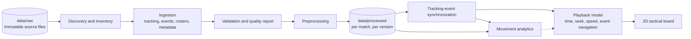

# Task 2 architecture

Scope: Task 2, Software Architecture & Tactical Board Streaming. Rules live in [PROJECT_RULES.md](../PROJECT_RULES.md); this document describes design intent.

## Status

**Implemented:** the installable `football_fatigue` package (Milestone 0) and a metadata-only **discovery and inventory** module, `football_fatigue.inventory` (Milestone 1A, pending final independent review). It lists files and sizes under a configurable raw root, classifies them from directory context and strict file names, keeps every Event Data version separate without selecting one, reports missing, duplicate, unrecognised, and skipped (symlink/junction) entries, and fails explicitly on an incomplete scan or a linked root. It never opens file contents.

**Also implemented (Milestone 2A, pending independent review):** `football_fatigue.ingestion`, the ingestion component below (typed read-only loaders, canonical models for the provisional contracts, streaming tracking frames, deterministic validation, and per-match quality reports written only below `data/processed/`). It performs no synchronization, smoothing, or metrics.

**Also implemented (Milestone 2B, pending independent review):** `football_fatigue.synchronization`, the synchronization component below, as a one-pass streaming temporal join of event rows to tracking frames under the provisional 1B alignment policy, with temporal, spatial, and validated claims kept separate.

**Also implemented (Milestone 2C, pending independent review):** `football_fatigue.match_data`, the single downstream entry point over ingestion and synchronization, with explicit coordinate states, an explicit coordinate policy, and usability indicators that do not claim physical validation. It also provides explicit quality summaries and the consumer-facing frame representation that tactical playback should use ([team_handoff.md](team_handoff.md)); it streams tracking frames with bounded memory and never assumes continuous frame coverage.

**Planned (not implemented):** checksum/provenance manifests, preprocessing, synchronization, analytics, playback, and the tactical board. The inventory proves only that files exist; it does not check that an ID in a file name matches the file's content. No data contract is finalized: the Milestone 1B audit documented the schemas, frame rate, units, coordinate system, and clocks (see [dataset_schema_audit.md](dataset_schema_audit.md)) and proposes provisional contracts in [data_contracts.md](data_contracts.md), pending independent review. No frontend framework or transport (file, API, streaming) has been chosen.

## Data flow (planned)

Solid boxes are the planned Task 2 path. Raw data flows only one way; nothing writes back to `data/raw`.

## Components (discovery and inventory is implemented at file level; all others are planned)

| Component | Responsibility | Must not |
| --- | --- | --- |
| Discovery and inventory (file names and sizes implemented; checksums and relating files to global reference files planned) | Find source files for any supplied match ID under a configurable data root; list files, sizes, checksums; report missing, duplicate, or multi-version candidates; relate match files to global reference files | Rename or edit sources; hardcode a match ID or path; pick among ambiguous candidates silently |
| Ingestion | Read verified source formats into in-memory structures | Compute metrics; rewrite sources |
| Validation | Verify structure, identifiers, periods, timestamps, frequency, units, coordinates, completeness; produce a findings report | Silently repair invalid input |
| Preprocessing | Produce documented derived representations in an optimized storage format (format not yet chosen) | Modify originals; hide missingness |
| Synchronization | Build explicit, documented tracking-to-event time mappings, handling periods and stoppages | Assume identical clocks or period conventions |
| Analytics | Documented movement metrics (distance, speed, acceleration, workload indicators) from validated inputs, with stated assumptions and uncertainty | Label tracking-derived metrics as physiological fatigue |
| Playback | Time-indexed access to positions and events: play/pause, seek, speed, event jumps | Parse raw files; embed analytics |
| Tactical board | 2D rendering of players and ball, consuming the playback interface | Own ingestion logic |

These are responsibility boundaries, not modules to create now. Add plain Python functions or classes when a milestone implements the behavior, before introducing services or plugin frameworks.

## Multi-match design

Entry points take a match ID and a data root. Match `3812` is the initial development sample only. The observed local layout (see [data_policy.md](data_policy.md)) suggests match files are keyed by ID across separate source folders, with some matches covered by fewer modalities and some having several versions of an event file; discovery must model modality availability and version ambiguity explicitly rather than assume completeness. Derived output may use a project-owned layout such as `data/processed/<match-id>/<processing-version>/` (an example, not a source schema), and each run records source hashes, configuration, software version, validation findings, and outputs.

## Synchronization and coordinates

Before synchronization, verify time units, period resets, stoppages, timestamp origins, event precision, and tracking coverage. Before distances, speeds, or rendering, verify coordinate units, pitch dimensions, origin, axes, and attacking direction by period. Document every transformation and retain links to the original time and position values.

## Future extension points (not implemented, no code or stubs)

- **Video detection/tracking, ball trajectory analysis, out-of-frame position estimation:** would add a new ingestion source and its own time mapping into synchronization. No video exists today.
- **Wearable and physiological data:** separate validated ingestion plus subject and time alignment; the prerequisite for any genuine fatigue indicator.
- **Fatigue prediction, injury-risk research, genetics:** separate research scopes consuming validated outputs, with leakage-safe splits and stated limits.

Keep domain logic independent of transport and UI choices so a frontend can be selected later without touching ingestion or analytics.

## Next gate

After authorization (Milestone 1): inventory actual files across matches, record provenance and checksums, inspect schemas starting with match 3812 and cross-check others, document match/global relationships and unknowns. Only then approve an ingestion design and data tests.
