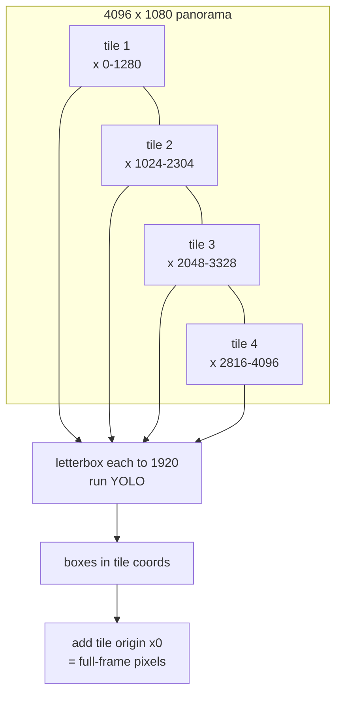
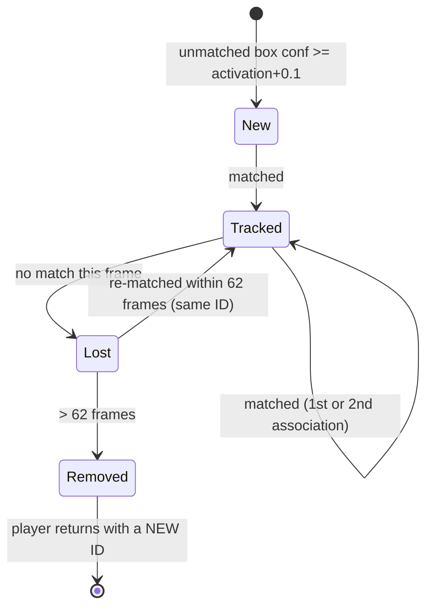
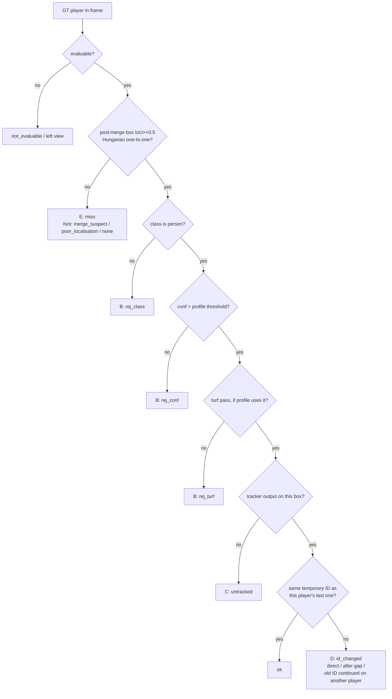

# Session B: complete guide to detection, tracking and occlusion

**Audience:** an engineer joining the Football Fatigue project who will work on the video side (Session B).

**Written:** 2026-11-21, from read-only inspection of the code, saved outputs and reports in `F:\Football-Fatigue-Video` (branch `feature/video-occlusion-events`) and the read-only Session A repository `F:\Football-Fatigue-Project`. Nothing was re-run to write it. The only new file is this guide.

### Evidence labels

Every factual claim carries one of these labels, either inline or in the table heading.

| label | meaning |
|---|---|
| **[V]** | Verified while writing this guide: file read, value read from a saved output, or code read. |
| **[D]** | Documented in an existing project report (path given). Not re-derived now. |
| **[I]** | Inference or interpretation. It may be wrong. |
| **[P]** | Proposed or planned. **Not executed.** |
| **[E]** | External fact (paper, repository, dataset page). Only items marked "checked 2026-11-21" were fetched in M13; the others come from general knowledge and should be re-checked before citing. |

---

## Contents

0. [Executive overview](#0-executive-overview)
1. [Glossary](#1-glossary)
2. [Status snapshot: implemented, tested, planned](#2-status-snapshot)
3. [Repository map](#3-repository-map)
4. [The data](#4-the-data)
5. [The video pipeline end to end](#5-the-video-pipeline-end-to-end)
6. [Detectors](#6-detectors)
7. [Preprocessing, tiling, NMS and filtering](#7-preprocessing-tiling-nms-and-filtering)
8. [Tracking methods](#8-tracking-methods)
9. [Tracking profiles and experiments](#9-tracking-profiles-and-experiments)
10. [Failure decomposition: from detection to identity](#10-failure-decomposition-from-detection-to-identity)
11. [Occlusion detection](#11-occlusion-detection)
12. [GTA and advanced identity recovery](#12-gta-and-advanced-identity-recovery)
13. [Evaluation and fairness](#13-evaluation-and-fairness)
14. [Experiment ledger](#14-experiment-ledger)
15. [How to experiment independently](#15-how-to-experiment-independently)
16. [Research roadmap](#16-research-roadmap)
17. [Experiments and mistakes we should not repeat](#17-experiments-and-mistakes-we-should-not-repeat)
18. [First experiments for a new team member](#18-first-experiments-for-a-new-team-member)
19. [Safety checklist](#19-safety-checklist)
20. [Unresolved scientific questions](#20-unresolved-scientific-questions)
21. [Internal documentation index](#21-internal-documentation-index)
22. [External references](#22-external-references)

---

## 0. Executive overview

**What Session B is.** The project measures football player load. Session A (`F:\Football-Fatigue-Project`) owns identity recovery models, which are trained on FIFA World Cup 2022 PFF tracking in pitch metres. Session A also owns the shared `football_fatigue.vision` code: the detector, the detection cache, the tracker and the evaluation.

Session B (`F:\Football-Fatigue-Video`) works on **video**. Its parts:
- the occlusion-event engine;
- the detection and tracking diagnostics;
- detector and tracker benchmarks;
- the native video player with its Debugger.

Session B works in **image pixels with temporary tracker IDs**. It produces no persistent player identities and no pitch-metre positions. [D `docs/handoffs/SESSION_B_CURRENT_STATE_2026-11-18.md` §1]

**Data.** Four ~4-minute SoccerTrack v2 panorama clips (4096 × 1080 px, 25 fps) with MOT ground truth for the 22 players:
- tune: 117093, 118575;
- check: 117092 (low light), 118576.

Six other matches are reserved and never opened. [V `src/football_fatigue/video/sources.py`]

**Pipeline in one line.** YOLO26-L detection on 4 overlapping tiles → per-tile NMS → cross-tile merge → detection cache (conf > 0.1) → tracker-input filter → supervision ByteTrack → temporary track IDs → occlusion engine v2 → evaluation and visual review.

**What we know, by strength of evidence.** All numbers come from the 4 development matches and are pooled over 526,760 evaluable GT player observations.

1. **The largest loss is "no box after the merge": 6.37 %.** It reaches 14.13 % in low-light 117092. [V `_diag/m13-baseline-v1/manifest.json`]
   - Whether YOLO never proposed the player or our NMS/merge deleted the box is **unknown** until the raw-tile capture runs.
   - Tracker settings cannot change this number.
2. **The old turf (grass-colour) filter deleted confident, correct detections: 5.07 %.** Turning it off (profile **T0**) raised HOTA by +0.035 to +0.053 on three matches. **T0 has been Session B's baseline since 2026-11-18.** [D `docs/research/VIDEO_DETECTION_DIAGNOSIS_v1.md`]
3. **Identity is the weak part.** AssA is 0.15–0.28 while DetA is 0.61–0.69.
   - There are 1,890 temporary-ID changes over 4 matches; **72 % follow a detector gap**.
   - 733 are GT-verified swaps: the old ID continues on another player. [D `docs/research/SESSION_B_PIPELINE_FAILURE_DECOMPOSITION_2026-11-21.md`]
4. **Six tracker alternatives without ReID do not beat production ByteTrack** on the same T0 detections: BoT-SORT, OC-SORT, Deep OC-SORT without appearance, FastTracker, TrackTrack, and Ultralytics ByteTrack. [D `docs/research/SESSION_B_DETECTOR_TRACKER_COMPARISON_2026-11-20.md`]
5. **Lowering ByteTrack's activation threshold makes more tracks, not better identities.**
   - Verified swaps rise 9–25 %.
   - False positives rise up to ×2.2.
   - The HOTA change depends on the match. [D `docs/research/SESSION_B_M13_BYTETRACK_ACTIVATION_ABLATION.md`]
6. **YOLO26-L (football fine-tune) has the best AP50** among locally runnable detectors.
   - YOLOv8m-COCO at 1280 px has higher recall in low light and finds 61 % of production's misses on the benchmark frames.
   - Its false-positive rate is about 3× higher. [D detector reports]
7. **Occlusion events from the engine are geometry-plus-tracking hypotheses, not verified visual occlusions.**
   - The ground truth itself is template boxes, so "occlusion" in GT is a *projection* proxy.
   - Probable-occlusion F1 is about 0.62–0.76. [D `docs/research/VIDEO_V1_STEP2_EVALUATION.md`]

**Most promising next steps** (detail in §16):
1. the raw-tile capture (A2-cap, ~15–20 min GPU, needs approval);
2. a fair detector benchmark focused on low light and small players;
3. gap-aware offline tracklet association (GTA or a motion-constrained variant), evaluated on identical T0 detections.

---

## 1. Glossary

| term | definition in this project |
|---|---|
| **Frame** | One decoded image. SoccerTrack: 25 frames per second. Frame indices are 0-based (`frame_num` in the cache). |
| **PTS / pts offset** | The container presentation timestamp. 117093's first frame has PTS 0.979 s, so `time = pts_offset + frame / fps`. [V event record] |
| **Bounding box (box)** | Axis-aligned rectangle `x1, y1, x2, y2` in full-frame pixels (cache, tracks) or `x, y, w, h` (MOT files). |
| **Confidence (conf)** | The detector's score in [0, 1] for one box and class. It is not a calibrated probability. |
| **IoU** | Intersection over union of two boxes: area(A∩B) / area(A∪B). |
| **IoS** | Intersection over the *smaller* box's area. The occlusion engine uses it to measure how much of a far player is covered. |
| **GT** | Ground truth: SoccerTrack's MOT annotation. `G##` in the UI is a GT player ID. |
| **Detection** | A box produced by the detector **in that frame**. Only detections are measurements. |
| **Tracker input** | The subset of cached detections a profile passes to the tracker (§9). |
| **Track / temporary ID (`T##`)** | The tracker's label for a sequence of boxes. It changes when the tracker loses and re-acquires a player. **Not a player identity.** |
| **Tracklet** | A maximal run of one temporary ID. |
| **Global / persistent identity** | A claim that a tracklet is a specific real player over the whole match. **Session B does not produce these.** Session A's earlier `vision/identity.py` attempted it and failed its gates (§14). |
| **ID switch (IDSW)** | CLEAR-MOT count of times a GT player's matched track ID changes. |
| **GT-verified swap** | Our stricter count: after the change, the **previous** ID continues on a *different* GT player. |
| **Fragmentation (Frag)** | CLEAR-MOT count of times a GT trajectory is interrupted (tracked → untracked → tracked). |
| **Tiling** | Running the detector on overlapping crops (tiles) of the panorama, then mapping boxes back. |
| **NMS** | Non-maximum suppression: among boxes overlapping more than an IoU threshold, keep the highest-scoring and delete the rest. |
| **Per-tile NMS** | The NMS Ultralytics runs inside each tile (class-aware, IoU 0.7). |
| **Cross-tile merge** | Session A's merge of all tiles' boxes (`edge_aware` policy, IoU 0.5). |
| **Detection cache** | The saved post-merge boxes (conf > 0.1) for every frame of a match. It is the input of everything in Session B. |
| **Turf filter** | Session A's grass-colour test `_looks_like_player`. It rejects a box whose upper part is mostly green. Turned off in T0. |
| **B0 / T0 / T0L** | Tracker-input profiles (§9). B0 = historical production; T0 = Session B baseline; T0L = experimental. |
| **Occlusion event** | An event emitted by the occlusion engine: `box_overlap`, `probable_occlusion` or `detection_loss`. |
| **GT occlusion episode** | A pair of GT players where the near box covers ≥ 50 % of the far box for ≥ 3 frames (geometry proxy). |
| **Tune / check** | Development roles. Thresholds may be chosen on tune matches. Check matches are scored once with frozen settings. **Both are development data.** |
| **Reserved** | Matches 118577, 118578, 128058, 128057, 132831 and 132877. Code refuses them (`guard_not_reserved`). |
| **HOTA, DetA, AssA, IDF1, MOTA** | Tracking metrics (§13). |
| **ReID** | Re-identification: an appearance embedding of a person crop, used to match people across time. |
| **OSNet** | A lightweight ReID network family. torchreid provides it. |
| **GTA (gta-link)** | "Global Tracklet Association", an offline split-and-connect refinement of tracker output (§12). **Not GTATrack**, which is a different SoccerTrack challenge system. |

---

## 2. Status snapshot

| component | status | evidence |
|---|---|---|
| YOLO26-L tiled detection with edge-aware merge (Session A code) | **production**; caches exist for 4 dev matches | [V] cache manifests |
| Detection cache v2 (post-merge only) | **production**; no raw pre-merge boxes stored | [V] |
| Turf filter | **production in B0**, bypassed in T0 | [V] `tracking.py` |
| supervision ByteTrack (activation 0.5, buffer 75, matching 0.95) | **production tracker** for B0, T0 and T0L | [V] |
| Tracker-input profiles B0, T0, T0L, T0-A03, T0L-A03 | implemented; T0 = baseline; others are research | [V] `tracking.py` |
| Six Ultralytics trackers (T0-UBT/BOT/OCS/DOCS/FT/TT) | implemented, benchmarked, **rejected** | [D] 2026-11-20 report |
| Occlusion engine 0.2.0, profiles `step1` and `v2` | implemented; v2 is the default | [V] `occlusion/engine.py` |
| Event evaluation `eval-v1` (GT geometry proxy) | implemented and run on all profiles | [V] |
| Failure decomposition `pipeline-v1` | implemented and run (B0, T0, T0L, T0-A03, T0L-A03) | [V] `_diag/` |
| Native player and Debugger (:5831), Streamlit dashboard (:5830) | implemented; browser QA run historically | [D] handoffs |
| Detector benchmark harness (`video.bench`) | implemented; 9 runs on 92 frames | [D] |
| frames-v2 (274-frame benchmark set) | built; **no detector run on it yet** | [V] `_bench/frames/frames-v2.json` |
| Raw-tile capture v2 (`capture_v2.py`) | implemented, 1-frame CPU smoke test only; **GPU run awaits approval A2-cap** | [V] |
| MOT export for GTA (`bench/mot_export.py`) | implemented and unit-tested; **not run on real data** | [V] |
| GTA | **not installed**; awaits approval A5 | [V] |
| Session A tracklet contract builder (`ab_tracklets.py`) | implemented, synthetic test only | [V] |
| Pitch-metre positions in Session B | **not implemented** (no validated calibration) | [D] |
| Persistent / global identity in Session B | **not implemented** (out of scope) | [D] |
| RF-DETR, YOLO11/12/26-m COCO, football HF checkpoints | **proposed**, need downloads | [D] |

---

## 3. Repository map

```
F:\Football-Fatigue-Video\                 Session B worktree (Git: read-only for agents)
├─ src\football_fatigue\video\             ALL Session B code
│  ├─ sources.py          dev sources, RESERVED_MATCH_IDS, guard_not_reserved, ExactFrameReader, play-area polygon
│  ├─ schema.py           occlusion event schema 1.1.0
│  ├─ tracking.py         tracker-input profiles (B0, T0, T0L, T0-A03, ...), build T0-style track files
│  ├─ ab_tracklets.py     Session A contract builder (observed pixels only)
│  ├─ occlusion\          engine.py, geometry.py, evaluate.py (eval-v1), report.py, CLI run/evaluate
│  ├─ detection\          diagnose.py (diag-v1), replay.py (tracker-input variants), stages.py, merge.py (A0-A3),
│  │                      capture.py (v1, never run), capture_v2.py (M13), framestore.py, CLI
│  ├─ bench\              registry, frames (frames-v1/v2), detectors, evaluate, trackers, complement, mot_export,
│  │                      gallery, report, visual, CLI
│  ├─ failures\           pipeline (decompose), aggregate, engine_compare, heavy, gallery, activation, cases,
│  │                      baseline, recovery, CLI
│  ├─ player\             native player server (:5831), player.html, Debugger back end (debug.py), browser QA
│  ├─ dashboard\          Streamlit app (:5830): Viewer, Events, Results, Detection diagnostics, Benchmark, Upload (planned)
│  └─ render.py, render_focus.py, overlay.py   annotated MP4 and strips
├─ src\football_fatigue\vision\            Session B's copy of Session A's shared vision code (same commit; do not edit)
├─ tests\test_video_*.py                   Session B tests (occlusion, step2, detection, bench, player, failures, m13)
├─ docs\research\  docs\handoffs\  docs\video_*.md     reports (§21)
└─ data\processed\video\                   ALL Session B outputs (write-once, versioned)
   ├─ soccertrack-<id>\tracking\<profile>-tracker-input-v1\   frames.jsonl + manifest.json
   ├─ soccertrack-<id>\occlusion\0.2.0\occl-...\              events.jsonl, frames.jsonl, manifest.json, suppressed*.jsonl
   ├─ soccertrack-<id>\occlusion\evaluation\<run_id>.eval-v1.json
   ├─ soccertrack-<id>\detection\diag-v1\, replay-v1\<variant>\
   ├─ _bench\   frames\, detector-v1\, tracker-v1\, gallery-v1\, report-v1.md, complement-m13-v1.json
   ├─ _diag\    pipeline-v1\, pipeline-m13-v1\, engine-t0l-v1\, engine-activation-v1\, activation-ablation-v1\,
   │            heavy-v1.json, gallery-v2\, cases-m13-v1\, recovery-m13-v1\, m13-baseline-v1\, a2cap-plan-v1\,
   │            capture-v2-smoke\ (readiness only, not evidence)
   └─ _qa\      browser QA reports

F:\Football-Fatigue-Project\               Session A (READ-ONLY for Session B)
├─ data\  (read-only data root)            external\soccertrack-v2\, raw\soccertrack_v2\, processed\vision\<cache_run>\
├─ models\vision\player_detector.pt        production detector
├─ models\yolov8{n,s,m}.pt                 COCO checkpoints used in the CPU benchmark
└─ .venv\                                  shared Python 3.12 environment (never install into it without approval)
```

[V directory listings]

---

## 4. The data

### 4.1 Is "VTrack" a dataset?

**Unverified, and treated as different until proven otherwise.**
- The string "VTrack" appears nowhere in Session B's source or docs.
- It appears nowhere in Session A's `src/`, `docs/` or `configs/` Python and Markdown files. The only hit of a case-insensitive grep was inside a compiled `.pyc`, which is not a dataset reference. [V grep, 2026-11-21]
- The dataset actually used is **SoccerTrack v2**, in folders named `soccertrack-v2` / `soccertrack_v2`.

If a teammate says "VTrack", ask which files they mean. It may be an informal nickname for SoccerTrack v2, or a different dataset. Do not merge the two without a source.

### 4.2 SoccerTrack v2 (the only scored dataset)

| item | value | label |
|---|---|---|
| Official name | SoccerTrack v2 | [D master context] |
| Source | Gated Hugging Face dataset `atomscott/soccertrack-v2`; docs at `github.com/AtomScott/SoccerTrack-v2` | [D `F:\Football-Fatigue-Project\docs\PROJECT_MASTER_CONTEXT.md` §4.2] |
| Licence | CC BY 4.0 per the dataset page, as recorded by Session A; **re-check before sharing outputs** | [D] |
| Camera | One fixed panoramic camera. No pan or zoom, so camera-motion compensation is not needed for this data. | [D] |
| Resolution / fps | 4096 × 1080 px, 25 fps | [V cache manifest] |
| Clip length | About 4 minutes (about 6,000 frames) per match: **clips, not full halves** | [V] |
| GT format | MOT text, one line per player per frame: `frame,id,x,y,w,h,-1,-1,-1,-1`. Frames are 0-based. conf, class and visibility are −1 (absent). | [V file head] |
| GT content | **22 players only.** No referees, staff, ball or spectators. | [V 22 IDs per file], [D] |
| Box nature | Positions projected into the image with **template sizes**, so boxes are often narrower than the real silhouette | [D `VIDEO_V1_STEP2_EVALUATION.md`, engine decision report §A.4] |
| Visibility / occlusion labels | **None.** All Session B visibility classes are derived from GT-GT box overlap | [V], [D] |
| Calibration assets | Intrinsics and keypoints for 117092, 117093, 118575 and 118576; homography and padding info only for 117093 | [V listing] |
| Ball action events | Only 117092 (`raw/soccertrack_v2/bas/117092/117092_12_class_events.json`); unused | [V] |

**Per-match facts** [V counted from the GT files, 2026-11-21]:

| match | role in Session B | GT rows | frames | GT IDs | video path (under the data root) |
|---|---|---|---|---|---|
| 117093 | tune | 131,472 | 5,976 | 22 | `external/soccertrack-v2/raw/117093/117093.mp4` |
| 118575 | tune | 132,000 | 6,000 | 22 | `external/soccertrack-v2/mot/clips/118575.mp4` |
| 117092 | check (low light) | 132,000 | 6,000 | 22 | `raw/soccertrack_v2/mot/117092.mp4` |
| 118576 | check | 131,450 | 5,975 | 22 | `external/soccertrack-v2/mot/clips/118576.mp4` |

**Reserved, never opened:** 118577, 118578, 128058, 128057, 132831, 132877.
- 118577 was used once as an independent validation by Session A in M6.2, so it is "spent".
- The others are held out.
- Their files sit in the same folders, so **every loader must call `guard_not_reserved`**. [V `sources.py`]

**Tune/check status.** 118575 and 118576 were originally validation matches for Session A's M6.2 and have since been tuned on. **No Session B number is an independent validation result.** [D master context §5, current-state handoff §4]

**Limitations of the data:**
- Only four 4-minute clips from one camera system.
- Template-sized GT, so occlusion is a geometric proxy.
- No referee labels, so a correct referee detection counts as a false positive.
- 117092 is much darker and more compressed than the others and dominates the "check" role.

### 4.3 Other data near Session B

| dataset | what | used for scored results? |
|---|---|---|
| Wadi Degla videos (`data/external/wadi-degla/`) | Moving-camera local footage, no GT, no calibration | **No.** Qualitative viewing in the player only. [D] |
| FIFA World Cup 2022 PFF tracking and events (`data/raw/...`) | Session A's metric pitch tracking used to train its identity models | **No.** Session A only. Never fed with Session B pixels (§12.6). |

### 4.4 Six kinds of data, never to be confused

Each example below is copied from a real file and shortened (`…`).

**1. Raw match video.** An MP4, H.264, 4096 × 1080 at 25 fps. Decode it by *decoded index* with `sources.ExactFrameReader`, because the first PTS can be non-zero. [V]

**2. Ground-truth annotation** (`external/soccertrack-v2/mot/117093.txt`) [V]:

```
0,1,2033.86,193.80,21.24,53.82,-1,-1,-1,-1      frame 0, GT player 1, x, y, w, h (pixels)
0,2,2983.47,238.90,16.17,43.87,-1,-1,-1,-1
```

**3. YOLO detection output (detection cache).** Path: `processed/vision/soccertrack-117093-m6-d1fixed-full-merged-20261025/detection_cache/detections.jsonl`, frame 1599. [V]

Columns: `class_id, class_label, mapped_class, confidence, x1, y1, x2, y2, passes_turf_filter, inside_pitch_mask`.

```json
{"frame_num":1599,"timestamp_s":63.96,"observations":[
  [3,"goalkeeper","goalkeeper",0.874,1464.78,209.86,1484.26,266.15,0,null],
  [1,"player","player",0.849,2244.56,183.82,2262.76,236.03,1,null], …]}
```

The goalkeeper box has `passes_turf_filter = 0`: conf 0.87, yet B0 would drop it. Note that `timestamp_s` here starts at 0, not at the PTS offset.

**4. Tracking output.**

B0, Session A's production replay, `…-full-stable-replay/frames.jsonl`, carries many legacy identity fields. [V]

```json
{"frame_num":1599,"fps":25.0,"players":[{"track_id":17,"detected_class":"player","confidence":0.8489,
 "bbox_xyxy_px":[2244.56,183.82,2262.76,236.03],"x":null,"y":null,"estimated":true,"identity_usable":false, …}]}
```

T0, Session B's file `data/processed/video/soccertrack-117093/tracking/T0-tracker-input-v1/frames.jsonl`. [V]

```json
{"frame_num":1599,"fps":25.0,"players":[{"track_id":2,"detected_class":"player","observed_class":"goalkeeper",
 "confidence":0.8741,"bbox_xyxy_px":[1464.78,209.86,1484.26,266.15],"measured":true}, …]}
```

Here the goalkeeper the turf filter removed in B0 is tracked as `T2`. `measured: true` means the box is a cached detection, not a prediction.

**5. Occlusion-engine event.** Path: `occlusion/0.2.0/occl-soccertrack-117093-0-5975-v2-T0-ff8815ed/events.jsonl`. [V]

```json
{"schema":"football_fatigue.video.occlusion_event","schema_version":"1.1.0","event_class":"box_overlap",
 "start_frame":0,"end_frame":8,"start_pts_s":0.979,"end_pts_s":1.299,
 "members":[{"track_id":9,"role":"involved","hidden":[]},{"track_id":11,"role":"involved","hidden":[]}],
 "measurements":{"max_iou":0.098,"max_ios_widened":0.2444, …},"evidence":["ios>=0.2"],"evidence_level":"low",
 "uncertain":true,"uncertainty_reasons":["event touches the processing start"],
 "pitch":{"status":"not_computed","x_m":null, …},"provenance":{"engine_version":"0.2.0","profile":"v2", …}}
```

**6. Identity analysis / identity-recovery predictions.** **Session B makes no identity-recovery predictions.** Two related things exist:

(a) GT-based *evaluation* of identity in `_diag/pipeline-v1/<match>/<profile>/frames.jsonl`. Per frame, for each GT player: `[gid, code, temporary track id, conf]`, where code 0 = ok, 1 = id_changed, 6 = miss (codes in `failures/pipeline.py:57`). [V]

```json
{"frame":31,"o":[[4,6,null,null],[9,0,5,0.674], …]}      G4: no box; G9: tracked as T5
```

(b) Session A's proposed contract for asking its models to re-associate tracklets (`m11-session-ab-candidate-event-v1`). Its examples are synthetic and nothing is integrated. See §12.6. [D Session A `docs/research/m11_session_ab_interface_v1.md`]

---

## 5. The video pipeline end to end

```mermaid
flowchart LR
  V[Match video<br/>4096x1080, 25 fps] --> P[Decode + split into<br/>4 tiles 1280x1080, 20% overlap]
  P --> Y[YOLO26-L per tile<br/>letterbox to 1920]
  Y --> N1[Per-tile NMS<br/>class-aware IoU 0.7]
  N1 --> M[Cross-tile merge<br/>edge_aware IoU 0.5<br/>cross-role 0.7]
  M --> C[(Detection cache<br/>post-merge, conf > 0.1<br/>+ turf flag)]
  C --> F{Tracker-input filter<br/>B0 / T0 / T0L}
  F --> T[supervision ByteTrack<br/>activation 0.5, buffer 75]
  T --> TR[(Tracklets<br/>temporary IDs T##)]
  TR --> E[Occlusion engine v2]
  E --> EV[(events.jsonl)]
  TR --> D[Failure decomposition<br/>vs GT]
  EV --> R[Evaluation eval-v1<br/>vs GT geometry]
  D --> UI[Player + Debugger :5831<br/>Streamlit :5830]
  R --> UI
  classDef gpu fill:#fde2e2,stroke:#c00;
  class Y,N1,M gpu;
```



The red stages ran once on GPU in Session A (October 2026). Session B never re-runs them: everything from the cache onward runs on CPU. [V], [D]

| stage | input → output | why | implementation | key parameters | what goes wrong | how to diagnose | status |
|---|---|---|---|---|---|---|---|
| Decode | MP4 → RGB frames | – | PyAV via Session A (`vision`); Session B `ExactFrameReader` for display | index = round((pts − first_pts) × fps) | PTS offset ≠ 0 (117093: 0.979 s) shifts overlays by ~24 frames | player sync checks; the `INVALID-render-pts-offset_*` folder is a kept example | production |
| Tiling | frame → 4 crops | players are 20–60 px tall; full-frame inference would shrink them | `vision/detector.py` `_tile_grid` | tile 1280 × min(1280, 1080), overlap 0.2 → x origins 0, 1024, 2048, 2816 | players cut at tile edges | edge-aware merge statistics in the cache manifest | production |
| YOLO inference | tile → raw candidates | detect people | Ultralytics 8.4.182 | imgsz 1920, fp32, batch 2 | small, dark or overlapped players get low or no scores | AP / recall by stratum (§6) | production |
| Per-tile NMS | raw candidates → kept boxes | remove duplicate anchors | Ultralytics `non_max_suppression` | class-aware, IoU 0.7, max_det 300 | can delete a second, overlapping player | **raw-tile capture v2 only** | production (verified M13) |
| Cross-tile merge | 4 tiles' boxes → one set | remove duplicates in overlaps; resolve truncated edge boxes | `_merge_person_agnostic` (`edge_aware`) | merge IoU 0.5, cross-role 0.7, edge px 2, containment 0.8, conf margin 0.2 | IoU 0.5 can delete a heavily overlapped neighbour | GT pairs vs cached pairs (§7.6); capture v2 | production |
| Cache | → `detections.jsonl` | reuse ~10 GPU-hours; reproducible replays | `vision/detection_cache.py` | floor 0.1; turf flag stored | pre-merge evidence is lost | – | production |
| Tracker-input filter | cache → boxes for the tracker | choose which detections feed ByteTrack | `video/detection/replay.py`, `video/tracking.py` | B0: conf > 0.4 and turf pass; T0: conf > 0.4; T0L: conf > 0.1 | turf filter deletes real players (B0) | `rej_turf`, `rej_conf` codes | B0 historical, **T0 baseline** |
| Tracker | boxes → tracks | temporal association | supervision 0.30.9 ByteTrack via `vision/tracker.py` | activation 0.5 (new track needs ≥ 0.6), buffer 75 → 62 frames lost, matching 0.95 | ID changes after gaps; swaps in overlaps | IDSW, Frag, verified swaps | production |
| Occlusion engine | tracks + untracked cache boxes → events | name overlap, probable occlusion, detection loss | `video/occlusion/engine.py` 0.2.0 | §11 | template-GT disagreement; duplicate tracks; referees | `eval-v1` outcomes | v2 default |
| Identity analysis | tracks + GT → outcome codes | measure where identity breaks | `video/failures/pipeline.py` | Hungarian at IoU ≥ 0.5 | it is *evaluation*, not identity recovery | Debugger | research |
| Visualisation | all of the above | human inspection | `video/player`, `video/dashboard` | – | – | browser QA (`player/qa.py`) | implemented |

### 5.1 Image coordinates vs pitch coordinates

- **Image coordinates** are pixels in the 4096 × 1080 panorama. All Session B detections, tracks and events live here.
- **Pitch coordinates** are metres on a 105 × 68 m pitch. Session A's models consume these.

The panorama is strongly non-linear: a player 1 px wide near the camera and 1 px far away are very different distances on the pitch. A fixed scale is therefore meaningless.

Mapping between the two needs a calibrated camera model:
- Session A's best is a hybrid fisheye + thin-plate-spline model for 117093, with held-out median error 0.38–0.45 m and p90 about 1.0 m.
- 117092 **fails** calibration QC (k-fold 1.17 / 4.47 m).
- A global homography gives about 6.3 m error. [D `VIDEO_ENGINE_DECISION_REPORT_v1.md` §A.2]

Session B uses pitch geometry only to draw an **image-space play-area polygon** from the annotated keypoints (`sources.play_area_polygon`). That polygon removes bench and spectator tracks in engine v2. **Session B never outputs pitch metres:** event field `pitch.status = "not_computed"`. [V]

---

## 6. Detectors

### 6.1 How YOLO inference works (so you do not confuse model and post-processing)

1. **Letterbox.** The tile is resized so its longer side equals `imgsz` (1920 here: a 1280-wide tile is *upscaled* ×1.5), then padded to a stride multiple.
2. **Forward pass.** The network outputs, for every anchor point on several feature maps, a box (4 numbers) and a score per class (4 classes for the football model, 80 for COCO). On one real tile set of 117093 frame 1599, there were **378 candidates with max class score ≥ 0.05** across 4 tiles. [V `capture-v2-smoke`]
3. **Post-processing** (not the model):
   - drop candidates below the confidence floor;
   - **NMS**, class-aware at IoU 0.7: of 378 candidates, 53 survived;
   - cap at `max_det`.
4. **Our code** then:
   - maps boxes back to full-frame pixels (tile origin + un-letterbox);
   - runs the **cross-tile merge** (53 → 26 final boxes on that frame);
   - writes the cache.

"YOLO missed the player" therefore has three possible meanings:
- no candidate (the model);
- a candidate removed by step 3 (NMS);
- removed by step 4 (merge).

Only capture v2 can tell them apart (§7.7).

**Important correction [V M13].** YOLO26 heads *can* run end-to-end without NMS. **The production checkpoint has `end2end = False`**, so per-tile NMS does run. Two earlier statements were wrong for production:
- the engine decision report's "YOLO26 is natively NMS-free, so this suppression is ours";
- the docstring of `video/detection/merge.py`.

### 6.2 Every detector considered

Benchmark: 92 frames (frames-v1), the `on_pitch` view, conf > 0.4 for P/R, all runs with the same 1280 tiling and edge-aware merge except the production row (img 1920). [D `SESSION_B_DETECTOR_TRACKER_COMPARISON_2026-11-20.md` §2]

| detector (file) | training data | size | input | AP50 (all) | AP50:95 | P@0.4 | R@0.4 | FP/frame | R small (< 35 px) | R heavy overlap | s/frame CPU | run? |
|---|---|---|---|---|---|---|---|---|---|---|---|---|
| **YOLO26-L football** `models/vision/player_detector.pt` (sha 05ee5d6c…) | football broadcast footage per its model card (`mobadam/football-player-detection`); **not** SoccerTrack | L, 53.1 MB | img 1920, GPU cache | **0.866** | 0.572 | 0.897 | 0.865 | **2.19** | 0.626 | **0.429** | (GPU cache; 1.77 s/frame on GTX 1650 Ti) | **yes, production** |
| same checkpoint | – | – | img 1280, CPU | 0.855 | 0.569 | 0.867 | 0.879 | 2.96 | 0.673 | 0.438 | 9.7 | yes |
| YOLOv8m COCO `models/yolov8m.pt` | COCO 2017 | 25.9 M params (vendor) | 1280, CPU | 0.807 | **0.591** | 0.749 | 0.868 | 6.39 | **0.686** | 0.324 | 6.4 | yes |
| YOLOv8s COCO | COCO | – | 1280, CPU | 0.780 | 0.533 | 0.808 | 0.820 | 4.28 | 0.593 | 0.286 | 3.4 | yes |
| YOLOv8n COCO | COCO | – | 1280, CPU | 0.752 | 0.475 | 0.838 | 0.750 | 3.19 | 0.482 | 0.286 | 1.8 | yes |
| YOLOv8m / s / n COCO | COCO | – | 640, CPU | 0.744 / 0.659 / 0.579 | – | – | 0.694 / 0.577 / 0.469 | – | 0.357 / 0.166 / 0.113 | – | 2.7 / 1.1 / 0.8 | yes |
| YOLOv9m, YOLOv10m, YOLO11m, YOLO12m, YOLO26m (COCO) | COCO | ~15–20 M params (vendor) | – | – | – | – | – | – | – | – | – | **no** (need download, A1) |
| **YOLO26-L COCO** (architecture-matched control) | COCO | L | – | – | – | – | – | – | – | – | – | **no** (A1). Key for separating fine-tune data from architecture |
| RF-DETR medium | COCO (Apache-2.0 N–L per Session B registry) | – | – | – | – | – | – | – | – | – | – | **no** (install + weights, A3) |
| easychamp YOLOv8, soccana YOLO11 (Hugging Face) | football; data undocumented | – | – | – | – | – | – | – | – | – | – | **no** (A4, licence check first) |

**Production checkpoint metadata** [D engine decision report §A.1]:
- `yolo26l.yaml`, trained at imgsz 1280, 50 epochs, Ultralytics 8.4.9;
- classes {0 ball, 1 player, 2 referee, 3 goalkeeper}.

**Licence: conflicting labels.** The model card says Apache-2.0, but the checkpoint carries Ultralytics' AGPL-3.0 stamp. Treat it as acceptable for research and unresolved for any product.

**Equivalence checked:** YOLO26-L on CPU at production settings reproduced the GPU cache exactly on 6 frames (max abs difference 0.0). [D]

**Low light (117092 only, 24 frames), paired bootstrap, prod → YOLOv8m@1280:** ΔR@0.4 = **+0.059 [+0.015, +0.105]** and ΔAP50 = −0.011 [−0.052, +0.043]. [D]

Frames within a match are correlated, so these intervals are optimistic.

**Complementarity (M13, existing runs only, conf > 0.1, greedy IoU ≥ 0.5)** [D `SESSION_B_M13_DETECTOR_BENCHMARK_PLAN.md` §2]. Production misses 195 GT boxes on frames-v1. YOLOv8m@1280 finds **119** of them:

| stratum | found by YOLOv8m |
|---|---|
| low light | 73 / 96 |
| small (< 35 px) | 68 / 101 |
| heavy overlap | 15 / 51 |
| hidden | 8 / 21 |

The same production checkpoint run at 1280 on CPU finds 59 of the 195, so **many misses are marginal and resolution-sensitive** [I].

**Strengths and weaknesses** [D, I]:

| detector | strengths | weaknesses |
|---|---|---|
| YOLO26-L football | best precision, fewest off-GT people, best heavy-overlap recall | weakest in low light; small-player recall below YOLOv8m@1280 |
| YOLOv8m COCO | tighter boxes (AP50:95), better small and low-light recall | about 3× FP: referees, staff and spectators count as FP because GT has none |

**Selection: keep YOLO26-L.** No tested model is better overall. The football fine-tune versus architecture question stays open until the yolo26l-coco control runs. [D]

---

## 7. Preprocessing, tiling, NMS and filtering

### 7.1 Why players are tiny

The panorama is 4096 px wide and covers the whole pitch, so far players are about 20–35 px tall. In tune matches:
- 13 % of GT observations are under 35 px;
- 52 % are 35–50 px. [D `recovery-m13-v1`]

A detector run on the whole frame at 1280 px would shrink a 35 px player to about 11 px, below what COCO-style detectors find reliably. Tiling at 1280 and letterboxing to 1920 instead *enlarges* each player 1.5×. Evidence that resolution matters:
- YOLOv8m at 640 → 1280 gains **+0.173 recall**;
- small-player recall goes 0.36 → 0.69. [D 2026-11-20 report]

### 7.2 Tiling and coordinates



`tile_height = 1280` is clamped to the frame height 1080. The step is int(1280 × 0.8) = 1024, and a final tile is pinned to the right edge. This gives 4 tiles; the smoke capture recorded 4. [V code + smoke capture]

A box at tile-local `x` maps to full-frame `x + x0`. Session A's M4 work named this layout "D1" (2D tiling). Against an older baseline it gave small-player recall +7.5 to +17 points on held-out 117092 windows. [D master context]

### 7.3 IoU and duplicate detections

```
IoU = area(A ∩ B) / area(A ∪ B)
```

Two boxes of *the same person* from overlapping tiles have high IoU, and are duplicates. Two *different* players standing one behind the other can also have IoU > 0.5. GT contains such pairs often:

| match | GT player pairs with IoU ≥ 0.5 (frame-pairs) |
|---|---|
| 117093 | 1,948 |
| 118575 | 1,321 |
| 117092 | 695 |
| 118576 | 1,934 |

[D `heavy-v1`]

Any IoU-based suppression at 0.5 therefore cannot tell "same person twice" from "two people overlapping". It has to choose.

### 7.4 Per-tile NMS (inside Ultralytics)

The procedure, per class: sort by score, keep the best, delete every box with IoU > 0.7 to it, repeat. **Two players of the same class overlapping at IoU > 0.7 cannot both survive.** On the one captured frame, 378 candidates became 53 kept boxes. That count includes the many anchors firing on the same player, which NMS is meant to remove. [V smoke]

### 7.5 Cross-tile merge (Session A, `edge_aware`)

- Boxes from all tiles are pooled.
- Boxes truncated by a tile cut (within 2 px of the cut) are resolved first: a truncated box contained ≥ 0.8 in a complete one is dropped.
- Then same-role NMS runs at IoU 0.5 *across all person boxes*, including boxes from the same tile.
- Cross-role suppression applies at IoU 0.7 (for example player vs goalkeeper).
- Ball and unmapped labels are merged separately.

The cache manifest records how many boxes each rule removed. For example, 117093 frames 0–624: 4,814 same-role suppressions and 808 edge-truncation removals. [V manifest]

### 7.6 Evidence that overlapping players collapse into one box [D]

| match | GT pairs IoU ≥ 0.5 | cached person-box pairs IoU ≥ 0.5 |
|---|---|---|
| 117093 | 1,948 | 18 |
| 118575 | 1,321 | 44 |
| 117092 | 695 | 252 |
| 118576 | 1,934 | 22 |

[`heavy-v1`; pairs at conf > 0.1]

Recall of the far (occluded) player by GT occlusion fraction, conf > 0.4 [D engine decision report §A.4]:

| occlusion fraction | 117092 | 117093 | 118575 | 118576 |
|---|---|---|---|---|
| 0 (isolated) | 0.825 | 0.984 | 0.962 | 0.981 |
| [0.25, 0.5) | 0.591 | 0.868 | 0.783 | 0.871 |
| [0.5, 0.75) | 0.383 | 0.483 | 0.429 | 0.513 |
| ≥ 0.75 | 0.141 | 0.191 | 0.258 | 0.233 |

This is **consistent with** suppression removing hidden players, and **also consistent with** the model never proposing them. That is why a post-merge miss cannot be blamed on YOLO automatically.

### 7.7 The raw-tile capture (A2-cap): what it can and cannot establish

`video/detection/capture_v2.py` stores four stages per frame:
1. every raw candidate ≥ 0.05, with all class scores;
2. the per-tile NMS keep flag, recomputed and **checked equal to the predictor's own output**;
3. the merge inputs;
4. the final boxes, replayed with Session A's merge and **compared with the cache**.

One-frame CPU smoke test: NMS recompute equal, replay 26/26 matching the cache. [V]

Each evaluable GT player is then assigned exactly one category: `detected_and_passed`, `rejected_downstream_conf`, `no_raw_proposal`, `poor_localisation`, `shared_box_given_to_neighbour`, `removed_by_tile_nms`, `removed_by_cross_tile_merge`, `below_cache_floor`.

The plan covers 480 frames: per match, 2 targeted windows plus 2 seeded random control windows. Targeted and random results are reported separately. [V `_diag/a2cap-plan-v1/plan.json`]

**It can establish:** for missing players, which stage removed them; and what merge IoU 0.5 / 0.6 / 0.7 would recover, replayed offline with no new inference.

**It cannot establish:**
- whether a recovered box would have been tracked correctly (needs tracking on full matches);
- visual occlusion (pixels, not geometry);
- anything about other detectors.

The smoke frame (one frame, **not evidence**) showed 4 `shared_box_given_to_neighbour`, 2 `poor_localisation`, 1 `removed_by_cross_tile_merge` and 0 `removed_by_tile_nms`. That hints the model often puts one box on two players. Only the full capture can say. [V]

### 7.8 Confidence filtering, class mapping, turf filter

- **Class mapping.**
  - The football model's {player, goalkeeper, referee} map to "person".
  - COCO `person` (class 0) maps to the same.
  - Ball is excluded from tracking.
  - No class rejections of GT players were observed. [D]
- **Confidence.**
  - The cache keeps conf > 0.1.
  - The tracker input uses conf > 0.4 (B0, T0), which rejects 3.00 % of evaluable GT observations even though a correct box exists. The median conf of those boxes is 0.24–0.26.
  - Lowering to 0.3 adds 0.5–2.2 recall points and 30–150 % more off-pitch boxes. [D]
- **Turf filter** (`_looks_like_player`, Session A).
  - Rule: reject a box if more than 72 % of its upper 65 % is green (OpenCV hue 35–85, saturation ≥ 40).
  - It removed confident real players, median conf 0.87. Examples:
    - a lime-kit goalkeeper for **231 consecutive frames** (`soccertrack-117093/detection/diag-v1/examples/turf_filtered-f01585-gt6.png`);
    - a thin beige-kit player for 183 frames.
  - All 18 sampled high-confidence non-GT boxes it removed were **referees**, not grass.
  - It cost **5.07 %** of evaluable observations in B0 and is bypassed in T0. [D]

### 7.9 Real measured example: suppression vs identity (117093, G4 and G9)

From `_diag/pipeline-v1/soccertrack-117093/T0/frames.jsonl` [V, re-read 2026-11-21]:

| frame | G4 | G9 |
|---|---|---|
| 30 | tracked as **T3** (conf 0.554) | tracked as **T5** (0.828) |
| 31–37 | **no box after merge**; G4 and G9 overlap heavily (`merge_suspect` hint) | still T5 |
| 38 | reappears as **T5** (0.649) | becomes **T3** (0.758) |

The two temporary IDs were **exchanged** after a 7-frame detector gap during an overlap. This is the archetypal failure: a detection gap in an overlap, followed by ByteTrack's IoU association giving each ID to the other player. Open it with `http://127.0.0.1:5831/?source=soccertrack-117093&ti=T0&debug=1&gid=4&frame=30`.

---

## 8. Tracking methods

### 8.1 Building blocks

- **Kalman filter.** Predicts each track's next box from a constant-velocity model of (centre, aspect, height) and corrects it with the matched detection. ByteTrack, BoT-SORT and OC-SORT all use one.
- **Hungarian assignment** (linear assignment). Given a cost matrix tracks × detections (here 1 − IoU, possibly fused with score), it finds the minimum-cost one-to-one matching. Pairs above a cost threshold are rejected.
- **Track birth and death.**
  - An unmatched detection above a threshold starts a track.
  - An unmatched track is kept "lost" for a buffer of frames, then deleted.
  - A lost track can be re-matched; a deleted one cannot, and the player gets a new ID.
- **Appearance ReID.** An embedding network such as OSNet maps a crop to a vector; cosine distance compares crops. **No production Session B tracker uses appearance.**

### 8.2 ByteTrack (production)

The core idea [E: Zhang et al., ECCV 2022, arXiv 2110.06864]: associate high-confidence boxes first, then use **low-confidence boxes** to continue existing tracks instead of discarding them.

**Exact semantics in supervision 0.30.9** [V `site-packages/supervision/tracker/byte_tracker/core.py`, unit-tested in `tests/test_video_m13.py`]:

| step | rule | production value |
|---|---|---|
| 1st association | boxes with conf ≥ `track_activation_threshold`; cost = 1 − IoU·score; accept if cost ≤ `minimum_matching_threshold` | activation 0.5; threshold 0.95, so accepted when IoU·score ≥ 0.05 |
| 2nd association | boxes with 0.1 < conf < activation, to still-unmatched tracked tracks; accept if 1 − IoU ≤ 0.5 | IoU ≥ 0.5 |
| unconfirmed tracks | matched with threshold 0.7 on the fused cost | – |
| **new track** | unmatched box with conf ≥ `det_thresh` = activation **+ 0.1** | **≥ 0.6** |
| lost → removed | after `max_time_lost` = int(fps / 30 × buffer) frames | buffer 75 → **62 frames** at 25 fps |
| confirmation | `minimum_consecutive_frames` | 1 |

Football implications [I, supported by D]:
- A player whose box stays at 0.4–0.6 after a gap **cannot start a new track**.
- IoU association has no notion of *which* of two overlapping players a box belongs to, so swaps happen in overlaps (§7.9).
- The 62-frame buffer bridges short dips. Long low-light gaps exceed it.

Ultralytics' own ByteTrack scores about **0.02 HOTA lower** than supervision's on identical detections: implementation details matter as much as algorithms. [D]



### 8.3 Other trackers benchmarked (all on identical T0 detections, no ReID, no camera-motion compensation)

Implementation: `video/bench/trackers.py`, Ultralytics tracker YAML defaults with `track_buffer 75`, `gmc_method: none`, `with_reid: False`. [V]

| tracker | core idea [E] | motion | association | appearance in our run | result (check HOTA / IDF1 / IDSW) [D] | decision |
|---|---|---|---|---|---|---|
| **sv-bytetrack** (production) | two-stage high/low score | Kalman | IoU (fused score) | none | **0.3632 / 0.3631 / 859** | **kept** |
| ul-bytetrack | same algorithm, Ultralytics code | Kalman | IoU | none | 0.3439 / 0.3170 / 1,157 | rejected |
| ul-botsort | ByteTrack + camera-motion compensation + optional ReID | Kalman (modified state) | IoU (+ReID) | **off** | 0.3416 / 0.3280 / 1,059 (tune +0.003 HOTA, one match) | rejected |
| ul-ocsort | observation-centric re-update; momentum; recovery | Kalman with observation-centric correction | IoU + direction | none | 0.3465 / 0.3284 / 1,210 | rejected |
| ul-deepocsort | OC-SORT + appearance | as OC-SORT | IoU + ReID | **off**, so identical to OC-SORT | identical to OC-SORT | rejected (not truly tested) |
| ul-fasttrack | occlusion-aware variant (Ultralytics) | Kalman | IoU | none | 0.3130 / 0.2872 / 1,260 | rejected |
| ul-tracktrack | TrackTrack (Ultralytics) | Kalman | IoU (+ReID) | **off** | 0.3132 / 0.2834 / 997 | rejected |

**Earlier Session A trackers** [D `F:\Football-Fatigue-Project\data\processed\vision_eval\m9-local-tracking-phaseb-v1\M9B_RESULTS_AND_DECISION.md`]:
- **Deep-EIoU-style expanded-IoU association without ReID** (C1): pooled ΔHOTA **−0.053** vs ByteTrack, 1.33–1.43× the ID switches. **NO-GO.**
- Opening ByteTrack's low band (B1): +0.005 HOTA. Not adopted.
- **Pretrained OSNet ReID (OSNet-AIN x1.0, MSMT17)**: **NO-GO** in M6.3-B, 4 of 5 gates failed. [D `…\m63b-pretrained-reid-v1\README.md`]
  - It separates **teams** well (other-team AUC 0.95).
  - It does **not** separate **teammates** (same-team AUC 0.64–0.65 vs 0.75 required).
  - 0 % of same-team contact swaps were recovered at precision ≥ 0.80.
- **DCTracker:** closed-access paper, no public code, so unavailable. [D]

### 8.4 Three kinds of ID

| ID | example | produced by | meaning | may be a model input? |
|---|---|---|---|---|
| GT ID | `G4` | SoccerTrack annotation | the true player in the clip | **never** (evaluation only) |
| temporary tracker ID | `T3` | ByteTrack | "the same track as last frame" | yes, as `local_only` |
| recovered global identity | (none in Session B) | Session A M11 models / a future GTA link | a hypothesis that two tracklets are one player | only with its confidence and provenance |

---

## 9. Tracking profiles and experiments

### 9.1 Profile definitions

All profiles use the same detection cache and the same supervision ByteTrack (buffer 75, matching 0.95) unless stated. [V `tracking.py`, `detection/replay.py`]

| profile | tracker input | tracker | role |
|---|---|---|---|
| **B0** | person, conf > 0.4, **turf filter applied** | ByteTrack activation 0.5 | historical Session A production replay; reproduced box-for-box (`frames_differing = 0`) |
| **T0** | person, conf > 0.4, turf ignored | ByteTrack activation 0.5 | **Session B baseline** since 2026-11-18 (`RECOMMENDED_TRACKER_INPUT`) |
| T0L | person, conf > 0.1, turf ignored | ByteTrack activation 0.5 | experimental, not promoted |
| T0-A03 | as T0 | **activation 0.3** (new tracks ≥ 0.4) | M13 research, not promoted |
| T0L-A03 | as T0L | **activation 0.3** | M13 research, not promoted |
| T0-UBT / BOT / OCS / DOCS / FT / TT | as T0 | Ultralytics trackers (§8.3) | benchmark, rejected |
| TG6, C3, T0C3, T0P, T0C3P, TG6C3 | variants of turf/conf/play-area filters | ByteTrack | 2026-11-18 diagnostic replays only |

`DEFAULT_TRACKER_INPUT = "B0"` in code means "historical reproduction by default". It is not a recommendation.

### 9.2 B0 vs T0 (replay-v1, full matches) [D `VIDEO_DETECTION_DIAGNOSIS_v1.md`; numbers re-read in the 2026-11-18 handoff]

| match | role | profile | HOTA | AssA | IDF1 | IDSW | Frag |
|---|---|---|---|---|---|---|---|
| 117093 | tune | B0 → T0 | 0.371 → **0.423** | 0.210 → 0.264 | 0.377 → 0.435 | 373 → 348 | 2,692 → 921 |
| 118575 | tune | B0 → T0 | 0.371 → **0.409** | 0.223 → 0.247 | 0.345 → 0.391 | 383 → 266 | 3,256 → 1,452 |
| 117092 | check | B0 → T0 | 0.305 → 0.307 | 0.153 → 0.154 | 0.280 → 0.281 | 509 → 509 | 4,496 → 4,149 |
| 118576 | check | B0 → T0 | 0.384 → **0.420** | 0.215 → 0.253 | 0.373 → 0.445 | 387 → 350 | 2,399 → 996 |

The cost: DetPr falls 0.002–0.023, because referees are now tracked and GT has no referees.

117092 does not change, because its losses are model misses, not filtering.

### 9.3 T0 vs T0L and the activation ablation (pooled per role; IDSW, Frag, FP, FN summed) [D M13 report, `_diag/activation-ablation-v1/summary.json`, `_diag/engine-activation-v1/summary.json`]

| role | profile | HOTA | DetA | AssA | IDF1 | MOTA | IDSW | Frag | FP | FN | GT coverage | PO P | PO R | PO F1 |
|---|---|---|---|---|---|---|---|---|---|---|---|---|---|---|
| tune | T0 | 0.4164 | 0.6795 | 0.2558 | 0.4128 | 0.801 | 614 | 2,373 | 35,841 | 16,023 | 0.939 | 0.709 | 0.678 | 0.693 |
| tune | T0L | 0.4138 | 0.6749 | 0.2543 | 0.4138 | 0.792 | 608 | 1,601 | 41,356 | 12,853 | 0.951 | 0.705 | 0.696 | 0.700 |
| tune | T0-A03 | 0.4216 | 0.6743 | 0.2642 | 0.4265 | 0.792 | 632 | 2,696 | 39,224 | 14,838 | 0.944 | 0.713 | 0.737 | 0.724 |
| tune | T0L-A03 | 0.4277 | 0.6614 | 0.2777 | 0.4441 | 0.766 | 621 | 1,725 | 49,677 | 11,430 | 0.957 | 0.692 | 0.744 | 0.716 |
| check | T0 | 0.3632 | 0.6552 | 0.2035 | 0.3631 | 0.775 | 859 | 5,145 | 20,926 | 37,524 | 0.858 | 0.659 | 0.704 | 0.680 |
| check | T0L | 0.3681 | 0.6609 | 0.2074 | 0.3638 | 0.780 | 840 | 3,232 | 25,555 | 31,543 | 0.880 | 0.650 | 0.715 | 0.680 |
| check | T0-A03 | 0.3585 | 0.6520 | 0.1988 | 0.3524 | 0.768 | 917 | 5,966 | 24,995 | 35,212 | 0.867 | 0.629 | 0.743 | 0.679 |
| check | T0L-A03 | 0.3646 | 0.6446 | 0.2076 | 0.3597 | 0.749 | 903 | 3,813 | 37,293 | 28,017 | 0.894 | 0.610 | 0.764 | 0.676 |
| check | T0L-A20 (tune-selected) | 0.3741 | 0.6308 | 0.2232 | 0.3699 | 0.723 | 937 | 4,143 | 45,341 | 26,625 | 0.899 | – | – | – |

Per-match effects hide in these means:
- T0L-A30 vs T0: 117093 **−0.021**, 118575 **+0.044** HOTA.
- The tune-selected T0L-A20 gains +0.031 on 117092 but loses 0.009 on 118576.

GT-verified swaps (previous ID continues on another player; all 4 matches) [V `pipeline-m13-v1`]:

| profile | GT-verified swaps |
|---|---|
| T0 | 733 |
| T0L | 789 |
| T0-A03 | 796 |
| T0L-A03 | 914 |

False probable-occlusion alerts on check:

| profile | false PO alerts |
|---|---|
| T0 | 248 |
| T0L | 262 |
| T0-A03 | 325 |
| T0L-A03 | 358 |

### 9.4 Why fewer fragments is not better identity

`Frag` counts *interruptions* of a GT trajectory. It falls when the tracker keeps *some* box on the player through a dip.

It says nothing about whether the box after the dip has the **right** ID:
- T0L cuts Frag by 33–37 %, yet HOTA moves only ±0.005 and verified swaps *rise* (733 → 789).
- T0L-A03 adds more tracks (initialisations +26 % on check), more FP, and +25 % swaps.

Fragmentation, GT coverage and "detection-loss events" are *continuity of coverage* metrics. **Identity is measured by AssA, IDF1 and verified swaps.** [I, supported by the numbers above]

---

## 10. Failure decomposition: from detection to identity

### 10.1 Method (`python -m football_fatigue.video.failures decompose`)

For every GT player in every frame (one *observation*):
1. Mark it **not evaluable** if the box is off-pitch or on the frame border (0.03 %).
2. Match GT boxes to cached boxes **one-to-one** with the Hungarian algorithm at IoU ≥ 0.5. One box cannot explain two players.
3. Follow the matched box through the profile's filters and the tracker, and assign exactly one code.

[D decomposition report §1; codes V `failures/pipeline.py:57`]



### 10.2 Measured rates (share of 526,760 evaluable observations; all 4 matches) [V `_diag/m13-baseline-v1/manifest.json`, `pipeline-m13-v1`]

| outcome | B0 | T0 | T0L | T0-A03 | T0L-A03 |
|---|---|---|---|---|---|
| ok | – | 89.46 % | 91.20 % | 90.11 % | 92.11 % |
| E: no post-merge box | 6.37 % | 6.37 % | 6.37 % | 6.37 % | 6.37 % |
| B: rejected by turf | **5.07 %** | 0 | 0 | 0 | 0 |
| B: rejected by conf | 3.00 % | 3.00 % | 0 | 3.00 % | 0 |
| B: rejected by class | 0 observed | 0 | 0 | 0 | 0 |
| C: untracked | 0.85 % | 0.80 % | 2.07 % | 0.13 % | 1.13 % |
| D: ID changed | – | 0.36 % (1,890) | 0.36 % (1,885) | 0.38 % (1,991) | 0.39 % (2,041) |

The B0 `ok` share pooled over all matches is not stored in the M13 manifest. Per role: tune 85.73 %, check 82.88 % [D decomposition report §2.1].

**ID changes under T0** [D]:
- 1,369 after a gap (72 %);
- 521 direct;
- **733 with the previous ID still output on another player** (GT-verified swaps).

**After a T0 no-box gap on tune matches** [V `recovery-m13-v1`]:

| gap length | same ID afterwards | changed ID |
|---|---|---|
| 1 frame | 449 | 56 |
| 2–5 frames | 496 | 162 |
| 6–25 frames | 228 | 153 |
| > 25 frames | 31 | 55 |

The longer the gap, the more often the ID changes.

**Where misses happen (T0)** [D]:

| GT-derived visibility | miss rate |
|---|---|
| visible | 4.0 % |
| partial | 10.1 % |
| heavy | 43.2 % |
| hidden | 78.3 % |

| GT box height | miss rate |
|---|---|
| < 35 px | 21.1 % |
| 35–50 px | 5.2 % |
| 50–80 px | 0.9 % |

117092 holds **56 % of all misses** (18,649 of 33,579).

Miss hints:
- `none`: 50.5 %, mostly 117092;
- `merge_suspect`: 34.7 %;
- `poor_localisation`: 14.8 %.

**Hints are not causes.**

### 10.3 Inspecting a failure in the Debugger

1. Launch the player (§15.3) and open `http://127.0.0.1:5831/?source=soccertrack-117093&ti=T0&debug=1&gid=4&frame=30`.
2. GT boxes are coloured by outcome: tracked / ID changed / passed but not tracked / below conf / turf-filtered / no box / not evaluable.
3. In the **failure inspector**, filter by group (E / B / C / D), length or G id. Click an item to jump there.
4. Use **before / during / after / ▶ play through**, ←/→ for one frame, and Shift+arrow for ±25.
5. Compare profiles side by side with `&cmp=T0L` (any two of B0, T0, T0L, T0-A03, T0L-A03, T0-BOT, T0-OCS).

[D `docs/handoffs/SESSION_B_DETECTION_MISS_DEBUGGER_2026-11-21.md`]

Other verified examples (from that handoff and `_diag/cases-m13-v1/cases.md`):
- 118575 G2 f2464–2470: a confident box (0.82–0.88) removed by the turf filter in B0 but tracked in T0. URL `?source=soccertrack-118575&ti=B0&cmp=T0&debug=1&gid=2&frame=2463`.
- 118576 G14 f5614–5617: a 4-frame confidence dip followed by an ID swap.
- 117092 G12 f443–596: a 154-frame low-light no-box run; the player returns under a new ID.

---

## 11. Occlusion detection

### 11.1 Concepts that must stay separate

| concept | definition | how we observe it |
|---|---|---|
| Spatial box overlap | two boxes intersect (IoU / IoS > 0) | geometry only |
| Partial visual occlusion | part of a player is hidden by another body | **needs pixels or human review; not labelled** |
| Full visual occlusion | the player is invisible | same |
| Missing detection | no post-merge box | detection cache |
| Track fragmentation | the trajectory is interrupted | tracker output vs GT |
| ID switch | the temporary ID changes | tracker output vs GT |
| Camera movement | not present in SoccerTrack (fixed panorama) | – |
| Leaving the frame | the box exits the image or play area | geometry |

Box overlap is not occlusion, for three reasons:
- Template GT boxes overlap where real players may not.
- Players can stand side by side at different depths without hiding each other.
- A missing box can be NMS, low light or small size, not a body in front.

### 11.2 Engine 0.2.0 (`video/occlusion/engine.py`)

- **Input:** one tracker-input profile's tracks, plus cached person boxes the tracker did not output.
- **Output:** `events.jsonl`, `frames.jsonl` (including predicted boxes for hidden or lost tracks, which are never observations), `suppressed*.jsonl`, `manifest.json`. [V]

Event classes [V docstring]:

| class | subtypes | meaning |
|---|---|---|
| `box_overlap` | `overlap` | two visible boxes overlap (IoS ≥ 0.2 after 10 % horizontal widening); no hiding claimed |
| `probable_occlusion` | `partial` | overlap plus the far player's confidence or height drops |
| `probable_occlusion` | `full` | the track is lost while its predicted box lies ≥ 50 % behind a visible player |
| `probable_occlusion` | `merged` | like `full`, and the occluder's box grows (≥ 1.4×) |
| `detection_loss` | – | a track is lost with nobody in front, or it leaves the frame |

Profile `v2` (config `ff8815ed`) adds:
- one event per player pair, with a group ID;
- the play-area filter (off-pitch tracks are suppressed but kept);
- damped prediction (velocity capped at 0.25 box heights per frame for 5 frames, then held).

Evidence level (low / medium / high) is a grade, **not a probability**. Every event carries `uncertain` and `uncertainty_reasons`.

### 11.3 Evaluation (`eval-v1`)

**GT episodes** per GT pair (far = smaller bottom y):
- *overlap*: cover ≥ 20 % for ≥ 2 frames;
- *occlusion*: cover ≥ 50 % for ≥ 3 frames.

**Event outcomes:**
- `tp`: same pair, same tier, ±5 frames;
- `fp_gt_overlap_only`, `fp_no_gt_overlap`, `fp_duplicate_track`;
- `non_gt_person`: referees and others, **not scored**.

Recall is computed over *detectable* episodes, where both players are tracked within ±10 frames. [D `VIDEO_V1_STEP2_EVALUATION.md`]

Results, B0 input [D]:

| match | profile | PO events | PO P | PO R | PO F1 | median abs. end error (frames) |
|---|---|---|---|---|---|---|
| 117093 | step1 → v2 | 242 → 493 | 0.733 → 0.706 | 0.706 → 0.648 | 0.719 → 0.676 | 13 → 6 |
| 118575 | step1 → v2 | 204 → 299 | 0.790 → 0.703 | 0.695 → 0.695 | 0.739 → 0.699 | 11 → 5 |
| 117092 | step1 → v2 | 236 → 423 | 0.697 → 0.571 | 0.725 → 0.682 | 0.711 → 0.622 | 14 → 8 |
| 118576 | step1 → v2 | 208 → 458 | 0.894 → 0.742 | 0.804 → 0.767 | 0.846 → 0.754 | 15.5 → 6 |

- Claim-level precision, which is fair across grouping, barely changed (tune 0.666 → 0.663, 0.677 → 0.679).
- v2 is a timing and readability improvement, **not a precision improvement**.
- 98.6–98.9 % of scored detection-loss events are *not* occlusions in GT.

**Effect of the tracker on events** [D 2026-11-20 report §5]: BoT-SORT and OC-SORT raise PO recall by 0.02–0.06 and lower precision similarly. **A different tracker does not improve event accuracy.**

### 11.4 Limitations and failure cases

- The GT is a geometric proxy, so precision is a lower bound for visual occlusion.
- `fp_gt_overlap_only` is partly a template-box artefact.
- **Duplicate tracks create false pairs.**
- Referees are not in GT. Engine events involving them are 10–25 % of PO events and unscorable.
- Most missed GT occlusions are "tracked but no event". The cached boxes never overlap enough, because the merge collapses overlapping players (§7.6).
- No human event reviews have been saved yet; the review form exists.

---

## 12. GTA and advanced identity recovery

### 12.1 What GTA is (checked 2026-11-21 via the public repository and arXiv abstract) [E]

- **Repository and paper:** `github.com/sjc042/gta-link`; Sun et al., "GTA: Global Tracklet Association for Multi-Object Tracking in Sports", ACCV 2024 MLCSA workshop, arXiv 2411.08216.
- **Licence:** MIT (code). The checkpoint's own licence is not stated.
- **Published results:** SportsMOT HOTA 81.04; SoccerNet 79.41 → 83.11.

**Mechanism (offline, whole sequence):**
1. **Split.** For each tracklet longer than `min_len` (100), cluster its OSNet embeddings with DBSCAN (cosine). If it contains more than one appearance cluster (at most `max_k` = 3), split it. This targets ID switches *inside* a tracklet.
2. **Connect.** Greedily merge tracklets whose mean pairwise cosine distance of appearance embeddings is below `merge_dist_thres` (0.4).
   - Tracklets sharing any frame are never merged.
   - The spatial check allows a merge unless exit/entry centres differ by more than the sequence's box-centre range × `spatial_factor` (1.0), which is very loose on a panorama.
   - **There is no maximum temporal gap and no motion model.**

**Dependencies:**
- Python 3.8 (separate environment; our venv is 3.12);
- torch (tested 2.3.0 / CUDA 11.8);
- torchreid 1.4.0;
- 24 mostly unpinned packages.

**Checkpoint:** `reid_checkpoints/sports_model.pth.tar-60` (OSNet trained on SportsMOT per the README, 30,393,613 bytes) is **committed in the repository**, so it is not blocked by missing weights.

**Input:**
- MOT text `frame,id,x,y,w,h,conf,x,y,z` (1-based frames);
- **every frame as an image** under `<seq>/img1/` (MOT17 layout). That is about 12 GB for the two tune matches (estimate).

CPU is possible; no device flag.

[D `docs/research/SESSION_B_M13_GTA_FEASIBILITY.md`]

**GTA ≠ GTATrack.** GTATrack is the SoccerTrack challenge winner (Deep-EIoU plus ReID plus its own detector), with a reported HOTA of about 0.60 on these clips. Session A judged it not reusable: unpublished detector, unverified licence, reserved-match answer files in its repository. [D Session A `m9-tracking-feasibility-v1/M9_EXECUTIVE_RECOMMENDATION.md`]

### 12.2 Concepts

- **Global tracklet association.** Instead of deciding frame by frame (online), look at whole tracklets and decide which belong to one player, using the full sequence (offline).
- **ReID embedding / OSNet / torchreid.** OSNet is an omni-scale CNN for person re-identification [E arXiv 1905.00953]; torchreid is the library that trains and serves it [E github.com/KaiyangZhou/deep-person-reid]. Crops are resized to 256 × 128.
- **Long-gap linking.** Joining tracklets separated by seconds or minutes. GTA allows any gap.
- **Same-kit ambiguity.** Ten outfield players per team wear identical kits, and at 35–50 px the crop mostly encodes kit colour. Session A's M6.3-B measured exactly this with an MSMT17 OSNet: team separation 0.95 AUC, teammate separation 0.64 AUC. [D]
- **Motion vs appearance evidence.**
  - Motion (position, velocity, plausible running speed over the gap) separates teammates who are far apart.
  - Appearance separates teams.
  - GTA's connector uses appearance only, so the risk is **same-team merges**: two different players under one refined ID, which is a new identity error. [I]

### 12.3 What is implemented vs blocked

| item | status |
|---|---|
| GT-free MOT exporter `video/bench/mot_export.py` (write-once, sidecar with hashes, `ground_truth_used: false`, reader for refined output) | **implemented, unit-tested; not run on real data** [V] |
| Frame image export (img1 layout) | **not implemented** (disk; after approval) |
| GTA clone, Python 3.8 env, torchreid | **blocked on approval A5** |
| Evaluation protocol (T0 vs T0+GTA, same `detection.replay.score`, tune-only grid, frozen check, swap and same-team-merge reporting) | written [D M13 GTA report §4] [P] |

### 12.4 Alternatives worth researching (none tested) [P, I]

- Motion-constrained association: maximum running speed over the gap, combined with team colour (Session A has team-colour logic in `team_appearance.py`).
- Tracklet-level graph or min-cost-flow linking with gap-dependent costs.
- Sports-trained ReID with the same-team gate measured first (repeat M6.3-B's gates with the GTA sports checkpoint).
- Hybrid: GTA's *split* step only (cross-team contamination), without its connector.

### 12.5 Why GT IDs must never be model inputs

SoccerTrack GT IDs are the answer. Feeding them, directly or through a tracker trained on them, into an association model leaks the label. The MOT exporter reads only tracker output, and a test makes any GT read fail. [V `tests/test_video_m13.py`]

### 12.6 Session A's identity models and Session B

Session A's models were trained on **PFF pitch-metre coordinates** of FIFA World Cup 2022 tracking at 15 Hz. Their contract (`m11-session-ab-candidate-event-v1`) requires:
- per-sample `timestamp_s`;
- pixel {foot x, y, box height, conf};
- pitch {x_m, y_m, sigma_m}, or null;
- `position_status`, where only `observed` samples may be used.

Outgoing candidates must be anonymous. Without calibration, `pitch = null` and Session A abstains.

Session B's builder `video/ab_tracklets.py` follows this and is synthetic-tested. **Raw pixels must never be put in the pitch fields.** [D `docs/research/SESSION_B_M13_SESSION_AB_COMPATIBILITY.md`]

---

## 13. Evaluation and fairness

### 13.1 Detection metrics

| metric | definition | note |
|---|---|---|
| Precision | TP / (TP + FP) | referees count as FP (no GT) |
| Recall | TP / (TP + FN) | a GT box is TP if matched one-to-one at IoU ≥ 0.5 |
| F1 | 2PR / (P + R) | – |
| AP50 | area under the precision-recall curve at IoU 0.5 | our caches are truncated at conf 0.1 |
| AP50:95 (mAP) | AP averaged over IoU 0.50–0.95 | rewards tight boxes; template GT makes it noisy |
| FP/frame | false positives per frame | – |

### 13.2 Tracking metrics [E: Luiten et al., "HOTA", IJCV 2021; TrackEval]

| metric | definition | measures |
|---|---|---|
| HOTA | mean over IoU thresholds α of √(DetA_α · AssA_α) | balanced detection + association |
| DetA | detection Jaccard: TP / (TP + FN + FP) | finding players |
| AssA | mean over TP of the overlap between a GT trajectory and its matched track's trajectory | **keeping the right ID** |
| IDF1 | 2·IDTP / (2·IDTP + IDFP + IDFN) under the best global one-to-one ID mapping | identity consistency |
| MOTA | 1 − (FN + FP + IDSW) / GT | dominated by detection errors |
| IDSW | count of matched-ID changes | identity breaks |
| Frag | count of trajectory interruptions | coverage continuity |

Our harness: `detection.replay.score` and Session A's `vision.mot_eval` (TrackEval 1.3.0). It reproduces stored baselines exactly (ΔHOTA 0.0000). [D]

### 13.3 Event metrics

PO precision, recall and F1 at event level, plus claim-level precision and timing errors (§11.3).

### 13.4 Rules for a fair comparison

1. **Identical inputs.** Compare trackers on the *same* cached detections, and detectors on the *same* frames, tiling, merge and class mapping. Every result row names its detector, tracker and input filter.
2. **Change one variable.** The M13 ablation changed only `track_activation_threshold`, and its manifests record it.
3. **Tune on tune only.** Choose settings on 117093 and 118575, freeze them, and score 117092 and 118576 **once**.
4. **Pre-declare the selection rule** (e.g. "max mean tune HOTA; ties within 0.002 → IDF1 → fewer IDSW"). Report the check result of the *selected* setting, not the best check result.
5. **Model-selection bias.** With two matches per split, a tune winner can be a coin flip. M13's selected cell won its tie-break by 0.0002 IDF1. Report per-match numbers and look for sign agreement.
6. **Match-level aggregation.** Report the per-match values and the mean over matches. Pooled counts (IDSW, Frag) are sums. Frames within a match are correlated, so frame-bootstrap intervals are optimistic. With four matches, no interval is trustworthy; treat small differences (|ΔHOTA| < 0.01) as noise unless they are consistent across matches [I].
7. **Report costs and side effects.** Runtime (tracker 28–44 s per match on CPU; detector s/frame), GPU memory (record peak VRAM), FP and false alerts.
8. **Reproducibility.**
   - Seeds are fixed (frames-v1 20261120, frames-v2 20261121, A2-cap plan 13, cases 17).
   - Outputs are write-once with manifests and SHA-256.
   - `failures.baseline.verify()` checks that the 40 historical result files are unchanged.

### 13.5 Which metric matters most

The project's goal is to **keep player identities through detection gaps and occlusion**. The primary metrics are therefore:
- **AssA and IDF1**;
- **GT-verified swaps**: the old ID continuing on another player is the silent, most damaging error.

Report them alongside DetA, so that a gain bought by more false tracks is visible.

---

## 14. Experiment ledger

### 14.1 Completed

| date / version | hypothesis | data | code / command | what changed vs baseline | result | decision | limitations | report / output |
|---|---|---|---|---|---|---|---|---|
| Oct 2026 (Session A M2–M5) | tiling + edge-aware merge improves small players | 117092 / 117093 windows | `vision/detector.py` | 2D tiles, edge_aware merge | held-out HOTA +0.03–0.04, small recall +7.5–17 pts | adopted (production cache) | short windows | Session A `vision_eval/m4c-heldout-v1`, master context |
| Oct 2026 (Session A M6–M8) | a global identity layer can keep 22 identities | dev + 118577 | `vision/identity.py` | identity layers | gates failed (118577 CAND1 0.355 / 0.971; 16–19 IDs per player) | frozen as a reference | – | Session A master context §15 |
| Oct 2026 (Session A M6.3-B) | pretrained OSNet separates teammates | 4 dev | Session A scripts | MSMT17 OSNet-AIN | same-team AUC 0.64–0.65 (< 0.75), CPU 24–27 min per clip | **NO-GO** | pedestrian-trained model | `vision_eval/m63b-pretrained-reid-v1/README.md` |
| 2026-10-30 (Session A M9B) | Deep-EIoU-style association without ReID beats ByteTrack | 4 dev | Session A harness | C1 association | ΔHOTA −0.053 | **NO-GO** | no ReID | `vision_eval/m9-local-tracking-phaseb-v1/` |
| 2026-11-17 engine decision | merge NMS hides occlusions | 4 dev caches | read-only probe | – | cached overlapping pairs 0–26 vs GT 695–1,948 | V1 engine on caches | "NMS-free" claim later corrected (§6.1) | `VIDEO_ENGINE_DECISION_REPORT_v1.md` |
| 2026-11-17 Step 1 | rule engine can name overlap / occlusion / loss | 117093 f3000–3499 | `occlusion run --profile step1` | – | demo + annotated MP4; first render had a PTS bug (kept as INVALID) | continue | window only | `docs/video_occlusion_step1.md` |
| 2026-11-17 Step 2 | pair events + play area + damped prediction improve events | 4 dev | `occlusion run --profile v2` | engine v2 | timing 11–15.5 → 5–8 frames; precision not improved | v2 default | GT proxy | `VIDEO_V1_STEP2_EVALUATION.md` |
| 2026-11-18 diag-v1 / replay-v1 | losses are post-processing, not the model | 4 dev | `detection diagnose`, `replay` | B0 vs T0 (+ TG6, C3, T0P, …) | turf filter = main loss; T0 HOTA +0.035–0.053 on 3 matches | **T0 recommended** | template GT; referees | `VIDEO_DETECTION_DIAGNOSIS_v1.md` |
| 2026-11-18 playback + T0 profile | a native player fixes Streamlit playback; T0 engine runs | 4 dev | `video.player`, `video.tracking` | HTML5 player, T0 tracks | QA passed; T0 PO F1 ≈ B0 (no occlusion gain) | player adopted | – | `VIDEO_PLAYBACK_AND_DETECTION_REPORT_v1.md` |
| 2026-11-20 detector bench | another local YOLO beats YOLO26-L | frames-v1 (92) | `bench detect/evaluate` | 8 CPU runs | YOLO26-L best AP50 0.866; YOLOv8m better low light | keep YOLO26-L | CPU only; 92 frames | `SESSION_B_DETECTOR_TRACKER_COMPARISON_2026-11-20.md` |
| 2026-11-20 tracker bench | complex trackers beat ByteTrack | 4 dev, T0 | `bench track` | 6 Ultralytics trackers | none better on check | keep sv-bytetrack | no ReID; YAML defaults | same |
| 2026-11-21 pipeline-v1 | where do players disappear? | 4 dev | `failures decompose` | – | no box 6.37 %, turf 5.07 %, conf 3.00 %, untracked 0.80 % | – | miss cause not separable | `SESSION_B_PIPELINE_FAILURE_DECOMPOSITION_2026-11-21.md` |
| 2026-11-21 T0L | conf 0.1 into the tracker improves events / identity | 4 dev | `failures engine` | T0L | Frag −33 / −37 %, HOTA ±0.005, PO F1 +0.007 / 0.000 | not promoted | – | same |
| 2026-11-21 M13 activation | activation 0.3 improves identity | 4 dev | `failures activation` | activation 0.5 → 0.4 / 0.3 / 0.2 | check HOTA +0.011 (one match), swaps +9–25 %, FP up to ×2.2 | **not promoted** | 2 matches per split | `SESSION_B_M13_BYTETRACK_ACTIVATION_ABLATION.md` |
| 2026-11-21 M13 complementarity | other local detectors find production misses | frames-v1 | `bench/complement.py` | – | YOLOv8m@1280 finds 119 / 195 | plan Stage A | resolution differs per run | `SESSION_B_M13_DETECTOR_BENCHMARK_PLAN.md` |
| 2026-11-21 M13 capture readiness | raw stages can be captured exactly | 1 frame, CPU | `detection capture2 --smoke 1` | – | NMS recompute equal; replay 26/26 | ready, awaiting A2-cap | 1 frame | `SESSION_B_M13_RAW_TILE_CAPTURE_READINESS.md` |

### 14.2 Proposed, not executed [P]

| item | needs |
|---|---|
| A2-cap raw-tile capture (480 frames) + `evaluate2` + offline merge-IoU replay | GPU approval |
| Detector Stage A (YOLOv8m @1280 and YOLO26-L @1280 on frames-v2) | CPU, ~30–45 min per model; a small code change (run folders keyed by frame-set version) |
| Stages B–E (COCO m-models, yolo26l-coco, HF football models, RF-DETR, full-match tracking) | approvals A1–A4 + A2 |
| GTA on T0 | approval A5 |
| Low-light test-time scaling on 117092 | GPU approval |
| Roboflow `trackers` package as a second implementation | approval A6 |

### 14.3 Environmental problems and abandoned approaches (evidenced)

- **Streamlit widget-key crash**, and Streamlit playback limited to about 5–6 fps. Replaced by the native player. [D playback report]
- **PTS offset render bug** (0.979 s). The output is kept as an `INVALID-…` folder. [D]
- **An approval message never reached the session.** T0 was not implemented until it was re-sent. [D 2026-11-18 handoff §0]
- **T0L engine refusal.** The manifest had copied threshold 0.4; fixed in `tracking.build`. [D]
- **Session A M9B harness index-mapping bug**, found and corrected. Invalid outputs are kept and labelled. [D]
- **Two environmental test failures** (`test_proximity_audit`, `test_proximity_context`): they need a Session A file absent in this worktree. [D]
- **M13 test glob bug** (`-v2-T0L-*` matched the new `T0L-A03` run); fixed. [D M13 handoff]
- **Memory.** Windows commit headroom is small; run heavy jobs one at a time. [D]

---

## 15. How to experiment independently

### 15.1 Environment (PowerShell, per shell; never set PYTHONPATH globally)

```powershell
cd F:\Football-Fatigue-Video
$env:PYTHONPATH = "F:\Football-Fatigue-Video\src;F:\Football-Fatigue-Project\src"   # Session B first
$env:PYTHONIOENCODING = "utf-8"
$PY = "F:\Football-Fatigue-Project\.venv\Scripts\python.exe"
$DATA = "F:\Football-Fatigue-Project\data"     # read-only
& $PY -c "import football_fatigue, sys; print(football_fatigue.__file__)"   # must point into F:\Football-Fatigue-Video\src
```

Do not `pip install` into this venv. It is shared with Session A and needs approval. Versions are Ultralytics 8.4.182, supervision 0.30.9, torch 2.9.1+cu126. [D]

### 15.2 Tests

```powershell
$env:FOOTBALL_FATIGUE_DATA_ROOT = $DATA          # enables the real-data tests
& $PY -m pytest tests\test_video_m13.py tests\test_video_failures.py tests\test_video_bench.py tests\test_video_detection.py -q -p no:cacheprovider
& $PY -m pytest -q -p no:cacheprovider           # full suite (~5 min); 2 known environmental failures
```

### 15.3 Viewers

```powershell
# native player + Debugger (http://127.0.0.1:5831)
& $PY -m football_fatigue.video.player --data-root $DATA --port 5831
# Streamlit dashboard (http://127.0.0.1:5830, embeds the player on 5831)
& $PY -m football_fatigue.video.dashboard --data-root $DATA
```

Useful URL parameters: `source`, `ti` (profile), `cmp` (second profile), `debug=1`, `gid`, `frame`.

### 15.4 CLIs (all CPU unless stated; outputs are write-once)

```powershell
# tracks for a profile (reads the cache; no detector)
& $PY -m football_fatigue.video.tracking --data-root $DATA --source soccertrack-117093 --profile T0L
# occlusion engine and its evaluation
& $PY -m football_fatigue.video.occlusion run --data-root $DATA --source soccertrack-117093 --profile v2 --tracker-input T0 --start 0 --no-render
& $PY -m football_fatigue.video.occlusion evaluate --data-root $DATA --run-dir <run folder>
# failure analysis
& $PY -m football_fatigue.video.failures decompose --data-root $DATA --source soccertrack-117093 --profile T0 --version <new-version>
& $PY -m football_fatigue.video.failures engine --data-root $DATA --profile T0 --profile T0L --version <new-version>
# benchmark
& $PY -m football_fatigue.video.bench registry --data-root $DATA
& $PY -m football_fatigue.video.bench detect   --data-root $DATA --detector yolov8m-coco --protocol tile1280-img1280   # CPU; GPU needs FF_GPU_APPROVED=1 and approval
& $PY -m football_fatigue.video.bench evaluate --data-root $DATA
& $PY -m football_fatigue.video.bench track    --data-root $DATA --source soccertrack-117093 --tracker ul-botsort --input T0
& $PY -m football_fatigue.video.bench report   --data-root $DATA
```

Existing output folders (e.g. `pipeline-v1`, `frames-v1`, `runs/<key>`) are write-once. Use a new `--version` or the command will refuse.

`bench detect` currently writes per detector key against frames-v1. Running on frames-v2 needs the small change listed in §14.2. [D M13 plan]

### 15.5 Using cached detections

`video.detection.diagnose.iter_cache` and Session A's `vision.detection_cache.DetectionCacheReader` read the cache. Never run the detector to get production boxes; the cache *is* production. [V]

### 15.6 Adding a YOLO checkpoint

1. Get approval for the download or GPU. Put the file under `F:\Football-Fatigue-Project\models\`.
2. Add a `Candidate` to `video/bench/registry.py` with source, licence and classes. The SHA is recorded on first use.
3. Run `bench detect` with protocol `tile1280-img1280` on CPU. GPU needs approval plus `FF_GPU_APPROVED=1`.
4. Run `bench evaluate` and compare on the same frames.
5. Only then consider tracking.

### 15.7 Adding a tracker

1. Implement it in `video/bench/trackers.py` (see `UL_TRACKERS` and `sv-bytetrack`). It must consume the **T0 input** unchanged.
2. Add a profile `T0-<NAME>` to `TRACKER_INPUTS`, `TRACKER_BACKEND` and `DESCRIPTIONS` in `tracking.py`. Never change B0 or T0.
3. Build tracks, score them with `bench track` or `failures activation`-style code, run the engine and `failures decompose --version <new>`.
4. Add a test proving the new profile leaves T0 byte-identical.

### 15.8 MOT export (for GTA or external tools)

```powershell
& $PY -c "from pathlib import Path; from football_fatigue.video.bench.mot_export import export; print(export(Path(r'$DATA'), Path('data/processed/video'), 'soccertrack-117093', 'T0'))"
```

This writes `_bench/mot-export-v1/T0/<sid>.txt` plus a `.mot.json` sidecar. It has not yet been run on real data.

### 15.9 Saving results and adding tests

- New outputs go only under `data/processed/video/` with a new version name.
- Write `.partial` first and rename at the end.
- Store the inputs' SHA-256 and the parameters in a manifest.
- Add a test per change. See `tests/test_video_m13.py` for patterns:
  - synthetic unit tests;
  - `needs_data` tests skipped without `FOOTBALL_FATIGUE_DATA_ROOT`;
  - reserved-match refusal.

### 15.10 Protecting data and Session A

- Call `guard_not_reserved` in every new loader.
- Never write under `F:\Football-Fatigue-Project`.
- Never edit `src/football_fatigue/vision/`, which is Session A's code copy.
- Git is the user's job. Agents use read-only Git commands only.

---

## 16. Research roadmap

Ordered by strength of project evidence. "Baseline" means T0 unless stated.

| # | technique | problem | why it may help here | evidence | baseline to beat | cost | deps / data | evaluation | risks | approval |
|---|---|---|---|---|---|---|---|---|---|---|
| 1 | **Raw-tile capture + offline merge replay** | is the missing 6.37 % the model or our suppression? | 11,662 `merge_suspect` misses; cached overlapping pairs ≈ 0 vs GT thousands | **strong** [D] | – (diagnostic) | 15–20 min GPU, 5 MB | none new | `evaluate2` categories; merge IoU 0.5 / 0.6 / 0.7 replay | 480 frames may under-sample rare cases | **A2-cap** |
| 2 | **Overlap-aware merge** (e.g. don't suppress same-tile boxes; class/size-aware or soft-NMS-style rules; implemented as A1–A3 in `detection/merge.py`, unit-tested, never run on real data) | collapsed overlapping players | only meaningful if #1 shows `removed_by_*` dominates | conditional | T0 recall in heavy overlap 0.43 | CPU replay on captured frames | #1 outputs | detector recall + duplicates on capture frames, then tracking | more duplicates → duplicate tracks | after #1 |
| 3 | **Low-light / small-player detection** (resolution, second model, ensemble) | 117092 holds 56 % of misses; < 35 px miss rate 21 % | YOLOv8m@1280 low-light ΔR +0.059 [+0.015, +0.105]; finds 61 % of production misses | **strong for the problem, moderate for the fix** | YOLO26-L R@0.4 = 0.865 at 2.19 FP/frame | Stage A CPU ~30–45 min per model | frames-v2 | AP50, R by stratum, FP/frame; then full-match T0 tracking | FP ×3 (referees); ensembling adds duplicates | Stage A none; GPU / downloads A1/A2 |
| 4 | **Football fine-tune vs architecture** (yolo26l-coco control) | is the gap data or architecture? | decides whether to fine-tune or switch model | moderate | YOLO26-L football | ~5 min GPU on 274 frames (unmeasured) | download | same as #3 | – | A1 + A2 |
| 5 | **Gap-aware offline association** (GTA as published, then motion- and team-gated) | 72 % of ID changes follow gaps; 733 verified swaps | GTA designed for sports; reports +3.7 HOTA on SoccerNet | moderate (external); **risk evidence** from M6.3-B (teammate AUC 0.64) | T0 AssA 0.2035 / IDF1 0.3631 (check) | 12 GB frames; CPU 30–60 min per match (estimate) | Python 3.8 env, torchreid, sports OSNet | AssA, IDF1, swaps, **same-team merges**; tune grid → frozen check | silent same-team merges | **A5** |
| 6 | ByteTrack association tuning (matching threshold, buffer, 2nd-stage IoU) | swaps in overlaps | cheap CPU | **weak**: activation ablation and six trackers failed | T0 | CPU minutes | none | pre-declared selection, swaps constraint | selection bias with 2 matches | none |
| 7 | Tracklet-level consistency / uncertainty-aware identity (abstaining hypotheses, human confirmation) | automatic identity keeps failing gates | Session A M6–M8 history | moderate (negative history) | – | design work | Session A contract | coverage vs accuracy at fixed precision | scope creep into Session A | user decision |
| 8 | Camera-motion compensation | moving cameras | **not needed for SoccerTrack** (fixed); relevant for Wadi Degla, which has no GT | speculative | – | – | GT for moving cameras | – | no evaluation possible | – |
| 9 | Sports-domain ReID inside the online tracker (BoT-SORT / Deep OC-SORT with ReID) | association | ReID was off in all our tracker tests | speculative; M6.3-B negative for teammates | sv-bytetrack T0 | GPU preferable | ReID weights | as #5 | same-kit | A2 + download |

**Strong evidence:** #1, #3 (the problem), and the identity-after-gap problem behind #5. **Speculative:** #8, #9 and the specific fixes in #2 and #5.

---

## 17. Experiments and mistakes we should not repeat

1. **Do not equate detection disappearance with visual occlusion.** 98.6–98.9 % of detection-loss events are not GT occlusions. [D]
2. **Do not treat a low-confidence detection as necessarily false.**
   - 3.00 % of observations are correct boxes at conf ≤ 0.4, with median 0.24–0.26.
   - The turf filter deleted boxes with median conf 0.87. [D]
3. **Do not blame YOLO when merge NMS might have removed a proposal.** The cache is post-merge; only capture v2 can separate the two. [V]
4. **Do not repeat the "YOLO26 is NMS-free" assumption.** The production checkpoint has `end2end = False`. [V M13]
5. **Do not assume fewer fragments means better identity.**
   - T0L: Frag −35 %, HOTA ±0.005.
   - T0L-A03: swaps +25 %. [D]
6. **Do not treat temporary ByteTrack IDs as global identities.** IDF1 is 0.28–0.45; there are 1,890 ID changes in 4 × 4 minutes. [D]
7. **Do not compare trackers on different detections and call it fair.** Use identical T0 input. [D]
8. **Do not tune on the check matches.** Do not report the best check result; report the check result of the tune-selected setting. [D]
9. **Do not use provider GT identities as model inputs.** The MOT exporter is GT-free and tested. [V]
10. **Do not mix image-space and pitch-space coordinates.** Raw pixels never go into `pitch`. [D]
11. **Do not report planned experiments as completed.** Check for the output folder; for example, `capture-v2-smoke` is readiness, not evidence. [V]
12. **Do not trust a supervision-parameter description without reading the code.** M12 said boxes ≤ 0.5 cannot start tracks; the real threshold is activation + 0.1 = 0.6. [V]
13. **Do not assume implementations of the same algorithm are equal.** Ultralytics ByteTrack scored 0.02 HOTA below supervision's. [D]
14. **Do not test "Deep OC-SORT" or "BoT-SORT" with ReID off and conclude anything about ReID.** [D]
15. **Do not expect generic pedestrian ReID to separate teammates.** M6.3-B teammate AUC was 0.64. [D]
16. **Do not ignore the PTS offset** when overlaying or exporting time. [D]
17. **Do not write widget-bound keys after Streamlit widgets are created**, and do not use Streamlit for real-time playback. [D]
18. **Do not copy the production confidence threshold into a manifest of a profile with a different threshold.** The engine verifies boxes against it. [D]
19. **Do not overwrite outputs.** Use new versions; `baseline.verify()` must stay "unchanged". [V]
20. **Do not use broad globs on run folder names.** `-v2-T0L-*` also matched `-v2-T0L-A03-*`. [D]

---

## 18. First experiments for a new team member

1. **Reproduce and read** (CPU, about 1 h):
   - run the focused tests;
   - open the Debugger on the G4/G9 case (§7.9) and on the turf case (§10.3);
   - read `_diag/pipeline-v1/report.md`.
2. **Detector Stage A on frames-v2** (CPU, no approval):
   - make the small change keying detector run folders by frame-set version;
   - run YOLOv8m @1280 and YOLO26-L @1280 on the 274 frames;
   - report recall by stratum (low light, < 35 px, heavy) and FP/frame, separately for tune and check.
3. **A2-cap evaluation, once the user approves the capture:** run `evaluate2`, report targeted and random windows separately, then the offline merge-IoU replay.
4. **Same-team risk study before GTA** (CPU, no approval): from T0 tracks and GT, count how often two tracklets of *different* same-team players are separated by gaps GTA would consider. This gives an upper bound on GTA's merge risk.

---

## 19. Safety checklist

- [ ] `git status` read; no state-changing Git commands.
- [ ] `PYTHONPATH` set in this shell only; `football_fatigue.__file__` points to the Session B src.
- [ ] Only dev sources 117093, 118575, 117092, 118576; `guard_not_reserved` called by any new loader.
- [ ] Data root used read-only; outputs only under `F:\Football-Fatigue-Video\data\processed\video\` with a **new version name**.
- [ ] CPU only. Any GPU use, download or install has explicit user approval for *this* run.
- [ ] One heavy job at a time (memory).
- [ ] One variable changed; manifest records inputs, hashes and parameters.
- [ ] Selection rule written before looking at check results.
- [ ] Production defaults (`RECOMMENDED_TRACKER_INPUT`, B0/T0 files, detector config) unchanged.
- [ ] `failures.baseline.verify()` still reports unchanged.
- [ ] Focused tests plus the full suite run; only checks that actually ran are reported.

---

## 20. Unresolved scientific questions

1. Of the 33,579 "no box" observations, what share is the model, per-tile NMS, the cross-tile merge, or a box shared with a neighbour?
2. Is YOLO26-L's low-light weakness caused by its fine-tuning data, its architecture or the inference size?
3. Can any association method fix **same-team swaps** at 35–50 px without verified pitch positions?
4. How close is GT-geometry "occlusion" to human-labelled visual occlusion on SoccerTrack? No human labels exist yet.
5. Would merge changes that recover hidden players create more duplicate tracks than identity gains?
6. Do any results generalise beyond four 4-minute clips from one camera? Independent validation needs a separately authorised milestone.
7. How should referees be handled, given that GT has no referee labels?

---

## 21. Internal documentation index

**Session B (this repository):**
- `docs/handoffs/SESSION_B_CURRENT_STATE_2026-11-18.md`: full state on 2026-11-18, B0/T0, the turf filter.
- `docs/handoffs/SESSION_B_MULTI_YOLO_TRACKING_BENCHMARK_2026-11-20.md`: benchmark commands and approvals A1–A6.
- `docs/handoffs/SESSION_B_DETECTION_MISS_DEBUGGER_2026-11-21.md`: Debugger and failure examples.
- `docs/handoffs/SESSION_B_M13_HANDOFF_2026-11-21.md`: M13 summary and answers.
- `docs/research/VIDEO_ENGINE_DECISION_REPORT_v1.md`: architecture decision, occlusion probe (§A.4), identity position.
- `docs/research/VIDEO_V1_OCCLUSION_PLAN.md`, `docs/video_occlusion_step1.md`, `docs/video_occlusion_step2.md`, `docs/research/VIDEO_V1_STEP2_EVALUATION.md`: occlusion engine.
- `docs/research/VIDEO_DETECTION_DIAGNOSIS_v1.md`, `docs/video_detection_diagnostics.md`: diag-v1 and replay-v1.
- `docs/research/VIDEO_PLAYBACK_AND_DETECTION_REPORT_v1.md`: native player and T0 profile.
- `docs/research/SESSION_B_DETECTOR_TRACKER_COMPARISON_2026-11-20.md`: detector and tracker benchmark.
- `docs/research/SESSION_B_PIPELINE_FAILURE_DECOMPOSITION_2026-11-21.md`: pipeline-v1, T0L, heavy-v1.
- `docs/research/SESSION_B_MULTI_YOLO_AND_GTA_PLAN_2026-11-21.md`: staged plan.
- `docs/research/SESSION_B_M13_RAW_TILE_CAPTURE_READINESS.md`, `…_BYTETRACK_ACTIVATION_ABLATION.md`, `…_DETECTOR_BENCHMARK_PLAN.md`, `…_GTA_FEASIBILITY.md`, `…_FAILURE_CASE_STUDIES.md`, `…_SESSION_AB_COMPATIBILITY.md`: M13 reports.
- `data/processed/video/_bench/report-v1.md`, `_diag/pipeline-v1/report.md`, `_diag/cases-m13-v1/cases.md`: generated tables.

**Session A (read-only):**
- `F:\Football-Fatigue-Project\docs\PROJECT_MASTER_CONTEXT.md`: project history (§4.2 data, §15 CV milestones, §16 results).
- `F:\Football-Fatigue-Project\docs\vision_module.md`, `docs\cv_detection_tracking_report.md`: shared vision code.
- `F:\Football-Fatigue-Project\docs\research\m11_session_ab_interface_v1.md`, `m12_session_ab_compatibility_v1.md`: contract.
- `F:\Football-Fatigue-Project\data\processed\vision_eval\m63b-pretrained-reid-v1\README.md`: ReID NO-GO.
- `F:\Football-Fatigue-Project\data\processed\vision_eval\m9-local-tracking-phaseb-v1\M9B_RESULTS_AND_DECISION.md`: Deep-EIoU NO-GO.
- `F:\Football-Fatigue-Project\data\processed\vision_eval\m9-tracking-feasibility-v1\M9_EXECUTIVE_RECOMMENDATION.md`: GTATrack assessment.

---

## 22. External references

Items marked "checked 2026-11-21" were fetched during M13. The others are standard references from general knowledge and should be verified before citation. [E]

| reference | link |
|---|---|
| SoccerTrack v2 dataset (gated) | https://huggingface.co/datasets/atomscott/soccertrack-v2 (recorded in Session A docs) |
| SoccerTrack v2 repository and docs | https://github.com/AtomScott/SoccerTrack-v2 (recorded in Session A docs) |
| GTA / gta-link, checked 2026-11-21 | https://github.com/sjc042/gta-link; arXiv 2411.08216 |
| ByteTrack (Zhang et al., ECCV 2022) | arXiv 2110.06864 |
| BoT-SORT (Aharon et al., 2022) | arXiv 2206.14651 |
| OC-SORT (Cao et al., CVPR 2023) | arXiv 2203.14360 |
| Deep-EIoU (Huang et al., 2023/24) | arXiv 2306.13074 |
| HOTA (Luiten et al., IJCV 2021) | arXiv 2009.07736; TrackEval https://github.com/JonathonLuiten/TrackEval |
| OSNet (Zhou et al., ICCV 2019) | arXiv 1905.00953 |
| torchreid | https://github.com/KaiyangZhou/deep-person-reid |
| SportsMOT (Cui et al., ICCV 2023) | arXiv 2304.05170 |
| supervision (ByteTrack implementation used) | https://github.com/roboflow/supervision (version 0.30.9 installed) |
| Ultralytics YOLO and trackers | https://github.com/ultralytics/ultralytics (8.4.182 installed); weights `https://github.com/ultralytics/assets/releases/download/v8.4.0/<name>.pt` (registry) |
| RF-DETR | https://github.com/roboflow/rf-detr (proposed, not installed) |
| Production detector model card | `mobadam/football-player-detection` on Hugging Face (recorded in Session A docs) |
