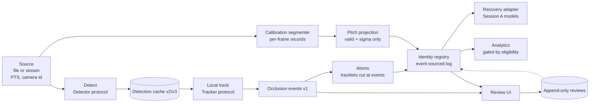

# Session B: football video intelligence engine, technical decision report v1

| | |
|---|---|
| Date | 2026-11-17 |
| Branch / worktree | `feature/video-occlusion-events` at `F:\Football-Fatigue-Video`, base `1bd016d`, clean at start |
| Scope | Research and decision only. No code changed, no model run, no GPU used, no download, no Git state change. |
| New measurement | One read-only CPU probe (15 s) over existing detection caches and ground truth of the 4 SoccerTrack development matches (§A.4). Script kept outside the repo. |
| Status | **Proposal awaiting approval.** Nothing in §L starts without explicit authorisation. |

Evidence tags used throughout:

- **[V]** verified in this session by inspecting files or running a read-only command;
- **[R]** reported by an earlier milestone report in `data/processed/vision_eval/…`, read but not re-run;
- **[W]** web source (vendor or paper) checked on 2026-11-17, not reproduced;
- **[I]** inference or recommendation.

---

## 0. Executive summary

1. **Recommendation: option 2, a modular core built around the validated parts** (§B). Wrap the components that have measured value behind clean interfaces:
   - detector and tiling with the edge-aware merge;
   - versioned detection cache;
   - TrackEval harness;
   - fisheye+TPS pitch mapping.

   Do not carry `identity.py`'s accumulated layers into the new core; keep them as a frozen benchmark. A full rebuild would throw away a reproducible harness and caches that took ~10 GPU-hours to build, and no evidence says a new detector or tracker would beat them.
2. **New measured finding that shapes the occlusion milestone** (§A.4):
   - In the cached detector output, the **occluded player's box usually disappears**. Recall of the occluded player drops from 0.83–0.98 when isolated to 0.38–0.51 at occlusion 0.5–0.75, and to 0.14–0.26 at occlusion ≥ 0.75.
   - Ground truth has 695–1,948 player pairs with IoU > 0.5 per match; the cache has **0–26**.
   - Our own tile-merge NMS (IoU 0.5, applied across all person boxes) structurally prevents two boxes overlapping by more than 0.5.

   A detector that only looks for "two boxes intersect" would therefore miss most real occlusions. The event engine must combine box geometry with **temporal disappearance and merge evidence from the tracker**, and the detector merge policy is a cheap, high-value fix to test next.
3. **First milestone (V1): an occlusion event engine on existing caches** (§F, §L).
   - CPU only, the 4 SoccerTrack development matches, versioned event schema.
   - A review page with a timeline and clickable events.
   - A pre-registered evaluation against geometric ground-truth occlusion episodes, plus a human-reviewed precision sample.

   Wadi Degla enters through V1-W: a short, approved GPU detection run on two 2-minute clips for qualitative review.
4. **Identity: I am challenging the plan** (§H). Seven milestones (M6 to M8.1b) show that fully automatic long-term identity at 30–50 px player height has repeatedly failed its gates. Persistent IDs must therefore be built as:
   - **event-sourced, abstaining hypotheses** over occlusion-bounded tracklet "atoms";
   - with human confirmation as a first-class input.

   "ID 4 stays left back" is achievable as a *displayed, confidence-labelled hypothesis*. It cannot be an automatic guarantee.
5. **Session A's GRU has a large expected domain gap on video** (§I). Its lead depends partly on FIFA ESTIMATED-track texture; on VISIBLE-only gaps its balanced accuracy is 0.845, and it falls to 0.757 with 5 cm noise, while video foot-point noise is 0.18–0.81 m. The adapter must check the model's domain and abstain. A SoccerTrack-based domain-transfer test is proposed before any claim.
6. **Licence risk** [V][W]:
   - The production checkpoint is **YOLO26-L** (verified from checkpoint bytes). It carries Ultralytics' AGPL-3.0 stamp, although its model card says Apache-2.0.
   - That is acceptable for academic research. It matters for any product or closed deployment.
   - RF-DETR (Apache-2.0 for Nano–Large detection and all segmentation sizes) is the main licence-clean alternative to benchmark.

---

## A. Verified existing pipeline and measured weaknesses

### A.1 Environment facts [V]

| item | finding | consequence |
|---|---|---|
| Worktree | `F:\Football-Fatigue-Video` holds code only: **no `data/`, no `models/`, no `.venv`** | Every new entry point must take `--data-root` and `--models-root`. Read shared data from `F:\Football-Fatigue-Project\data` read-only, and write Session B outputs to a separate subtree (§J.6) |
| Python env | Shared `.venv` in the main worktree: Ultralytics 8.4.182, supervision 0.30.9, torch 2.9.1+cu126, OpenCV 5.0.0.93, TrackEval 1.3.0, PyAV, pyarrow (undeclared transitive), pycocotools | No new dependency is needed for V1 |
| GPU | **GTX 1650 Ti, 4 GB** | Large models, SAM-class video segmentation and full-panorama runs are expensive. Plan event-triggered compute (§F.6) |
| Detector | `models/vision/player_detector.pt`, SHA-256 `05ee5d6c…087f` (matches the doc). Checkpoint metadata: `yolo26l.yaml`, trained `imgsz` 1280, 50 epochs, batch 4, Ultralytics 8.4.9, licence string AGPL. Classes {ball, player, referee, goalkeeper} | The doc's "YOLO26" claim is confirmed, size **L**. It is not trained on SoccerTrack or Wadi Degla |
| Tests | 64 files in `tests/` (not run in this session: no code changed) | — |

### A.2 Components and evidence of value

| component | file(s) | measured value | verdict |
|---|---|---|---|
| Tiled detection, edge-aware merge | `vision/detector.py` | M4-C held-out: HOTA +0.03–0.04 and small-player recall +7.5–17 pts vs B2 [R]. M5 cross-match: no regressions [R] | **Keep** (wrap). Merge NMS needs rework for occlusion (§A.4) |
| Detection cache v2 | `vision/detection_cache.py` | Hash-checked replay, floor 0.1; full-length caches for 117092/117093/118575/118576 (and spent 118577) [V] | **Keep**: it is the main reuse asset |
| Local tracker | `vision/tracker.py` (ByteTrack via supervision <0.31, IoU fallback) | Pooled dev B1: HOTA 0.362, AssA 0.204, IDF1 0.348, **15.8 IDs per GT player** [R M9B]. External reference on the same clips: GTATrack HOTA 0.60 [R] | Keep as baseline B0/B1. supervision's ByteTrack is deprecated (removed in 0.31) |
| TrackEval harness | `vision/mot_eval.py` | Reproduces stored baselines exactly (ΔHOTA 0.0000) [R M9B harness gate] | **Keep**: the benchmark backbone |
| Pitch mapping | `vision/pitch_mapping.py` | 117093 hybrid fisheye+TPS held-out median/p90 0.38–0.45 / ~1.0 m [R]. 117092 fails QC (k-fold 1.17/4.47 m) [R]. Global homography 6.3 m [R] | Keep for SoccerTrack. Generalisation to new cameras is unproven |
| Global identity | `vision/identity.py` (1,151 lines), `association.py`, `handover.py`, `identity_export.py` | M6–M8.1b: gates failed or conditional; 17–19 IDs per player; silent same-team swaps that no cue catches [R] | **Freeze as reference**. Do not extend (§B) |
| Team colour | `team_appearance.py`, `demo/teams.py` | Wrong-team 0.3–3.3% after the M7.2 fix; ~20% Unknown; touchline rule tested on 117093 only [R] | Reuse the logic later through an interface |
| Demo/board | `demo/`, `multicam_lab/` | Pixel-verified video sync (PTS offset 0.979 s lesson) [R] | Reuse the media serving and sync pattern; new review page (§K) |

### A.3 Structural weaknesses (why not to keep patching)

1. **Identity logic is a growing monolith.** `identity.py` has 1,151 lines with many default-off flags: `contact_mode`, `association_cap`, `confidence_features`, and so on. Every milestone has added options; none has been removed [V line count, R history].
2. **Stage boundaries are implicit.** Tracker output, identity, team, role, calibration and display continuity merge into one overlay JSON (`overlay_v5.json`) built by milestone scripts under `data/processed/vision_eval/*/scripts/`. Those scripts are not in `src/` [R]. The production path is not reproducible from the package alone.
3. **The design is specific to one match and one camera.** The demo serves 117093. The touchline rule was checked only on 117093. Calibration is per-match and hand-supplied.
4. **There is no event layer.** Occlusion, contact and swap evidence is computed inside identity code as a means to an end. It is never a stored, reviewable product.
5. **Time is handled as frame index only.** Cache records store `timestamp_s = frame/fps` starting at 0 [V], but the container PTS starts at 0.979 s [R]. The demo fixed this at display time, not in the data contract.

### A.4 New probe: what the cache contains during occlusion [V]

- **Method.** For every ground-truth (GT) box, the occlusion fraction is the share of its area covered by a GT box whose foot is nearer the camera (larger bottom y). Detections are matched 1:1 greedily at IoU ≥ 0.5, using the person classes in the full-length cache.
- **Caveat.** SoccerTrack GT boxes are BePro positions projected into the image with template sizes [R official-repo audit]. "Occlusion" here is therefore **geometric projection occlusion**, a proxy for visual occlusion.

Recall of the occluded player by occlusion fraction (cache confidence > 0.4):

| occlusion fraction | 117092 | 117093 | 118575 | 118576 |
|---|---|---|---|---|
| 0 (isolated) | 0.825 | 0.984 | 0.962 | 0.981 |
| (0, 0.25) | 0.703 | 0.970 | 0.928 | 0.964 |
| [0.25, 0.5) | 0.591 | 0.868 | 0.783 | 0.871 |
| **[0.5, 0.75)** | **0.383** | **0.483** | **0.429** | **0.513** |
| **≥ 0.75** | **0.141** | **0.191** | **0.258** | **0.233** |
| n boxes with occlusion ≥ 0.5 | 3,980 | 5,984 | 3,267 | 5,827 |

Pair statistics per match:

| | 117092 | 117093 | 118575 | 118576 |
|---|---|---|---|---|
| GT pairs with IoU > 0.5 (frame-pairs) | 695 | 1,948 | 1,314 | 1,934 |
| **Detection pairs (conf > 0.4) with IoU > 0.5** | **26** | **4** | **5** | **0** |
| Detection pairs with IoU > 0.3 / > 0.1 | 1,585 / 6,997 | 843 / 8,565 | 493 / 6,640 | 918 / 10,298 |
| Occluder (near player) still detected | 0.757 | 0.722 | 0.757 | 0.766 |
| Severe-occlusion cases where one detection overlaps both GT boxes (IoU ≥ 0.3) and the pair is not resolved | 2,038 | 3,907 | 2,062 | 4,058 |

Lowering the confidence to 0.1 recovers only 5–12 points of recall at occlusion ≥ 0.5.

**Interpretation [I].**

- The detector-plus-merge **collapses overlapping players into one box**, or drops the hidden one, in most severe occlusions.
- Detection pairs with IoU > 0.5 are almost absent, while GT has hundreds to thousands. This is consistent with our post-hoc `batched_nms(…, 0.5)` in `_merge_tiles` and `_merge_person_agnostic`, which is applied to all boxes, including different players inside one tile.
- YOLO26 is natively NMS-free [W], so this suppression is **ours and removable**.
- How much recall comes back once it is removed must be measured (V2). The model may also suppress or miss the hidden player itself.
- Consequences:
  - V1 must detect occlusion through **multi-signal temporal evidence** (§F.3), not box intersection alone.
  - V2's first experiment is a merge-policy ablation: apply cross-tile duplicate suppression only to boxes from *different* tiles.

Reproduction:

- script: `…\scratchpad\occl_cache_probe.py`, Python `-I`, ~15 s CPU;
- output: `occl_cache_probe.json` in the same session scratchpad;
- the scratchpad is temporary. If you approve V1, I will move the logic into the tested reference builder (§F.7).

---

## B. Refactor vs modular rebuild vs full rebuild

| criterion | 1. Patch the existing pipeline | **2. Modular core around validated parts** | 3. Full rebuild |
|---|---|---|---|
| Measured performance at start | Same as now | Same as now (identical detector, cache and tracker), proven by a parity test | Unknown until it re-reaches B1 HOTA 0.362 |
| Maintainability | Worsens: flags pile up in `identity.py` and overlay scripts | Typed stage contracts; legacy frozen | Good, if finished |
| Integration complexity | Low per step, high in total | Medium: adapters plus a parity harness | High |
| Development time to V1 | ~1 week, but no event layer exists | ~1–1.5 weeks | 3–5 weeks before parity |
| Swappable detectors/trackers | Poor: the detector is wired to Ultralytics tiling | Good: `Detector` and `Tracker` protocols, with the cache as the interface | Good |
| Testing / reproducibility | Mixed: key scripts live outside `src/` | Parity tests against existing caches and TrackEval numbers | Must rebuild trust from zero |
| GPU/CPU | Unchanged | Unchanged; adds event-triggered GPU use | Likely more GPU (re-detection) |
| Different cameras | Hard: 117093-specific rules | Camera/source and calibration are explicit per-frame objects | Good |
| Session A integration | Ad hoc | Versioned handoff contract (§I) | Same, later |
| Risk of repeating failures | **High**: the same identity heuristics again | Low: identity rebuilt on new evidence (occlusion-bounded atoms), legacy kept as the comparison | Medium: may rediscover the same limits (resolution, swaps) |

**Decision [I]: option 2, built as a "strangler".**

- A new package (proposed name `football_fatigue.video`) owns the schemas, events and orchestration.
- It *imports* `vision.detector`, `vision.detection_cache`, `vision.tracker`, `vision.mot_eval` and `vision.pitch_mapping`; it does not copy them.
- Legacy `vision/identity*.py`, `association.py`, `handover.py` and the overlay scripts are untouched and remain the frozen benchmark.
- A legacy component is retired only after its replacement beats it under a pre-registered comparison.
- Per project rules, only modules for approved, implemented behaviour are created; there are no empty stubs.

---

## C. Detector candidates and fair benchmark methodology

### C.1 Candidates (none is claimed better before benchmarking)

| id | candidate | why | licence [W] | compute on 4 GB GPU [I unless R] | priority |
|---|---|---|---|---|---|
| D0 | YOLO26-L as cached (D1-EA, merge IoU 0.5) | Production baseline | AGPL-3.0 (Ultralytics) | 1.77 s/frame on 4096×1080 panorama [R] | baseline |
| **D0-m** | Same weights; **no cross-player NMS inside a tile**; cross-tile dedup only between different tiles (plus the edge-aware rule) | Directly targets §A.4; no new model | same | Same cost; re-detection on windows | **V2, first** |
| D1 | YOLO26-L-**seg** or a fine-tuned YOLO26 variant | Masks for occlusion depth order; same family | AGPL-3.0 | Similar or heavier | V3 |
| D2 | **RF-DETR** detection (S/M/L) and **RF-DETR-Seg** | Strong DETR-family alternative, licence-clean; 2026 segmentation checkpoints N–2XL | Apache-2.0 (N–L detection, all segmentation); XL/2XL under Roboflow PML | Must be measured; DETRs are often weak on tiny objects unless tiled | V3 |
| D3 | Fine-tune on SoccerTrack development boxes | Domain adaptation | Inherits weights' licence | ~hours of GPU; **label noise risk: template boxes** | Only if D0-m and D2 plateau |
| D4 | Specialist ball detector (tiled, temporal) | Ball is ~5–10 px in the panorama | depends | High | Deferred (§9 roadmap) |

Rejected for now:

- Larger COCO YOLOv8 variants. The earlier grid showed F1 0.79–0.82 regardless of size [R].
- Jersey OCR. Player boxes are ~41–46 px high [R].

### C.2 Fair benchmark protocol (detection)

- **Data:**
  - SoccerTrack development matches only: 117092, 117093, 118575, 118576.
  - Fixed windows: the M4-C/M6 windows already used, plus one new 625-frame window per match chosen by hash **before** any run.
  - Wadi Degla annotated clips once they exist (§E.3).
  - 118577 is spent. 118578 and 128058 are reserved and **never opened**.
- **Identical inputs:** same decoded frames, same tiling grid unless tiling is the variable, same confidence sweep (0.1 to 0.7), same class mapping (person = player ∪ goalkeeper ∪ referee for detection; referees are excluded from GT matching because GT has none [R]).
- **Metrics:**
  - AP50 and AP50:95 (pycocotools, installed) on GT boxes;
  - precision/recall at the operating threshold;
  - **recall by box height** (<35, 35–50, ≥50 px);
  - **recall by occlusion fraction** (the §A.4 table becomes a standard metric);
  - **pair-separation rate**: for GT pairs with IoU > 0.3, the share where both are detected separately;
  - runtime in ms/frame, peak VRAM, CPU fallback ms/frame.
- **GT caveat:** template boxes bias AP50:95. Report AP50 as primary and include a centre-distance matching variant (≤ 0.5 × box width) as a sensitivity check.
- **Unmatched detections:** report them separately as "probable non-GT person" (referees, staff), not as false positives. This is the M2 lesson: 90% of FP were real people outside GT [R].

---

## D. Tracker candidates and identity-continuity strategy

### D.1 Evidence so far

| tracker | evidence | status |
|---|---|---|
| ByteTrack B0/B1 (supervision) | HOTA 0.358/0.362, IDF1 0.344/0.348 pooled dev [R M9B] | Baseline |
| Deep-EIoU-style, no ReID | −0.053 HOTA vs B1, all gates fail [R M9B] | NO-GO |
| BoT-SORT + GMC (Ultralytics) | Most fragmented on Wadi Degla moving camera; **no GT**, so weak evidence [R M10.7] | Not established |
| OSNet-AIN ReID | Same-team AUC 0.651; improves only at crop height ≥ 55 px [R M6.3-B] | NO-GO at SoccerTrack resolution |
| GTATrack (Deep-EIoU + GTA-Link) | HOTA 0.60 on the same clips (external) [R] | External upper reference; its repo contains reserved answer files, so it is **never opened** |

### D.2 Candidates to benchmark (V4)

| id | method | rationale | licence / availability [I; verify at V4] |
|---|---|---|---|
| T0 | ByteTrack B1 | baseline | in repo |
| T1 | **OC-SORT** | Observation-centric re-update after occlusion; designed for non-linear motion and occlusion; not tested yet | MIT reference code; can be re-implemented in ~200 lines with no dependency |
| T2 | BoT-SORT + GMC on **SoccerTrack** (with GT) | Settles the M10.7 question properly | Ultralytics (AGPL) |
| T3 | **Occlusion-aware ByteTrack**: at V1 events, freeze the Kalman state of the hidden track, widen its gate, forbid re-assignment of the occluder's box to the hidden ID | Uses our own event engine; directly targets swaps | Ours |
| T4 | McByte / McByte++ (mask propagation as an association cue) | Reported gains on SoccerNet-tracking [W] | Needs SAM2-class masks: only on event windows (§F.6), and only after V3 shows masks are usable at 30–50 px |
| T5 | CAMELTrack (learned association) | Strong on SportsMOT [W] | Needs training data and compute; long-term candidate only |

**Metrics:** HOTA, DetA, AssA, IDF1, IDSW, Frag, IDs per GT player, span percentiles, **IDSW inside occlusion events vs outside**, and ms/frame. Use leave-one-match-out selection as in M9B.

### D.3 Continuity strategy [I]

- **The local tracker should be conservative.** Prefer fragmentation to swaps, because a fragment is recoverable later and a silent swap is not (M6.3-C/D [R]).
- **Cut tracklets at occlusion events into "atoms".**
  - M6.3 found isolated atoms between contacts to be 99.6–99.9% pure [R].
  - V1 events give an explicit, stored cut-point source.
  - Identity is then built by linking atoms (§H), with every link and abstention logged.
- **Separate IDs by layer** (already a project principle, M7.3 [R]):
  - `local_track_id` (tracker, per run);
  - `atom_id` (stable hash of run + track + frame span);
  - `persistent_player_id` (registry);
  - `human_verified_id` (review log).
- **Camera cuts** reset tracker state. A detected cut closes all atoms and opens a new calibration segment (§G).

---

## E. Development-data strategy

### E.1 Inventory [V unless marked]

| source | location | content | GT |
|---|---|---|---|
| SoccerTrack 117092 | `data/raw/soccertrack_v2/mot/117092.{mp4,txt}` (560.6 MB mp4) | Panorama; calibration fails QC [R] | MOT 22 IDs, 6,000 frames |
| SoccerTrack 117093 | `data/external/soccertrack-v2/raw/117093/117093.mp4` + `mot/117093.txt` | 4096×1080, 25 fps, 5,976 frames (cache manifest) | MOT + calibration assets (intrinsics, homography, keypoints, padding) |
| SoccerTrack 118575 / 118576 | `mot/clips/<id>.mp4` + `mot/<id>.txt`; `raw/<id>/` keypoints + intrinsics | 4-min clips | MOT; calibration passes QC [R] |
| SoccerTrack 118577 | present | **Spent** validation | read reports only |
| SoccerTrack 118578, 128058 | present on disk | **Reserved, never accessed** | — |
| Tier 2 (132877, 128057, 132831) | not downloaded | final test | — |
| Wadi Degla | `data/external/wadi-degla/raw/`: `wadi_degla_moving.mp4` (5,496.6 s), `wadi_degla_fixed.mp4` (5,433.5 s), `wadi_degla_fixed_same_match.mp4` (5,497.7 s); all **640×360, 30 fps** [V] | Moving camera = XbotGo pan-only, no zoom [R]. `fixed` is a different match; `fixed_same_match` = same match as moving [R]. Fixed file contains 25 fps content in a 30 fps container and an inserted copied segment at 2,711.9–2,748.8 s [R M10.8, not re-verified] | **None** |

GT warnings:

- SoccerTrack MOT GT has no referees, staff or ball [R].
- The boxes are projections with template sizes [R], so boxes are approximate and "occlusion" is geometric.
- Frames are 0-indexed and `conf/class/vis` = −1 [V for 117093/117092 first rows].

### E.2 Clip roles per milestone

| milestone | tune on | check on (development-internal hold-out) | never |
|---|---|---|---|
| V1 occlusion engine | 117093, 118575 | 117092, 118576 (frozen thresholds) | 118577 (spent), 118578, 128058, Tier 2 |
| V2 detector merge | M4-C/M6 windows on 117093/118575 | new hashed windows on 117092/118576 | same |
| V4 trackers | LOMO over the 4 development matches (M9B design) | — | same |
| Wadi Degla | all as deployment-domain checks, with human annotation (E.3) | — | — |

The first use of 118578/128058 requires a separate pre-registered protocol and your authorisation, as before.

### E.3 Wadi Degla annotation proposal (to approve)

**Clips.** Six clips of 20 s each (600 frames at 30 fps):

- three from `moving`, three from `fixed_same_match`;
- times chosen by hash, stratified by match period;
- the copied insert and replays are avoided.

**Annotation layers, cheapest first:**

1. **Occlusion events.** On all frames: start frame, end frame, involved people (temporary labels), and type (partial / full / merge / box-only). Done in our own review page (§K), which doubles as the annotation tool, so no new installation is needed.
2. **Person boxes every 5th frame.** About 120 frames × ~15 people ≈ 1,800 boxes.
   - Tool: CVAT (MIT; needs an install, which requires approval) or a minimal box editor in the review page.
   - This gives detection P/R and height-stratified recall for 640×360.
3. **Calibration keypoints.** About 10 visible pitch landmarks on 3 frames per camera. These give held-out metric error (the fixed camera has M10.7/M10.8 data to start from [R]).
4. **Identity spans** (who is who across 20 s). For tracking IDF1, only if V4 needs it.

**Effort estimate [I]:** layer 1 ≈ 2–3 h; layer 2 ≈ 4–6 h; layer 3 ≈ 1 h.

**Rules:**

- Labels must come from a human; an assistant-made label is never presented as GT (an M10.7 lesson [R]).
- A second annotator on 20% of the material gives agreement figures.

---

## F. First milestone: visual occlusion event engine (V1)

### F.1 Definitions

- **Box overlap candidate:** two person boxes (detections or tracks) whose expanded boxes intersect.
- **Visual occlusion event:** a time interval in which at least one person is *probably partly or fully hidden in the image* by another. The event exists whether or not tracker IDs change, and whether or not the players are close on the pitch. M11-D2 found 97–98% of severe projection occlusions at ground distance > 0.25 m [R].
- **Event group:** the connected component of the per-frame occlusion graph. Three or more players form one event, with membership changes recorded.

### F.2 Event types (classes, not exclusive tags)

| type | evidence | example |
|---|---|---|
| `box_overlap` | Two visible boxes, intersection-over-smaller ≥ τ₁, both detected | Players crossing at different depths |
| `partial_occlusion` | Overlap, plus the far box shrinks or loses confidence, or its bottom edge is covered | Feet hidden behind the near player |
| `full_occlusion` | A track **becomes unmatched while its predicted box lies inside or adjacent to a visible near box**, and a track reappears near that box within the gap limit | The hidden player disappears behind the occluder |
| `merged_detection` | One box grows sharply in width or area (one box now covers two people) as a neighbour disappears; a split happens at the end | The §A.4 "one box covers both" case |
| `crowd` | A group of 3 or more people | Set pieces |

Each event also carries **outcome flags**, computed after it ends:

- `ids_preserved`;
- `switch_suspected` (displacement or appearance inconsistency between entry and exit);
- `fragmented` (a new ID on exit);
- `left_view`;
- `unresolved`.

These are flags, not a ground-truth claim.

### F.3 Detection logic (rule-based in V1; learned scoring only after human labels exist)

Per frame, at native frame rate (25 fps SoccerTrack, 30 fps Wadi Degla), from the cache plus a ByteTrack replay:

1. **Geometry.**
   - For all person pairs within a coarse grid cell: IoU, intersection-over-smaller (IoS), horizontal overlap ratio, foot-y difference (depth order: larger bottom y means nearer camera), and box-height ratio.
   - Boxes are expanded by 10% in width for limbs (sensitivity-tested).
2. **Track context.**
   - Lost and born tracks.
   - For each track lost at frame t, the predicted box (Kalman) at t+k, and which visible box covers it.
   - Box-size jump of the neighbour: `area_t / median(area_{t-5..t-1})`.
3. **Confidence trajectory.** A drop in detection confidence of either member.
4. **Optional, from V3:** masks. Mask IoU and a mask-overlap depth order replace box IoS where available.

**Lifecycle (hysteresis state machine per event group):**

- `candidate`: evidence above τ_open in 1 frame;
- `active`: evidence above τ_open in at least m of the last n frames, or `full_occlusion` and `merged_detection` evidence immediately;
- `ending`: evidence below τ_close;
- `closed`: below τ_close for g frames, or the gap limit reached.

Merging and splitting:

- Groups that touch merge into one event, with a `members` timeline.
- A group that splits produces child events linked by `parent_event_id`.

**Latency:** the event start is emitted online. The end and outcome flags need up to g + reappearance-limit frames of look-ahead. This lag is declared in the manifest, which keeps the design live-capable (§J.5).

**Thresholds:**

- τ, m/n, g and the gap limit are set on 117093 and 118575, then frozen before 117092 and 118576 are evaluated.
- No threshold is presented as a physical constant. Each is a configuration value with recorded sensitivity.

### F.4 Event schema `occlusion_event` v1 (JSON Lines, one event per line)

```json
{
  "schema": "football_fatigue.video.occlusion_event", "schema_version": "1.0.0",
  "event_id": "oe-117093-cam0-000123",            // stable within run: hash(run_id, start_frame, sorted members)
  "run_id": "occl-v1-117093-20261118-ab12cd",
  "source": {"match_id": "117093", "camera_id": "st-pano-0", "video_sha256": "dfe2…", "fps": 25.0,
             "pts_offset_s": 0.979, "frame_width": 4096, "frame_height": 1080},
  "type": "full_occlusion",                         // dominant type; per-frame types in timeline
  "lifecycle": {"state": "closed", "start_frame": 3120, "end_frame": 3134,
                "start_pts_s": 125.779, "end_pts_s": 126.339, "emitted_at_frame": 3120,
                "closed_at_frame": 3146, "truncated": null},          // "video_start" | "video_end" | "camera_cut"
  "members": [
    {"local_track_id": 41, "role_in_event": "occluder", "detector_class": "player",
     "present_frames": [3120, 3134], "team_hint": null},
    {"local_track_id": 57, "role_in_event": "occluded", "hidden_frames": [[3124, 3131]]}
  ],
  "timeline_ref": "events_frames.jsonl#oe-117093-cam0-000123",       // per-frame boxes, masks, metrics
  "measurements": {"max_iou": 0.41, "max_ios": 0.93, "frames_overlapping": 15, "frames_hidden": 8,
                   "max_area_jump": 1.62, "min_conf_occluded": 0.0},
  "pixel_location": {"x": 2101.5, "y": 402.0, "basis": "union_box_bottom_centre"},
  "pitch": {"status": "unavailable", "x_m": null, "y_m": null, "sigma_m": null,
            "calibration_id": null, "calibration_quality": null},  // "valid" | "uncertain" | "unavailable"
  "confidence": {"score": 0.82, "method": "rule_v1", "calibrated": false,
                 "evidence": ["ios>=0.8", "track_lost_inside_neighbour", "reappear_near_occluder"]},
  "outcome": {"ids_preserved": true, "switch_suspected": false, "fragmented": false,
              "left_view": false, "identity_recovery_needed": false, "recovery_ref": null},
  "review": null,                                    // filled only from the append-only review log
  "provenance": {"engine": "football_fatigue.video.occlusion", "engine_version": "0.1.0",
                 "config_sha256": "…", "detection_cache": {"run_id": "…", "records_sha256": "0dbab9…"},
                 "tracker": {"name": "bytetrack", "params_sha256": "…"}, "git_commit": "…", "dirty": true}
}
```

The `//` comments are explanatory and not part of the file.

**Schema evolution rules:**

- semantic versioning;
- additive fields are a minor bump, and readers ignore unknown fields;
- renamed or retyped fields are a major bump with a converter;
- every run writes a `manifest.json` (input hashes, config, counts, versions, status `writing` / `complete` / `incomplete`), following the existing `detection_cache` pattern;
- human reviews are **never written into the events**; they live in an append-only `reviews.jsonl` joined at read time (M7.2 pattern [R]).

**Storage:** per-frame details go in `events_frames.jsonl`: per frame, member boxes, IoS/IoU, optional mask RLE and confidences. JSONL keeps V1 dependency-free. Parquet (pyarrow is present but undeclared) is the documented upgrade path when volumes require it; it would need a declared dependency and your approval.

**Evidence media:** no image dumps by default. Frames are re-decoded on demand from `video_sha256` plus `frame` for review. An optional `--export-evidence` writes one PNG strip per event (start / peak / end crops), with a per-run size cap.

### F.5 Calibration independence

`pitch.status` is computed after detection, from a separate calibration record (§G).

- An event is never dropped, delayed or altered because calibration is missing or invalid.
- Pixel location is always present.

### F.6 Event-triggered compute

Events mark short windows. Typically 4–5 frames for a median severe pair-episode, p95 about 25–29 [R M11-D2]. Expensive steps can therefore run on **event windows only**:

- segmentation (V3);
- mask-propagation tracking (T4);
- high-resolution re-detection (D0-m at a larger `imgsz` per crop).

This is what makes SAM-class or segmentation models affordable on a 4 GB GPU.

### F.7 V1 evaluation (to pre-register before running)

1. **Reference episodes (SoccerTrack).** Build GT projection-occlusion episodes (occlusion ≥ 0.5 for ≥ 3 frames, merged across gaps of ≤ 2 frames) from the MOT files with a tested reference builder; this generalises the probe.
2. **Recall.** The share of reference episodes overlapped by an engine event, stratified by occlusion level, duration and box height.
   - Primary population: episodes where both players are detected at least once within ±10 frames. Otherwise no detection-based method can see them; those episodes are reported separately as "detector-invisible".
3. **Precision.** Human review of a stratified random sample of 200 engine events (types × matches), labelled by the user or a team member:
   - true visual occlusion;
   - box overlap without hiding;
   - false (not people, or the same person twice);
   - unsure.
4. **Proposed gates (draft, to finalise at pre-registration):**
   - recall ≥ 0.85 on the primary population at occlusion ≥ 0.5 on the held-out matches 117092 and 118576;
   - reviewed precision ≥ 0.80 for "true visual occlusion or box overlap";
   - the engine adds ≤ 5 ms/frame CPU on top of the replay;
   - events are deterministic across two runs (byte-identical).
5. **Failure analysis.** Separate tables for:
   - detector-invisible occlusions;
   - merges never split;
   - events caused by referees or staff (not in GT);
   - events with outcome `switch_suspected`, cross-checked against GT IDs to estimate how often the flag is right.

---

## G. Calibration: research and recommended approach

### G.1 What exists [R]

- **SoccerTrack.**
  - Per-match hand keypoints with a fisheye+TPS hybrid: 0.38–0.65 m median held-out on 117093/118575/118576.
  - 117092 fails QC.
  - A global planar homography gives 6.3 m, so homography alone is wrong for this lens.
- **Wadi Degla fixed.** Refined pitch-space affine, held-out nearest-neighbour 1.13 m; tripod verified stationary between halves.
- **Wadi Degla moving.** Rotation-only bundle adjustment to a background panorama, residual ~0.25–0.5 px; pan only, no zoom.
- **Foot-point noise** through the Jacobian: σ 0.18 m near, 0.48 m middle, 0.81 m far third (117093).

### G.2 Methods surveyed

| method | type | fit to our cameras [I] | licence |
|---|---|---|---|
| PnLCalib / "No Bells, Just Whistles" | HRNet keypoints + line extremities → camera parameters; trained on SoccerNet-Calibration and WorldCup broadcast [W] | Domain gap: broadcast vs our fisheye panorama and 640×360 amateur video. Worth a zero-shot test on Wadi Degla frames only | **Unverified**: check the repo LICENSE before download |
| Sportlight SoccerNet calibration | keypoint model, challenge entry [W] | as above | check |
| TVCalib | line segmentation + differentiable camera optimisation | Handles broadcast PTZ | check |
| Classic: line segmentation + RANSAC homography / PnP | geometry | Needs a lens model for the panorama | ours |
| Anchor calibration + temporal propagation | human-anchored once per camera setup, then automatic per-frame update | **Matches our setups** (a fixed tripod; a pan-only robot camera) | ours |

### G.3 Recommendation [I]

1. **The calibration product is a per-frame `CalibrationRecord`**, never a global constant:
   - `calibration_id`, `camera_id`, `model` (`homography` / `fisheye_tps` / `rotation_chain`), `valid_from_frame`, `valid_to_frame`;
   - `status` (`valid` / `uncertain` / `invalid` / `unavailable`);
   - residuals on held-out keypoints or detected lines;
   - an uncertainty model σ(u, v) from the Jacobian and the residual field;
   - `cut_segment_id`.
2. **Fixed cameras:** a semi-automatic anchor fit (≥ 8 clicked landmarks, held-out landmarks reported), plus a cheap per-N-frames **drift check**: background feature correlation against the anchor. If it fails, the record is `invalid`.
3. **Pan cameras:** an anchor panorama, then a per-frame rotation `R_t` estimated by feature tracking on masked background (the M10.6 method [R]). Each frame's validity uses inlier count and reprojection of detected pitch lines.
4. **Automatic keypoint models (PnLCalib etc.)** are *candidates* evaluated against the hand anchors on the annotated Wadi Degla frames (§E.3 layer 3). They are used only if held-out error is ≤ the anchor method's.
5. **Camera cuts:** shot-boundary detection (histogram distance plus a feature-match collapse). A cut ends the calibration segment; there is no propagation across it.
6. **Ground contact point:**
   - default: box bottom-centre;
   - with a mask: the lowest mask pixels;
   - when an occlusion event covers the member's bottom edge, the ground point is flagged `occluded_foot` and its σ is inflated. This is a direct use of V1 events.
   - Pixel coordinates are always stored; metres are stored only when the record is `valid`, together with σ.
7. **Two cameras later:** each camera maps to the **same pitch frame** independently, so fusion happens in metres, not by stitching. Use the Wadi Degla time-offset estimate (τ ≈ −0.125 s [R]) with recorded uncertainty. Full fusion is out of scope for now.

**Evaluation:** metres error on held-out keypoints (median, p90), per pitch third; plus foot-point agreement against SoccerTrack GT positions where BePro positions exist [R].

---

## H. Persistent ID initialisation and tracking-state design

### H.1 What the evidence says

Every fully automatic long-term identity attempt so far failed its gate:

- M6.1: conditional;
- M6.2: Gate B failed;
- M6.3-B (ReID): NO-GO;
- M6.3-C and D: NO-GO;
- M8 / M8.1b roster flow: NO-GO.

Even with oracle-perfect atoms, the roster solver reached pooled IDF1 0.45 in pixel space and 0.50 in pitch metres [R].

The root causes are low pixel height (30–50 px), similar kits within a team, and silent same-team swaps inside tracklets. **A registry cannot invent evidence the video does not contain.**

### H.2 Design [I]

**Event-sourced identity.** The registry state is *derived* from an append-only decision log. Each entry is one of:

- `create_player`;
- `link_atom` (method, score, competitors, margin);
- `abstain`;
- `unlink`;
- `human_confirm` / `human_reject`;
- `retire` (substitution);
- `set_role_prior`.

Replaying the log rebuilds state exactly. Human corrections and model decisions coexist with provenance, and a better linker can replay history without losing confirmations.

**`PersistentPlayer` record:**

| field | content |
|---|---|
| `player_id` | stable integer ("ID 4") |
| `entity_kind` | `player` / `goalkeeper` / `referee` / `staff` / `unknown` |
| `team` | {label, confidence, evidence count} |
| `role_prior` | probability distribution over tactical roles (from Session A when available) with its source and time; **a prior, never a constraint** |
| `appearance` | kit colour descriptor, optional jersey number (null until readable) |
| `atoms` | list of {atom_id, link decision id, link confidence} |
| `recent_track` | last N pixel positions plus pitch positions with σ and calibration ids |
| `state` | `active` / `occluded` (linked to an open occlusion event) / `out_of_view` / `lost` / `retired` |
| `identity_confidence` | calibrated only once human labels exist; until then a labelled heuristic |
| `last_confirmed` | frame, plus who confirmed it (model or human) |

**Progressive initialisation:**

- A player is created only from an atom that:
  - lasts ≥ T_init seconds (e.g. 2 s);
  - has team confidence ≥ c;
  - is not an official or staff member;
  - does not overlap an existing player's live atom.
- Until then, the atom is an `unknown` entity.
- The registry never forces 22 players. A soft cap of 11 per team is used only as an inconsistency alarm, not as an assignment constraint.
- With a partial-pitch view, the registry grows as players appear.

**Re-appearance:** candidates are scored (motion gate in metres when calibration is valid, team, appearance, role-prior consistency). The registry **links only above a margin and abstains otherwise**, and the abstention stays visible in the UI.

**Substitutions:** never inferred from absence alone. A new entity appearing while an old one has been `out_of_view` for a long time is surfaced as a *candidate* substitution for review.

**Referees and goalkeepers:**

- These are separate entity kinds.
- The detector's referee class also fires on staff (6/10 in the M7 audit [R]), so the kind is decided from accumulated evidence, not per frame.

**"ID 4 = left back":** a role prior assigned in the initialisation window. ID 4 *keeps its ID* through an overlapping run because identity comes from atom links, not position. Position only *informs* a link through the prior, with low weight.

**Out of scope until approved:** the linker itself beyond a conservative motion+team baseline. V6 delivers the registry, log and UI; better linkers plug in later.

---

## I. Candidate generation and Session A integration

### I.1 Distinguishing failure types (taxonomy stored on events and atoms)

| situation | signature | source |
|---|---|---|
| Visual occlusion | V1 event | engine |
| Detection miss | Lost track, no occluder nearby, isolated location, short gap | engine + tracker |
| Association miss (fragment) | New ID born at the predicted position of a just-lost track, no occluder | tracker |
| ID switch (suspected) | Two tracks exchange predicted continuations across an event | event outcome |
| Leaving view | Predicted box exits the frame or the calibrated visible-pitch polygon | geometry |
| Camera cut | Shot boundary | calibration segmenter |
| Temporary loss | Lost < gap limit, then re-acquired | tracker |
| Substitution | Long out-of-view plus a new entity (candidate only) | registry |

### I.2 Candidate generation for recovery

When atoms end ambiguously (an event with k incoming and k′ outgoing atoms), the candidate set is all outgoing atoms born within Δt_max and inside a reachable region:

- the disc of radius v_max·Δt + 3σ around the last position, in metres when calibration is valid, otherwise a pixel-scaled gate with a camera-motion correction;
- filtered by team compatibility;
- excluding atoms that left the view.

The k × k′ cost matrix is solved globally (Hungarian) **with an abstain option**. This generalises beyond 2-in/2-out; the model behind the costs is pluggable.

### I.3 Session A GRU adapter (`RecoveryRequest` / `RecoveryResponse` v1)

What Session A's model is [R, Stage 3/4C reports]:

- input on a 1/15 s grid with T = 30 samples per side;
- gap g0 = 0.8 s;
- two incoming plus two outgoing tracklets in pitch metres;
- output P(SWAPPED).

Domain warnings:

- Transfer to other gap lengths is poor: 0.4 s gives BA 0.84, 1.6 s gives 0.75.
- 5 cm noise drops BA to 0.757.
- On fully VISIBLE gaps BA is 0.845, versus 0.926 overall, and a texture-only probe reached 0.70 (provider-texture signal).

The adapter:

1. **Domain check, abstaining otherwise:**
   - exactly 2 in and 2 out;
   - gap within Session A's declared supported range (to be supplied by Session A, not assumed by us);
   - pitch status `valid` for the required context on all four atoms;
   - σ below a declared limit;
   - no camera cut inside the window.
2. **Resampling only inside the adapter:**
   - native timestamps (PTS) are kept in the request;
   - resampling to 15 Hz uses a declared method (linear; no extrapolation beyond observed samples);
   - masks and σ are carried along for the model to ignore or use.
3. **Response:** probability, the model's version and hash, the domain-check result, and `abstained` with a reason. A fallback chain follows: a constant-velocity global-assignment baseline, then the human review queue.
4. **Versioning:**
   - the contract is a shared interface, so it is drafted as `docs/interfaces/video_identity_recovery_v1.md` **jointly with Session A**;
   - Session B does not edit Session A's code or schemas;
   - until both sessions agree, the adapter writes requests to disk and consumes nothing.
5. **Domain-transfer test (proposed, later milestone V7).** On SoccerTrack development data, build 2-in/2-out cases at V1 events and feed the frozen GRU:
   - (a) GT-projected positions mapped to metres, a "clean video-geometry" condition;
   - (b) detector + calibration positions.

   Compare with the constant-velocity baseline. Only this tells us whether the FIFA-trained model helps on video.

---

## J. Modular architecture and repository organisation

### J.1 Pipeline



Why this order [I]:

- **Events come before calibration** in the dependency graph, so events survive calibration failure.
- **Atoms depend on events**, so identity rests on occlusion-bounded evidence.
- **Calibration is a sidecar keyed by frame,** never baked into detections.

### J.2 Interfaces (Python protocols; implementations wrap existing code)

| interface | contract | first implementation |
|---|---|---|
| `FrameSource` | yields (frame_index, pts_s, image); exposes `camera_id`, `video_sha256`, `fps`, `pts_offset_s` | PyAV/cv2 file reader (existing decode path) |
| `Detector` | image → detections (xyxy, class, conf, optional mask) + provenance dict | wraps `vision.detector.YoloDetector` |
| `DetectionStore` | write/replay with hash checks | existing `detection_cache` (schema v2; v3 adds optional masks) |
| `Tracker` | per-frame detections → track states (id, box, lost/born, Kalman prediction) | wraps `vision.tracker` ByteTrack |
| `EventEngine` | track states + detections → event updates (open/update/close) | new V1 |
| `Calibrator` | frame → `CalibrationRecord` | wraps `vision.pitch_mapping` |
| `RecoveryModel` | `RecoveryRequest` → `RecoveryResponse` | constant-velocity baseline; Session A's GRU via the adapter |

### J.3 Conventions

**Time:**

- `frame_index` is the 0-based decoded index;
- `pts_s` comes from the container (it is not `frame/fps`); the offset is stored per source;
- display uses `mediaTime`;
- every record carries `frame_index` and joins on it.

**Pixel space:** the original resolution, origin top-left, x right, y down, boxes `xyxy` as float.

**Pitch space:**

- metres, centre origin;
- x along the long axis, y across;
- attacking direction recorded per period.
- This matches Session A's FIFA frame. **To confirm with Session A** before V5, because SoccerTrack uses a corner origin.

**IDs:** `local_track_id` < `atom_id` < `player_id` < `human_verified_id`. Each lives in its own field and is never overloaded.

### J.4 Package layout (created only as each milestone is approved)

```
src/football_fatigue/video/
  schema.py        # dataclasses + JSON schema export for occlusion_event v1, manifests   (V1)
  sources.py       # FrameSource, PTS handling                                             (V1)
  occlusion/       # geometry.py, lifecycle.py, engine.py, reference.py (GT episodes), __main__.py  (V1)
  review/          # server + static page, reusing multicam_lab media serving               (V1)
  calibration/     # CalibrationRecord, segmenter, adapters                                 (V5)
  registry/        # decision log, PersistentPlayer, replay                                 (V6)
  recovery/        # request/response, domain checks, baselines                             (V7)
tests/test_video_*.py   # synthetic fixtures only; real-data checks skip when data is absent
```

There is no change to `vision/`, `demo/` or `multicam_lab/` except where an approved milestone needs a small, parity-tested hook.

### J.5 Live-readiness

Every stage is an iterator over frames with **bounded look-ahead**, declared in its manifest:

- the event engine needs g + reappearance frames;
- the registry needs a link-decision delay.

Offline runs use the same code with unbounded look-ahead disabled. This keeps one code path for files and streams. No streaming code is written now.

### J.6 Data and collaboration

**Inputs** are read-only from `F:\Football-Fatigue-Project\data`, passed as `--data-root`, with no machine path in code.

**Outputs** go to a Session B-owned tree:

```
<data-root>/processed/video/<source_id>/<stage>/<stage_version>/<run_id>/
```

- `source_id` is e.g. `soccertrack-117093` or `wadidegla-moving`.
- Each run holds a manifest with upstream manifest hashes, which forms a provenance DAG.
- Runs are write-once.
- This avoids collisions with Session A's `m11-*` folders.

**Git:**

- small focused commits, prepared by me and made by you;
- no data, video, checkpoints or caches committed;
- shared docs (`PROJECT_RULES.md`, `CLAUDE.md`, `README.md`, `docs/architecture.md`) are changed only with coordination. A short pointer in `architecture.md` would be proposed as a diff, not applied.

---

## K. Visual dashboard and testing plan

### K.1 V1 review page (local web page, stdlib server pattern as in `demo`/`multicam_lab`)

- **Video player** synced on `mediaTime` with the PTS offset, using the M7 sync method (verified on decoded pixels).
- **Overlay:**
  - player boxes with temporary IDs;
  - overlap regions shaded by IoS;
  - occluded members drawn dashed at their Kalman-predicted box;
  - an event-type badge, with start and end markers.
- **Timeline:**
  - event bars per type;
  - a density sparkline;
  - click to jump to an event;
  - keyboard next/previous.
- **Event panel:**
  - measurements;
  - an evidence list;
  - outcome flags;
  - start/peak/end crop strip;
  - review buttons (true occlusion / box overlap only / false / unsure, plus a note), written to `reviews.jsonl`.
- **Filters:** type, confidence, duration, outcome, reviewed / unreviewed.
- **SoccerTrack mode:** reference GT episodes as a second lane, showing hits, misses and engine-only events. This is the honest true-versus-false view.
- **Export:** filtered events as CSV/JSONL, plus a short MP4 per event (ffmpeg via PyAV, opt-in).
- **Tactical mini-board:** shown only when `pitch.status = valid`, with an explicit "approximate" badge otherwise. Wadi Degla fixed and SoccerTrack 117093/118575/118576 qualify; 117092 shows none.

### K.2 Tests

- **Unit tests (synthetic fixtures, clearly labelled):**
  - geometry: IoU, IoS, depth order, expansion;
  - lifecycle state machine: open/active/close, hysteresis, merge/split of groups, 3-player groups, truncation at video start/end and camera cut;
  - schema round-trip, unknown-field tolerance, version check;
  - determinism: same input gives byte-identical output.
- **Parity tests:**
  - wrapped detector, cache and tracker reproduce the existing B0 replay on one stored window (ΔHOTA 0, ΔIDSW 0);
  - skipped when the data root is absent.
- **Reference-builder test:** probe numbers reproduce from the tested module.
- **Browser self-test** (existing CDP approach): sync on decoded pixels, a click-to-seek accuracy of ±1 frame, and the review write path.
- **Failure-case gallery:** the V1 report must show at least 10 misses and 10 false events with crops, not only successes.

---

## L. Prioritised milestones

Compute figures are estimates [I] unless marked [R]. GPU means the GTX 1650 Ti. None of these starts without your approval.

| # | milestone | content | acceptance criteria (draft) | compute | main risks |
|---|---|---|---|---|---|
| **V1** | **Occlusion event engine on caches** | `video.schema`, `sources`, `occlusion` (engine + GT reference builder), review page, pre-registered evaluation on 4 SoccerTrack development matches | §F.7 gates; ≥ 10 failure cases shown; review page with a sync self-test; tests pass | CPU only: replay ~minutes per match; human review ≈ 2–3 h for 200 events | GT is geometric (template boxes); the detector hides most severe occlusions (§A.4), which caps recall |
| V1-W | Wadi Degla preview | Detection run on two 2-minute clips (one moving, one fixed_same_match) at native 640×360; same engine; qualitative review + layer-1 event annotation | Engine runs unchanged; reviewed precision reported; failure gallery | GPU ≈ 7,200 frames; ~10–30 min [I] | Very small players at 640×360; pan motion |
| V2 | Detector occlusion recall | D0-m merge-policy ablation on hashed windows; then RF-DETR(-Seg) vs YOLO26-L under §C.2 | Recall at occlusion ≥ 0.5 +10 pts without precision loss > 2 pts on held-out development windows | GPU: 4 windows × 625 frames × 1.77 s ≈ 75 min per variant [R speed] | Gain may come from the model, not the NMS; RF-DETR small-object performance |
| V3 | Masks on event windows | YOLO26-seg / RF-DETR-Seg / SAM2.1-tiny on event windows only; mask-based depth order and foot point | Occlusion-type accuracy on the reviewed sample; runtime per event | GPU, event windows only | Masks of limited use at 30–50 px |
| V4 | Tracker benchmark + atoms | T0–T3 (T4 if V3 succeeds), atom cutting at events, IDSW inside vs outside events | Pre-registered LOMO, M9B style; atom purity ≥ 99.5% at retained coverage | CPU replays | Repeating M9B's null result |
| V5 | Calibration service | `CalibrationRecord`, segmenter, Wadi Degla anchors, PnLCalib zero-shot test (licence check first) | Held-out p90 ≤ 1.5 m on annotated frames; zero silent invalid propagation in cut tests | CPU; download needs approval | Wadi Degla resolution; moving-camera drift |
| V6 | Identity registry | Event-sourced log, `PersistentPlayer`, conservative linker, review-driven confirmation | Log replay is exact; wrong-link rate on development data below the M6.3-A status-cap baseline at reported coverage | CPU | Low coverage (honest) |
| V7 | Session A adapter + domain test | Contract with Session A; SoccerTrack 2-in/2-out cases; GRU vs constant-velocity | Report-only gate: does the GRU beat constant-velocity on video geometry? | CPU | Domain gap (§I.3) |
| later | Ball, possession, events, physical metrics | See the roadmap below | Each needs its own labels and validation | — | — |

### Roadmap classification (§9 of the brief)

| capability | class | prerequisite |
|---|---|---|
| Player speed / distance / sprints | Direct measurement only when calibration is valid and the identity span is attributable; currently **withheld** by the plausibility gate (M7.2/M7.3 [R]) | V5 + V6 + foot-point noise gate |
| Team shape, tactical maps | Direct measurement (team-level, robust to identity errors) | V5 |
| Team / goalkeeper classification | Learned estimate | Existing colour model + human labels |
| Ball detection, possession | Learned estimate; the ball is ~5–10 px in the panorama | Specialist detector + ball labels (none in SoccerTrack MOT [R]) |
| Pass / shot / goal events | Learned estimate | Ball track + event labels (BAS exists for 117092 only [R]) |
| Jersey numbers | Not feasible at the current resolution | Higher-resolution footage |
| xG | Learned estimate | Shot events + location |
| Fatigue / load | **Not measurable from video**; movement indicators only (PROJECT_RULES) | Physiological data |
| Fouls, offside | Not supported | Not claimed |

---

## Recommended first implementation milestone

**V1: visual occlusion event engine on existing SoccerTrack development caches, with a review page and a pre-registered evaluation.**

What V1 delivers:

- the versioned `occlusion_event` v1 schema and run manifests;
- the multi-signal rule engine (§F.3), which handles 3+ players and full occlusions without requiring ID changes;
- a tested GT reference builder;
- the review/annotation page with timeline, click-to-event and export;
- a report with recall, reviewed precision and a failure gallery.

What V1 costs:

- CPU only;
- no new dependencies;
- no change to legacy modules;
- reserved data untouched.

Wadi Degla follows immediately as **V1-W**, which needs your approval for a short GPU detection run.

**Decisions needed from you before I start:**

1. Approve option 2 (modular core; legacy frozen as benchmark) and the package name `football_fatigue.video`.
2. Approve V1 scope and the tune/check split (117093+118575 / 117092+118576).
3. Agree the output root `<data-root>/processed/video/…` in the main worktree's data folder.
4. Name who reviews the 200-event precision sample (it must be a human).
5. V1-W: approve or defer the ~10–30 min GPU run on two Wadi Degla clips.
6. Ask Session A to confirm the pitch coordinate frame and the GRU's supported domain (§I.3), for the later contract.

---

## Sources

Repository evidence: files cited inline. Earlier reports are under `F:\Football-Fatigue-Project\data\processed\vision_eval\` (M4-C, M5, M6.x, M7.x, M8.x, M9B, M10.x, M11-E1) and in `docs/research/M11_VIDEO_GROUNDED_OCCLUSION_RESEARCH.md`.

Web sources (checked 2026-11-17; vendor claims not reproduced):

- [RF-DETR model licensing (Roboflow)](https://roboflow.com/model-licenses/rf-detr)
- [RF-DETR segmentation checkpoints (Roboflow blog)](https://blog.roboflow.com/rf-detr-segmentation/)
- [YOLO26 licensing (Roboflow)](https://roboflow.com/model-licenses/yolo26)
- [Ultralytics YOLO26 announcement](https://www.ultralytics.com/news/ultralytics-redefines-state-of-the-art-vision-ai-with-yolo26)
- [Ultralytics docs](https://docs.ultralytics.com)
- [McByte: Masks and Boxes for MOT (arXiv 2409.14220)](https://arxiv.org/html/2409.14220v3)
- [McByte++ (alphaxiv 2608.15688)](https://www.alphaxiv.org/abs/2608.15688)
- [CAMELTrack (arXiv 2505.01257)](https://arxiv.org/html/2505.01257v1)
- [PnLCalib / No Bells Just Whistles (arXiv 2404.08401)](https://arxiv.org/abs/2404.08401v5)
- [Sportlight SoccerNet calibration](https://github.com/NikolasEnt/soccernet-calibration-sportlight)
- [Deep-EIoU (WACVW 2024)](https://openaccess.thecvf.com/content/WACV2024W/RWS/papers/Huang_Iterative_Scale-Up_ExpansionIoU_and_Deep_Features_Association_for_Multi-Object_Tracking_WACVW_2024_paper.pdf)
- [STC2025 challenge](https://sites.google.com/g.sp.m.is.nagoya-u.ac.jp/stc2025)
